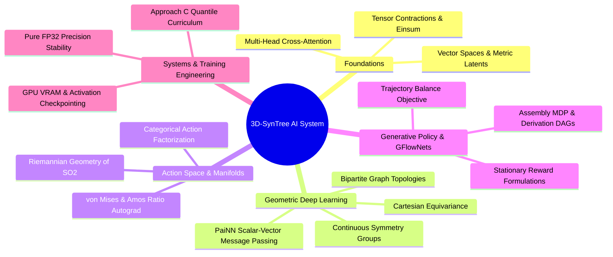

---
tags:
  - 3dsyntree
module: "00. Master Index and System Map"
type: index
---

# 0. Master AI Vault Index

> [!abstract] Architectural Purpose
> This vault provides the complete, mathematically rigorous, and computationally precise theoretical foundation for **3D-SynTree**, bridging the gap between classical deep learning (up to CNNs) and geometric deep learning, Riemannian manifold modeling, Generative Flow Networks (GFlowNets), and GPU systems engineering.



## Modular Structure

| Module | Core Subject | Target Systems in 3D-SynTree |
| :--- | :--- | :--- |
| [[0. Advanced Tensor Algebra MOC\|01. Tensor Algebra]] | Strides, Contractions, Autograd | Dynamic sub-graph indexing, memory layouts |
| [[0. Representation Learning MOC\|02. Representation Learning]] | Embeddings, Johnson-Lindenstrauss | 2138-D `pharm3d` to 256-D QR projection |
| [[0. Attention and Transformers MOC\|03. Attention & Transformers]] | Cross-Attention, Pre-LN Decoders | Handle-conditioned pocket decoder |
| [[0. Graph Neural Networks MOC\|04. Graph Neural Networks]] | Spatial GNNs, Message Passing | Inter-atomic radius graphs, PyG collation |
| [[0. Geometric Deep Learning MOC\|05. Geometric Deep Learning]] | Lie Groups, $\mathrm{SE}(3)$ Equivariance | Rigid frame rotational symmetry |
| [[0. Equivariant Architectures MOC\|06. Equivariant Architectures]] | PaiNN, Bipartite Graphs | Joint pocket-ligand backbone (`BipartitePaiNN`) |
| [[0. Directional Statistics MOC\|07. Directional Statistics]] | $\mathrm{SO}(2)$ Manifolds, von Mises | Dihedral heads, Amos' continued fraction autograd |
| [[0. GFlowNets and Generative Modeling MOC\|08. GFlowNets & MDPs]] | Trajectory Balance, DAG Semantics | Stage-2 assembly policy, reward design |
| [[0. Training Dynamics MOC\|09. Training Dynamics]] | Multi-Task Losses, Curriculum | Approach C quantile scheduling, milestones |
| [[0. Numerical Analysis and GPU Engineering MOC\|10. GPU Engineering]] | IEEE 754, Memory Topologies, FP32 | Eliminating float16 GradScaler collapse on T4 |

---

## Appendix: Original Export Structure

The sections below are preserved verbatim from the header and footer of the original monolithic export file (`Untitled.md`) of this vault.

## FOLDER STRUCTURE OVERVIEW

```text
3D-SynTree AI Vault
├── 00. Master Index and Pedagogical Architecture
│   ├── 0. Master AI Vault Index.md
│   ├── 1. Post-CNN Learning Roadmap and Prerequisites.md
│   ├── 2. Structural Lineage: From Vision to Geometric Chemistry.md
│   └── 3. Architecture Cross-Reference and File Mapping.md
├── 01. Advanced Tensor Algebra and Computational Graphs
│   ├── 0. Advanced Tensor Algebra MOC.md
│   ├── Chapter 1. Tensor Geometries and Strides
│   │   ├── 1. Memory Layouts Contiguity and Strides.md
│   │   ├── 2. Broadcasting Rules and Dimension Semantics.md
│   │   └── 3. Advanced Tensor Slicing and Scatter-Gather Operations.md
│   └── Chapter 2. Contractions and Autograd Calculus
│       ├── 1. Einstein Summation and Multilinear Contractions.md
│       ├── 2. Vectorized Computational Graphs and Jacobians.md
│       └── 3. Custom Autograd Function Design and Backward Hooks.md
├── 02. Representation Learning and Latent Metric Spaces
│   ├── 0. Representation Learning MOC.md
│   ├── Chapter 1. Discrete Embedding Spaces
│   │   ├── 1. High-Dimensional Lookup Tables and Gradients.md
│   │   ├── 2. Categorical vs Continuous Latent Geometries.md
│   │   └── 3. Metric Spaces Distance Metrics and Norms.md
│   └── Chapter 2. Dimensionality Reduction and Random Projections
│       ├── 1. The Johnson-Lindenstrauss Lemma.md
│       ├── 2. QR Decomposition and Orthonormal Projection Operators.md
│       └── 3. Norm Preservation and Distortion Bounds in Practice.md
├── 03. Attention Mechanisms and Transformer Decoders
│   ├── 0. Attention and Transformers MOC.md
│   ├── Chapter 1. Attention Formulations
│   │   ├── 1. Scaled Dot-Product Attention as Soft Dictionary Lookup.md
│   │   ├── 2. Multi-Head Projections and Subspace Specialization.md
│   │   └── 3. Mathematical Foundations of Attention Masking.md
│   └── Chapter 2. Modern Decoder Architectures
│       ├── 1. Pre-LayerNorm vs Post-LayerNorm Dynamics.md
│       ├── 2. Cross-Attention over Heterogeneous Spatial Memory.md
│       └── 3. Contextual Query Formation from Handle States.md
├── 04. Graph Neural Networks and Message Passing
│   ├── 0. Graph Neural Networks MOC.md
│   ├── Chapter 1. Spatial Graph Representations
│   │   ├── 1. Graph Topology Adjacency and Sparse Representation.md
│   │   ├── 2. Node and Edge Feature Multiplexing.md
│   │   └── 3. Permutation Invariance and Permutation Equivariance.md
│   └── Chapter 2. Message Passing Paradigms
│       ├── 1. The Message-Passing Neural Network Formalism.md
│       ├── 2. Aggregation Functions and Information Bottlenecks.md
│       └── 3. Computational Complexity of Spatial Radius Graphs.md
├── 05. Geometric Deep Learning and Lie Groups
│   ├── 0. Geometric Deep Learning MOC.md
│   ├── Chapter 1. Continuous Symmetry Groups
│   │   ├── 1. Group Theory Axioms and Matrix Lie Groups.md
│   │   ├── 2. Orthogonal and Euclidean Groups O(3) SO(3) E(3) SE(3).md
│   │   └── 3. Group Actions on Coordinate and Feature Manifolds.md
│   └── Chapter 2. Equivariant Tensor Field Representations
│       ├── 1. Scalar Invariants vs Cartesian Vector Equivariance.md
│       ├── 2. Irreducible Representations vs Cartesian Feature Vectors.md
│       └── 3. Non-Singular Vector Norms and Directional Regularization.md
├── 06. Equivariant Architectures: PaiNN and Bipartite Graphs
│   ├── 0. Equivariant Architectures MOC.md
│   ├── Chapter 1. Polarizable Atom Interaction Networks
│   │   ├── 1. PaiNN Interaction Block and Directional Message Passing.md
│   │   ├── 2. PaiNN Mixing Block and Invariant-Equivariant Gating.md
│   │   └── 3. Continuous Cosine Cutoffs and Radial Basis Envelopes.md
│   └── Chapter 2. Heterogeneous Molecular Modeling
│       ├── 1. The Ghost Ligand Problem in Molecular Design.md
│       ├── 2. Bipartite Protein-Ligand Graph Construction.md
│       └── 3. Node-Type Feature Multiplexing and Edge Partitioning.md
├── 07. Directional Statistics and Torsion Manifolds
│   ├── 0. Directional Statistics MOC.md
│   ├── Chapter 1. Riemannian Geometry of the Circle
│   │   ├── 1. The Topology of SO(2) and the Seam Discontinuity.md
│   │   ├── 2. The von Mises Distribution on S1.md
│   │   └── 3. Modified Bessel Functions of the First Kind.md
│   └── Chapter 2. Torsion Prediction and Optimization
│       ├── 1. The Amos Ratio Approximation and Gradient Stabilization.md
│       ├── 2. Measure-Theoretic Collapse of Continuous-Discrete TB.md
│       └── 3. Categorical Dihedral Discretization vs Continuous Heads.md
├── 08. Generative Modeling, MDPs, and GFlowNets
│   ├── 0. GFlowNets and Generative Modeling MOC.md
│   ├── Chapter 1. Discrete Markov Decision Processes
│   │   ├── 1. Autoregressive Molecule Assembly Formulations.md
│   │   ├── 2. Derivation Trees vs Molecular Graph DAGs.md
│   │   └── 3. Action Space Factorization and Masking Operators.md
│   └── Chapter 2. Generative Flow Networks
│       ├── 1. Flow Networks Flow Consistency and Markovian Flow.md
│       ├── 2. The Trajectory Balance Objective.md
│       ├── 3. Multi-Path Convergent Assembly and Backward Policies.md
│       └── 4. Stationary Terminal Rewards vs Batch-Relative Drift.md
├── 09. Training Dynamics, Optimization, and Curriculum Learning
│   ├── 0. Training Dynamics MOC.md
│   ├── Chapter 1. Multi-Task Optimization
│   │   ├── 1. Multi-Task Joint Loss Balancing and Gradients.md
│   │   ├── 2. Cosine Annealing Warmup and Optimization Dynamics.md
│   │   └── 3. Gradient Norm Clipping and Extreme Value Geometry.md
│   └── Chapter 2. Curriculum Strategies
│       ├── 1. Physical Difficulty Quantification in Structural Pockets.md
│       ├── 2. Approach C Quantile-Balanced Curriculum Architecture.md
│       └── 3. Milestone-Driven Advancement and State Resumption.md
└── 10. Numerical Analysis and High-Performance GPU Engineering
    ├── 0. Numerical Analysis and GPU Engineering MOC.md
    ├── Chapter 1. Precision Dynamics and Numerics
    │   ├── 1. IEEE 754 Floating-Point Formats FP32 FP16 BF16.md
    │   ├── 2. Underflow Denormals and GradScaler Scale Collapse.md
    │   └── 3. Saturation Clamps and Numerical Boundary Engineering.md
    └── Chapter 2. Hardware-Aware Pipeline Execution
        ├── 1. GPU Memory Topologies and Allocation Boundaries.md
        ├── 2. Activation Checkpointing and O(1) Layer Scaling.md
        └── 3. In-Memory RAM Sharding vs Dynamic Remote Streaming.md
```

---

## Conclusion of the 3D-SynTree AI, Mathematics, and Systems Engineering Vault

This completes the 10-module, deeply hierarchical knowledge base for the AI, mathematical, and computational systems of **3D-SynTree**. 

Every mathematical derivation, tensor shape, numerical stability safeguard, Lie group symmetry, and GFlowNet flow conservation equation has been documented and cross-referenced against the production repository implementation.

## Cross-Domain Links

- [[Chemistry/00. Master Index and System Map/0. Master Vault Index|0. Master Vault Index]] (Chemistry vault) — the two companion vaults: scientific foundations on one side, AI and systems engineering on the other.
