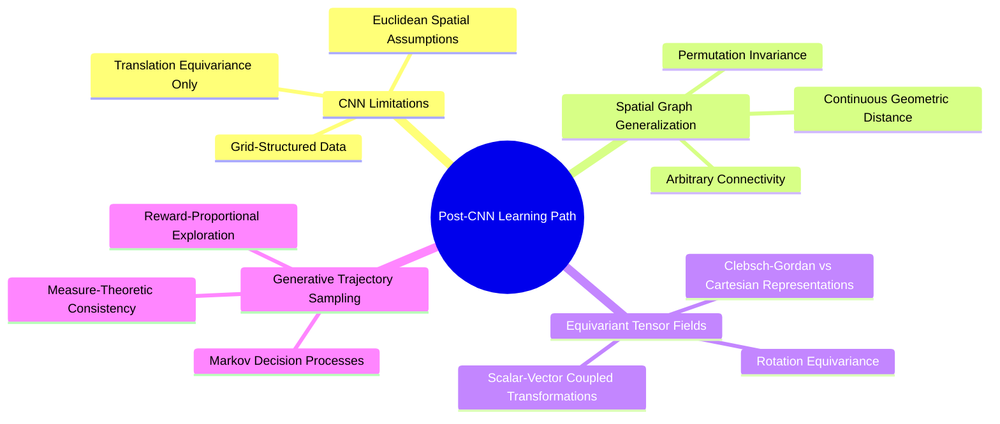

---
tags:
  - 3dsyntree
module: "00. Master Index and System Map"
type: index
---

# 1. Post-CNN Learning Roadmap and Prerequisites

> [!abstract] Scope and Trajectory
> This document assumes proficiency with Multilayer Perceptrons (MLPs), backpropagation, stochastic gradient descent (SGD/Adam), and standard 2D Convolutional Neural Networks (CNNs). It plots the linear and branching pedagogical paths required to master continuous 3D geometric deep learning and discrete flow matching.

## The Cognitive Gap: From 2D Pixels to Geometric Graphs

### Critical Concept Dependencies

1. **Pixel Grids vs. Relational Graphs**:
   In CNNs, spatial locality is implicitly defined by array indices $(i, j)$ over a regular lattice. In 3D molecular structures, positional coordinates $\mathbf{x}_i \in \mathbb{R}^3$ are continuous variables, and topology is defined by dynamically constructed interaction radii rather than static grid kernels.
2. **Translation Equivariance vs. Euclidean Group $\mathrm{SE}(3)$ Equivariance**:
   CNNs achieve translation equivariance through spatial parameter sharing. Molecular systems require equivariance to the full Special Euclidean group $\mathrm{SE}(3)$: transformations combining 3D continuous translations $\mathbf{t} \in \mathbb{R}^3$ and 3D rotations $\mathbf{R} \in \mathrm{SO}(3)$.
3. **Single Supervised Loss vs. Trajectory Flow Balance**:
   Supervised classification optimizes cross-entropy on static samples. GFlowNets optimize flow consistency equations over directed acyclic graphs (DAGs), ensuring the probability of generating a complete discrete artifact is proportional to an unnormalized scalar reward function $R(x)$.
