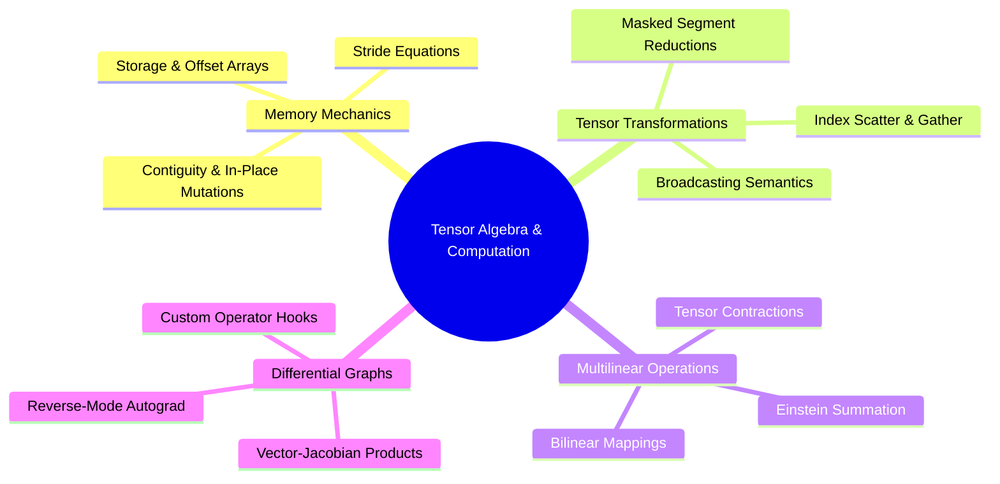

---
tags:
  - moc
  - 3dsyntree
module: "01. Advanced Tensor Algebra and Computational Graphs"
type: moc
---

# 0. Advanced Tensor Algebra MOC

> [!abstract] Module Overview
> Mathematical foundations and low-level implementations of multi-dimensional array operations, strided memory access, differential tensor calculus, and custom autograd operators within PyTorch.

## Detailed Chapters

- **Chapter 1. Tensor Geometries and Strides**
  - [[1. Memory Layouts Contiguity and Strides]]
  - [[2. Broadcasting Rules and Dimension Semantics]]
  - [[3. Advanced Tensor Slicing and Scatter-Gather Operations]]
- **Chapter 2. Contractions and Autograd Calculus**
  - [[1. Einstein Summation and Multilinear Contractions]]
  - [[2. Vectorized Computational Graphs and Jacobians]]
  - [[3. Custom Autograd Function Design and Backward Hooks]]
