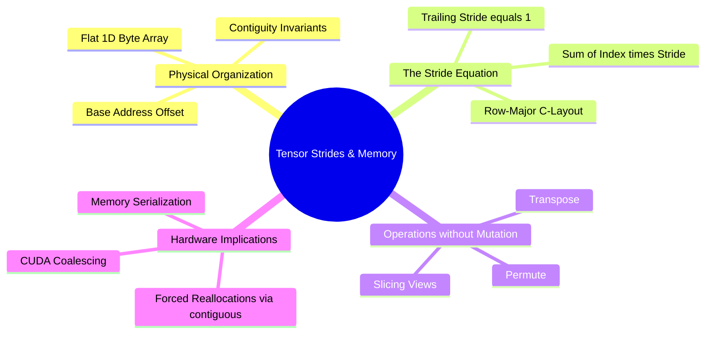

---
tags:
  - 3dsyntree
  - depth/essential
module: "01. Advanced Tensor Algebra and Computational Graphs"
chapter: "Chapter 1. Tensor Geometries and Strides"
type: concept
---

# 1. Memory Layouts Contiguity and Strides

> [!abstract] Mathematical Core
> A tensor $\mathbf{T} \in \mathbb{R}^{d_0 \times d_1 \times \dots \times d_{k-1}}$ is an abstract multi-dimensional mapping stored in physical hardware as a flat, one-dimensional block of contiguous memory. The layout is completely parameterized by a base pointer, a shape tuple $\mathbf{s} = (d_0, \dots, d_{k-1})$, and a stride tuple $\mathbf{\sigma} = (\sigma_0, \dots, \sigma_{k-1})$.

## 1. What It Is

In modern deep learning frameworks, physical random-access memory (RAM and VRAM) is organized linearly. Memory addresses are sequential integers. A tensor's multi-dimensional coordinate vector $\mathbf{i} = (i_0, i_1, \dots, i_{k-1})$ is mapped to an offset $O(\mathbf{i})$ relative to a base memory pointer via the fundamental stride equation:

$$O(\mathbf{i}) = \sum_{j=0}^{k-1} i_j \cdot \sigma_j$$

where $\sigma_j$ represents the **stride** along dimension $j$—the number of scalar memory cells that must be traversed to advance by one unit along index $i_j$.

```text
Logical 2D View [2, 3]:
[[a, b, c],
 [d, e, f]]

Physical Memory Layout (Row-Major / C-Contiguous):
Offset:    0    1    2    3    4    5
Element:   a    b    c    d    e    f
Strides:  (3, 1)  ->  Moving 1 row steps 3 elements; moving 1 col steps 1 element.
```

A tensor is **C-contiguous** (row-major) if the strides satisfy the recursive relation:

$$\sigma_{k-1} = 1, \quad \sigma_j = \sigma_{j+1} \cdot d_{j+1} = \prod_{m=j+1}^{k-1} d_m$$

## 2. Why It Exists

Tensors must support view manipulations—such as transpositions, slicing, squeezing, and reshaping—without copying underlying data buffers in memory. If transposing a matrix required moving every byte in physical memory, structural permutations would become computationally prohibitive $O(N)$ operations.

By altering only the stride tuple $\mathbf{\sigma}$ and the shape tuple $\mathbf{s}$, operations like `.transpose()`, `.view()`, and `.permute()` run in $O(1)$ constant time. However, this creates **non-contiguous** tensors where adjacent logical indices no longer map to adjacent physical memory locations.

## 3. How It Works

### 3.1 Transposition and Non-Contiguity Mechanics

Consider a matrix $\mathbf{A} \in \mathbb{R}^{3 \times 4}$ with row-major strides $\mathbf{\sigma} = (4, 1)$:

$$
\mathbf{A} = \begin{bmatrix}
a_{00} & a_{01} & a_{02} & a_{03} \\ 
a_{10} & a_{11} & a_{12} & a_{13} \\ 
a_{20} & a_{21} & a_{22} & a_{23} 
\end{bmatrix}
$$

Physical memory sequence:
$$\text{idx: } 0 \to a_{00}, \; 1 \to a_{01}, \; 2 \to a_{02}, \; 3 \to a_{03}, \; 4 \to a_{10}, \dots, 11 \to a_{23}$$

Applying a transpose operation $\mathbf{B} = \mathbf{A}^T$:
- New shape: $\mathbf{s}_B = (4, 3)$
- New strides: $\mathbf{\sigma}_B = (1, 4)$

The physical memory buffer is untouched. To access $\mathbf{B}[1, 2]$:
$$O(1, 2) = 1 \cdot \sigma_0^B + 2 \cdot \sigma_1^B = 1 \cdot 1 + 2 \cdot 4 = 9$$
In the original array $\mathbf{A}$, offset 9 corresponds to:
$$9 = 2 \cdot 4 + 1 \cdot 1 \implies \mathbf{A}[2, 1]$$
Mathematically, $\mathbf{B}[1, 2] \equiv \mathbf{A}[2, 1]$. However, $\mathbf{B}$ is no longer C-contiguous because advancing along the trailing dimension (columns) requires a stride of 4 rather than 1.

### 3.2 Consequences for CUDA Kernel Execution

Graphics processing units achieve maximum bandwidth when threads within a warp (32 parallel threads) access contiguous physical memory addresses simultaneously—a hardware process known as **memory coalescing**.

When a custom CUDA kernel or a PyTorch primitive attempts to execute over a non-contiguous tensor:
1. Coalescing fails, causing the GPU memory controller to serialize requests into multiple independent memory transactions.
2. Vectorized assembly instructions (e.g., `LDG.E.128`, loading 128 bits at once) fail to compile, falling back to slow scalar reads (`LDG.E.32`).
3. Methods like `.view()` raise explicit runtime exceptions (`RuntimeError: input is not contiguous`) because `.view()` requires an unambiguous mapping where a flattened dimension corresponds directly to a contiguous slice of linear memory.

Calling `.contiguous()` forces a physical reallocation: a new linear memory buffer is allocated, and elements are copied to restore standard row-major strides.

## 4. What It Consists Of

- **Base Pointer (`storage_offset`)**: Memory address in bytes marking the start of the tensor's data.
- **Storage Array (`Storage`)**: The underlying flat 1D array of untyped or typed raw bytes allocated on the host CPU or device GPU.
- **Shape (`Size`)**: A tuple of integers $(d_0, d_1, \dots, d_{k-1})$ specifying logical dimensionality.
- **Strides**: A tuple of integers $(\sigma_0, \sigma_1, \dots, \sigma_{k-1})$ specifying element step counts.

## 5. What You Must Understand

> [!warning] Pitfall: Silent Performance Degeneration via Involuntary Clones
> When operations like `.reshape()` are called on non-contiguous memory, PyTorch silently triggers a memory allocation and deep copy equivalent to calling `.contiguous().view()`. If placed within an inner training loop, this causes steady GPU VRAM allocation spikes, garbage collection pressure, and memory fragmentation.

> [!tip] Memory Hook
> **Strides dictate the jump; shape dictates the count.** If a stride along the final dimension is not 1, your tensor cannot use coalesced memory transactions on CUDA.

## 6. Prerequisites

- Basic multi-dimensional array concepts (matrices, vectors).

## 7. Project Connection

In `3D-SynTree`, heterogeneous graphs combine variable-sized pocket clouds and growing ligand clouds. In `syntree/models/policy.py`, node representations are dynamically split and gathered:
```python
perm = torch.argsort(union_batch, stable=True)
local_idx = torch.empty_like(local_idx_sorted)
local_idx[perm] = local_idx_sorted
padded[union_batch, local_idx] = joint_s
```
Manipulating sub-graph batches requires direct management of contiguity before attention layers to prevent memory leaks and maintain compatibility with CUDA kernels in PyTorch's native `MultiheadAttention`.

## 8. Required Depth

**Essential**: Non-contiguous tensors in custom autograd backward passes will directly crash custom PyTorch operations.

## 9. Further Dependencies

- [[2. Broadcasting Rules and Dimension Semantics]]
- [[3. Advanced Tensor Slicing and Scatter-Gather Operations]]

## Concept Mind Map


