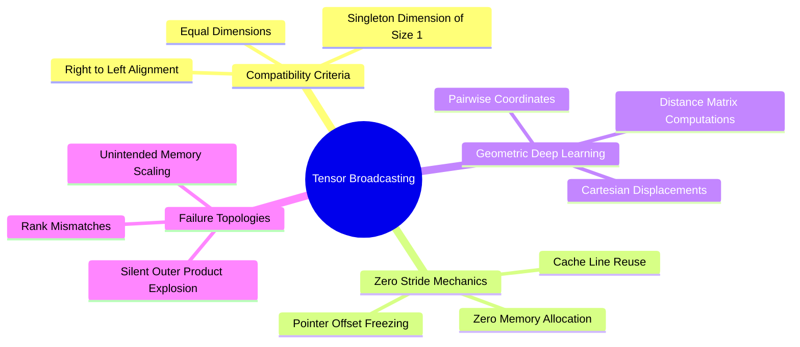

---
tags:
  - 3dsyntree
  - depth/essential
module: "01. Advanced Tensor Algebra and Computational Graphs"
chapter: "Chapter 1. Tensor Geometries and Strides"
type: concept
---

# 2. Broadcasting Rules and Dimension Semantics

> [!abstract] Mathematical Core
> Broadcasting is a set of formal algebraic rules allowing element-wise tensor operations between operands of differing shapes without allocating redundant memory buffers. It works by virtually duplicating dimensions using a stride of 0.

## 1. What It Is

When two tensors $\mathbf{A} \in \mathbb{R}^{s_A}$ and $\mathbf{B} \in \mathbb{R}^{s_B}$ participate in an element-wise binary operation $f(\mathbf{A}, \mathbf{B})$ (such as addition, multiplication, or comparisons), their shape tuples must be aligned according to standard broadcasting rules.

Two dimensions $d_A$ and $d_B$ are compatible if:
1. They are equal ($d_A = d_B$), or
2. One of them is 1 ($d_A = 1$ or $d_B = 1$).

If the tensors have differing numbers of dimensions (ranks), the shape of the lower-rank tensor is prepended with 1s until both ranks match.

## 2. Why It Exists

In geometric deep learning and pairwise potential calculations, we frequently evaluate functions across all pairs of points:

$$\mathbf{D}_{ij} = \|\mathbf{x}_i - \mathbf{y}_j\|_2 \quad \forall i \in \{1, \dots, N\}, \; j \in \{1, \dots, M\}$$

Without broadcasting, one would have to explicitly tile and copy $\mathbf{x}$ across $M$ columns and $\mathbf{y}$ across $N$ rows, requiring $O(N \cdot M \cdot 3)$ physical memory allocations. Broadcasting performs this pairing in $O(1)$ memory by setting the stride of the expanded dimension to 0.

## 3. How It Works

### 3.1 The Zero-Stride Trick

Suppose we have a vector $\mathbf{x} \in \mathbb{R}^N$ with shape $(N,)$ and stride $(1,)$. We unsqueeze it to shape $(N, 1)$ with strides $(1, 1)$. We wish to compute the difference matrix against $\mathbf{y} \in \mathbb{R}^M$ of shape $(1, M)$ and strides $(M, 1)$.

```text
Logical Shapes:
  x: [N, 1]
  y: [1, M]
Target Broadcast Shape: [N, M]

Physical Execution:
  x is expanded to [N, M] with strides (1, 0)
  y is expanded to [N, M] with strides (0, 1)
```

For $\mathbf{x}$, the stride along the column axis is set to **0**. Evaluating the stride offset formula:

$$O(i, j) = i \cdot \sigma_0 + j \cdot \sigma_1 = i \cdot 1 + j \cdot 0 = i$$

No matter what column index $j$ is requested, the pointer reads from the exact same memory address $i$. The hardware registers read the single physical value of $\mathbf{x}[i]$ across all $j$, saving memory and utilizing cache lines effectively.

### 3.2 Formal Algebraic Tracing: Pairwise Cartesian Displacements

Given:
- A set of ligand atoms: $\mathbf{X}_L \in \mathbb{R}^{N \times 3}$
- A set of pocket atoms: $\mathbf{X}_P \in \mathbb{R}^{M \times 3}$

We want the directional displacement tensor $\mathbf{\Delta} \in \mathbb{R}^{N \times M \times 3}$ where $\mathbf{\Delta}_{ij} = \mathbf{X}_{L, i} - \mathbf{X}_{P, j}$.

```python
# Shapes:
# X_L: [N, 3] -> unsqueeze(1) -> [N, 1, 3]
# X_P: [M, 3] -> unsqueeze(0) -> [1, M, 3]

delta = X_L.unsqueeze(1) - X_P.unsqueeze(0) # Output shape: [N, M, 3]
```

Dimension alignment steps:
1. `X_L.unsqueeze(1)` produces shape $(N, 1, 3)$, strides $(\sigma_0, 0, \sigma_1)$.
2. `X_P.unsqueeze(0)` produces shape $(1, M, 3)$, strides $(0, \sigma_0, \sigma_1)$.
3. The subtraction operator aligns dimensions from right to left:
   - Dim 2: size 3 vs size 3 $\implies$ equal (compatible).
   - Dim 1: size 1 vs size $M \implies$ one is 1 (compatible, expands to $M$).
   - Dim 0: size $N$ vs size 1 $\implies$ one is 1 (compatible, expands to $N$).
4. The output shape is $(N, M, 3)$.

## 4. What It Consists Of

- **Dimension Right-Alignment**: Shapes are paired from the trailing (rightmost) dimension backward.
- **Singleton Dimensions**: Any dimension of length 1 that can be expanded to size $k > 1$.
- **Stride Zeroing**: The mathematical mechanism that enables reading from an un-replicated scalar cell across an arbitrary logical axis.

## 5. What You Must Understand

> [!warning] Pitfall: Accidental Outer Products via Missing Dimensions
> If two vectors of intended length $N$ are passed as shape $(N, 1)$ and shape $(N,)$, operating on them without matching dimensions yields an $(N, N)$ matrix rather than an $(N,)$ vector. This silent failure expands computational memory from $O(N)$ to $O(N^2)$, which can trigger an unexpected CUDA Out-of-Memory (OOM) error.

```python
a = torch.randn(10000, 1)
b = torch.randn(10000)
c = a + b # Unintended broadcasting -> Allocates [10000, 10000] matrix (~400 MB)!
```

## 6. Prerequisites

- [[1. Memory Layouts Contiguity and Strides]]

## 7. Project Connection

In `syntree/chemistry/conformer.py`, the soft-core Lennard-Jones calculation uses broadcasting to compute distances between all pairs of atoms:
```python
diff = lig[:, None, :] - poc[None, :, :] # [N_lig, 1, 3] - [1, N_poc, 3] -> [N_lig, N_poc, 3]
r = np.sqrt((diff ** 2).sum(-1)).clip(min=1e-6)
sigma = ligand_vdw[:, None] + pocket_vdw[None, :] # [N_lig, 1] + [1, N_poc] -> [N_lig, N_poc]
```

## 8. Required Depth

**Essential**: All pairwise potentials, radius graph constructions, and attention score matrices rely on broadcasting mechanics.

## 9. Further Dependencies

- [[3. Advanced Tensor Slicing and Scatter-Gather Operations]]
- [[1. Einstein Summation and Multilinear Contractions]]

## Concept Mind Map


