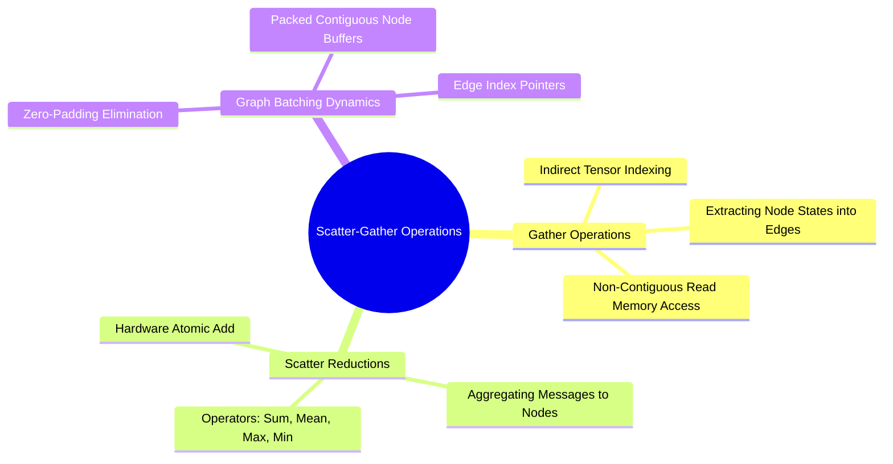

---
tags:
  - 3dsyntree
  - depth/essential
module: "01. Advanced Tensor Algebra and Computational Graphs"
chapter: "Chapter 1. Tensor Geometries and Strides"
type: concept
---

# 3. Advanced Tensor Slicing and Scatter-Gather Operations

> [!abstract] Mathematical Core
> Graph neural networks operate on non-grid, sparse, and irregular topologies. Instead of standard dense matrix operations, they rely on non-contiguous memory access primitives: index-select, masked scatter, and atomic reductions (scatter-add, scatter-reduce).

## 1. What It Is

When processing batched graphs where each graph contains a varying number of nodes $N_b$ and edges $E_b$, arrays cannot be organized into uniform rectangular tensors without wasteful padding.

Instead, all nodes are packed into a single continuous tensor $\mathbf{X} \in \mathbb{R}^{N_{\text{total}} \times d}$ where $N_{\text{total}} = \sum_b N_b$. To route representations through topological connections, we use **scatter-gather operations**:
- **Gather (`index_select`)**: Pulls elements from a source tensor based on an integer index map.
- **Scatter (`scatter_add_`, `index_add_`)**: Accumulates elements into a destination tensor at specified indices.

$$\mathbf{Y}[i] = \bigoplus_{j \text{ such that } \text{index}[j] = i} \mathbf{X}[j]$$

where $\bigoplus$ represents a reduction operator (sum, mean, max, or min).

## 2. Why It Exists

In a standard batch of molecules, Molecule A may have 12 atoms, while Molecule B has 48. Traditional mini-batching would require padding Molecule A with 36 dummy atoms. This approach introduces two problems:
1. Wasted computation on dummy nodes in attention layers ($O(N^2)$ scaling).
2. Masked computations that can suffer from numerical errors if dummy values are not handled correctly.

By packing all atoms into a unified continuous tensor and tracking connectivity via an edge index list $\mathbf{E} \in \mathbb{N}^{2 \times E_{\text{total}}}$, computation runs only on physically real atoms and bonds.

## 3. How It Works

### 3.1 Gather Mechanics

Let $\mathbf{X} \in \mathbb{R}^{N \times d}$ denote node features, and let $\mathbf{E}_{\text{src}} \in \mathbb{N}^E$ define the source indices of directed edges. The gather operation produces edge-wise source features:

$$\mathbf{X}_{\text{edges}} = \mathbf{X}[\mathbf{E}_{\text{src}}] \in \mathbb{R}^{E \times d}$$

Physical memory tracking:
For each edge $e \in \{0, \dots, E-1\}$, the hardware reads the integer node index $k = \mathbf{E}_{\text{src}}[e]$ and loads the $d$ feature values stored at $\mathbf{X}[k]$. This constitutes an indirect, irregular read.

### 3.2 Scatter-Add Mechanics and the Multi-Thread Write Race

The inverse operation aggregates messages along incoming edges back into destination nodes:

$$\mathbf{S}[i] = \sum_{e \mid \mathbf{E}_{\text{dst}}[e] = i} \mathbf{M}[e]$$

In multi-threaded architectures (CUDA warps), multiple edges often point to the same destination node simultaneously ($e_1 \to \text{node } 4$, $e_2 \to \text{node } 4$). If thread 1 and thread 2 write to $\mathbf{S}[4]$ concurrently, a **write race condition** occurs:

```text
Thread 1: Read S[4] (0.0) -> Add M[e1] (1.5) -> Write S[4] (1.5)
Thread 2: Read S[4] (0.0) -> Add M[e2] (2.0) -> Write S[4] (2.0)  [OVERWRITES THREAD 1!]
```

To prevent data loss, the GPU must use hardware-level **atomic operations** (`atomicAdd`):

```cpp
// CUDA Device Implementation
atomicAdd(&destination_pointer[node_index * d + feature_idx], message_value);
```

Atomic operations serialize conflicting writes, ensuring mathematical correctness at the cost of memory pipeline stalls when node degrees are high.



## 4. What It Consists Of

- **Index Tensor**: A 1D or 2D array of integers specifying source or destination coordinates.
- **Source Feature Tensor**: The tensor containing raw states to be gathered or scattered.
- **Segment Accumulator**: The output tensor containing aggregated values.
- **Atomic Execution Primitives**: Low-level instruction sets ensuring thread-safe write operations on GPU memory.

## 5. What You Must Understand

> [!warning] Pitfall: Non-Deterministic Floating-Point Floating-Sum Reductions
> Floating-point addition is non-associative: $(a + b) + c \neq a + (b + c)$ due to rounding errors. Because the order of `atomicAdd` instructions depends on hardware thread scheduling, repeating the exact same forward pass with `scatter_add_` can yield slightly different results at the level of precision limits ($\approx 10^{-6}$ in FP32).

## 6. Prerequisites

- [[1. Memory Layouts Contiguity and Strides]]

## 7. Project Connection

In `syntree/models/equivariant.py`, the core PaiNN interaction message aggregation relies on PyTorch's native `index_add_`:
```python
agg_s = torch.zeros_like(scalar)
agg_v = torch.zeros_like(vector)
agg_s.index_add_(0, row, msg_s)
agg_v.index_add_(0, row, msg_v)
```
This aggregates messages from all directed edges targeting atom `row`, forming the foundation of the physical interaction layers.

## 8. Required Depth

**Essential**: This operation is the core computational primitive used in all Graph Neural Networks and message-passing layers.

## 9. Further Dependencies

- [[1. The Message-Passing Neural Network Formalism]]
- [[1. PaiNN Interaction Block and Directional Message Passing]]

## Cross-Domain Links

- [[Chemistry/02. Medicinal Chemistry and Synthesis/Chapter 1. Building Blocks and the Reaction Grammar/3. Reaction SMARTS and Isotope Provenance|3. Reaction SMARTS and Isotope Provenance]] (Chemistry vault) — the isotope offsets $1000+i$ and $2000+j$ that track atom provenance across buffers are implemented with tensor slicing and scatter-gather.
