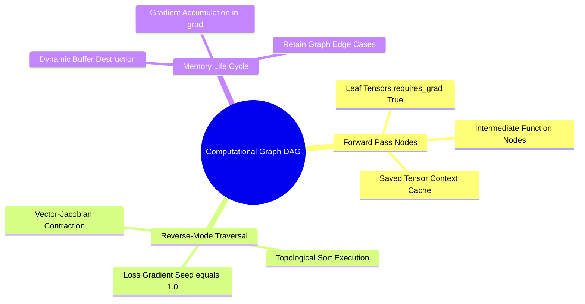

---
tags:
  - 3dsyntree
  - depth/essential
module: "01. Advanced Tensor Algebra and Computational Graphs"
chapter: "Chapter 2. Contractions and Autograd Calculus"
type: concept
---

# 2. Vectorized Computational Graphs and Jacobians

> [!abstract] Mathematical Core
> Modern deep learning frameworks implement reverse-mode automatic differentiation. Rather than computing and storing the full Jacobian matrix $\mathbf{J} \in \mathbb{R}^{M \times N}$, which is often too large to fit in memory, the engine calculates the **Vector-Jacobian Product (VJP)** directly during the backward pass.

## 1. What It Is

Let $\mathbf{f}: \mathbb{R}^N \to \mathbb{R}^M$ represent a vectorized forward mapping executed by a layer within a neural network:

$$\mathbf{y} = \mathbf{f}(\mathbf{x})$$

The complete derivative of this mapping is the **Jacobian matrix** $\mathbf{J} \in \mathbb{R}^{M \times N}$, whose entries are defined as:

$$\mathbf{J}_{ij} = \frac{\partial f_i}{\partial x_j}$$

In reverse-mode automatic differentiation, the objective is to compute the gradient of a final scalar loss $\mathcal{L} \in \mathbb{R}$ with respect to the input variables $\mathbf{x}$. Given the incoming gradient vector from downstream layers $\mathbf{v} = \nabla_{\mathbf{y}} \mathcal{L} \in \mathbb{R}^M$, the chain rule is expressed as:

$$\nabla_{\mathbf{x}} \mathcal{L} = \mathbf{v}^T \mathbf{J} = \sum_{i=1}^M v_i \frac{\partial f_i}{\partial \mathbf{x}}$$

This product $\mathbf{v}^T \mathbf{J}$ is the **Vector-Jacobian Product (VJP)**.

## 2. Why It Exists

Consider an intermediate feature map of size $[B, N, d] = [16, 500, 256]$, which contains $2 \times 10^6$ parameters. 

If a layer maps this tensor to another tensor of the same size, the full Jacobian matrix $\mathbf{J}$ would contain:

$$\mathbf{J} \in \mathbb{R}^{(2 \times 10^6) \times (2 \times 10^6)} \implies 4 \times 10^{12} \text{ elements}$$

In FP32 precision, storing this matrix would require **16 Terabytes of memory** for a single layer, quickly causing an out-of-memory error on any hardware.

Reverse-mode autograd avoids this problem by never instantiating the full Jacobian matrix $\mathbf{J}$. Instead, it computes the action of the transposed Jacobian directly on the incoming gradient vector $\mathbf{v}$, reducing memory complexity from $O(M \cdot N)$ to $O(N)$.

## 3. How It Works

### 3.1 The Computational DAG (Directed Acyclic Graph)

During the forward pass, PyTorch builds a dynamic directed acyclic graph (DAG) composed of `Node` objects (representing mathematical functions) and edges (representing data dependencies):
- Tensors with `requires_grad=True` act as leaf nodes.
- Each operation creates a new `Node` (subclass of `torch.autograd.Function`).
- Tensors needed for the backward pass are explicitly saved in the node's context using `ctx.save_for_backward()`.

### 3.2 Mathematical Formulation of Vectorized VJPs

Let us derive the VJP for the non-singular safe norm implemented in `syntree/models/equivariant.py`:

$$y = f(\mathbf{x}) = \sqrt{\sum_{k=1}^3 x_k^2 + \epsilon^2} - \epsilon$$

Here, the mapping is $f: \mathbb{R}^3 \to \mathbb{R}^1$. The Jacobian is a $1 \times 3$ row vector:

$$\mathbf{J} = \begin{bmatrix} \frac{\partial y}{\partial x_1} & \frac{\partial y}{\partial x_2} & \frac{\partial y}{\partial x_3} \end{bmatrix} = \frac{\mathbf{x}^T}{\sqrt{\sum_{k=1}^3 x_k^2 + \epsilon^2}}$$

Given the incoming scalar gradient $v = \frac{\partial \mathcal{L}}{\partial y} \in \mathbb{R}^1$, the Vector-Jacobian Product is computed as:

$$\nabla_{\mathbf{x}} \mathcal{L} = v \cdot \mathbf{J} = v \cdot \frac{\mathbf{x}}{\sqrt{\|\mathbf{x}\|_2^2 + \epsilon^2}}$$

As $\mathbf{x} \to \mathbf{0}$, the limit of this product is well-behaved:

$$\lim_{\mathbf{x} \to \mathbf{0}} \nabla_{\mathbf{x}} \mathcal{L} = v \cdot \frac{\mathbf{0}}{\sqrt{0 + \epsilon^2}} = \mathbf{0}$$

This confirms that the gradient remains stable and bounded, avoiding the division-by-zero singularities that can occur with the standard Euclidean norm.

## 4. What It Consists Of

- **Forward Node**: The execution logic that computes outputs from input tensors.
- **Saved Context (`ctx`)**: An execution state cache that retains references to input or output activations needed during backpropagation.
- **Backward Node**: The reverse-mode function that takes the incoming gradient $\mathbf{v}$ and computes the VJP for each input.
- **Topological Traversal Engine**: An execution scheduler that traverses the computational graph in reverse topological order, accumulating gradients at each node.

## 5. What You Must Understand

> [!warning] Pitfall: Retaining Activation Tensors and Memory Leaks
> Calling `ctx.save_for_backward(t)` keeps a reference to the tensor `t` alive until the backward pass completes. If an operation saves an excessively large intermediate tensor that is not strictly needed for the VJP, it will unnecessarily consume VRAM throughout the forward pass. Save only the minimal set of tensors required to compute the gradient.

## 6. Prerequisites

- Multivariable differential calculus (partial derivatives, the gradient operator, and the chain rule).
- [[1. Einstein Summation and Multilinear Contractions]]

## 7. Project Connection

In `3D-SynTree`, evaluating the modified Bessel function ratio $\frac{I_1(\kappa)}{I_0(\kappa)}$ using naive autograd through an unrolled power series caused gradient explosions for $\kappa > 10$. To fix this, we implemented a custom `torch.autograd.Function` that bypasses the computational graph entirely. The backward pass evaluates the Vector-Jacobian Product using the closed-form Amos continued fraction approximation:
$$\nabla_{\kappa} \mathcal{L} = v \cdot \frac{\kappa}{0.5 + \sqrt{\kappa^2 + 2.25}}$$

## 8. Required Depth

**Essential**: Understanding how reverse-mode autograd works is required to write custom operators and prevent numerical instabilities during backpropagation.

## 9. Further Dependencies

- [[3. Custom Autograd Function Design and Backward Hooks]]
- [[1. The Amos Ratio Approximation and Gradient Stabilization]]
