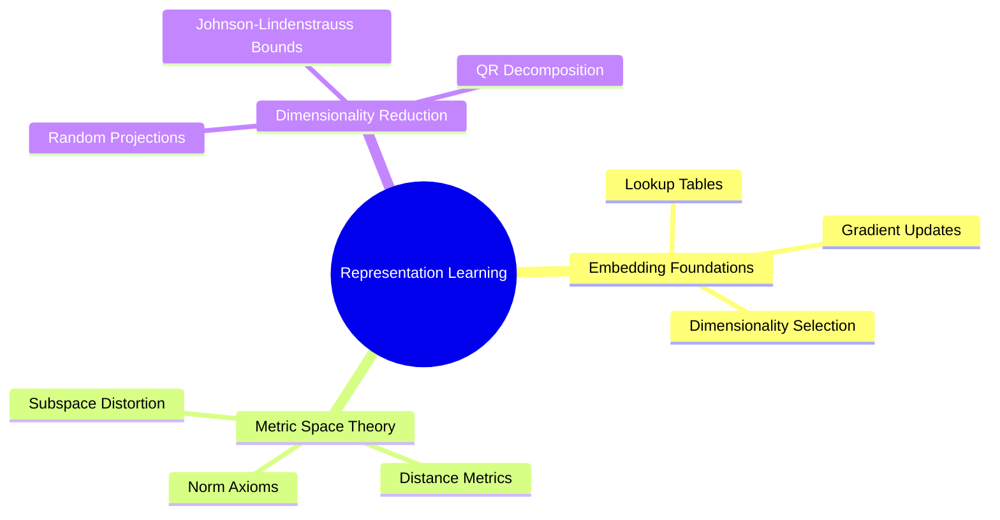

---
tags:
  - moc
  - 3dsyntree
module: "02. Representation Learning and Latent Metric Spaces"
type: moc
---

# 0. Representation Learning MOC

> [!abstract] Module Overview
> Mathematical and algorithmic principles of projecting high-dimensional chemical and topological descriptors into continuous metric spaces, preserving distances, and constructing latent embeddings.

## Detailed Chapters

- **Chapter 1. Discrete Embedding Spaces**
  - [[1. High-Dimensional Lookup Tables and Gradients]]
  - [[2. Categorical vs Continuous Latent Geometries]]
  - [[3. Metric Spaces Distance Metrics and Norms]]
- **Chapter 2. Dimensionality Reduction and Random Projections**
  - [[1. The Johnson-Lindenstrauss Lemma]]
  - [[2. QR Decomposition and Orthonormal Projection Operators]]
  - [[3. Norm Preservation and Distortion Bounds in Practice]]
