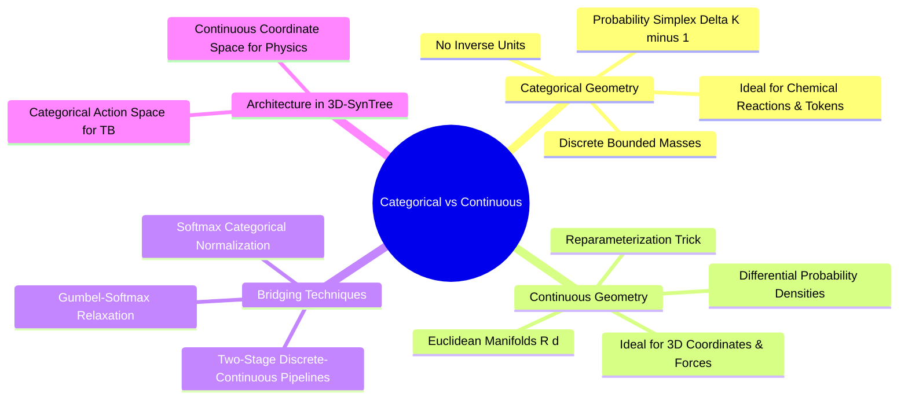

---
tags:
  - 3dsyntree
  - depth/supporting
module: "02. Representation Learning and Latent Metric Spaces"
chapter: "Chapter 1. Discrete Embedding Spaces"
type: concept
---

# 2. Categorical vs Continuous Latent Geometries

> [!abstract] Mathematical Core
> Categorical latent spaces map discrete decisions to finite symbol sets using probability simplexes $\Delta^{K-1}$. Continuous latent spaces map states to smooth manifolds $\mathbb{R}^d$ or Lie groups. Generative models must choose between these geometries to balance optimization stability against physical resolution.

## 1. What It Is

A **categorical latent space** represents choices as discrete points within a finite set:

$$\mathcal{Z}_{\text{cat}} = \{1, 2, \dots, K\}$$

The model parameterizes uncertainty over this space using probability vectors on the **standard simplex** $\Delta^{K-1}$:

$$\Delta^{K-1} = \left\{ \mathbf{p} \in \mathbb{R}^K \;\middle|\; \sum_{k=1}^K p_k = 1, \; p_k \ge 0 \right\}$$

A **continuous latent space** represents states as points on a smooth, infinite geometric manifold:

$$\mathcal{Z}_{\text{cont}} \subseteq \mathbb{R}^d$$

Distances and directions are continuous, and uncertainty is parameterized using probability density functions (such as Gaussians on $\mathbb{R}^d$ or von Mises distributions on $S^1$).

## 2. Why It Exists

Molecular design involves both continuous and discrete physics:
- **Discrete Structure**: Chemical bonds, reaction mechanisms, and atom selections are inherently discrete. A molecule either has an amide bond or it does not; an atom is either Carbon or Nitrogen.
- **Continuous Geometry**: Bond lengths, 3D coordinates, and dihedral angles vary continuously in physical space.

Attempting to model discrete chemical bonds as continuous variables (as in continuous diffusion models) often produces unphysical structures with fractional bonds. Conversely, discretizing continuous 3D space into fine grids causes computational complexity to explode.

An effective molecular architecture must use categorical spaces for chemical decisions and continuous spaces for geometric coordinates.

## 3. How It Works

### 3.1 Mathematical Comparison of Latent Geometries

```text
Categorical Simplex Delta^(K-1):
        Vertex 1 (Reaction A)
               /\
              /  \
             /    \
            /  p   \   <-- Valid state is a convex combination on simplex
           /________\
Vertex 2 (Rxn B)    Vertex 3 (Rxn C)

Continuous Manifold R^d:
A smooth, unconstrained Euclidean space where distances are defined by ||z_1 - z_2||.
```

| Property | Categorical Latent Space | Continuous Latent Space |
| :--- | :--- | :--- |
| **Domain** | Finite alphabet $\{1, \dots, K\}$ | Smooth manifold $\mathbb{R}^d$ or Lie group |
| **Probability Form** | Discrete mass: $P(k) \in [0, 1]$ | Continuous density: $p(z) \in [0, \infty)$ |
| **Probability Bound** | Strictly bounded: $\sum P(k) = 1.0$ | Differential: $\int p(z) dz = 1.0$ |
| **Log-Probability** | Always non-positive: $\log P \le 0$ | Can be positive: $\log p \in (-\infty, +\infty)$ |
| **Sampling Mechanism**| Categorical draw: $\text{Multinomial}(\mathbf{p})$ | Reparameterization: $z = \mu + \sigma \odot \epsilon$ |
| **Gradients** | Requires score-function estimators or Gumbel-Softmax | Differentiable via the reparameterization trick |

### 3.2 The Gumbel-Softmax Continuous Relaxation

Because drawing discrete samples $k \sim \text{Categorical}(\mathbf{p})$ is a step function, it has zero derivative, preventing gradient backpropagation.

When continuous gradients are needed through discrete selections, models use the **Gumbel-Softmax relaxation** (Jang et al., 2017):

$$y_k = \frac{\exp\left( \frac{\log(p_k) + g_k}{\tau} \right)}{\sum_{j=1}^K \exp\left( \frac{\log(p_j) + g_j}{\tau} \right)}$$

where:
- $g_k \sim \text{Gumbel}(0, 1) = -\log(-\log(u_k))$ with $u_k \sim \text{Uniform}(0, 1)$.
- $\tau > 0$ is a temperature parameter controlling the smoothness of the relaxation:
  - As $\tau \to \infty$, $\mathbf{y}$ converges to a uniform distribution $[1/K, \dots, 1/K]$.
  - As $\tau \to 0$, $\mathbf{y}$ sharpens into an exact one-hot vector $\mathbf{e}_{\arg\max_k(\log p_k + g_k)}$.

This provides a continuous, differentiable approximation of discrete sampling.

## 4. What It Consists Of

- **Probability Simplex ($\Delta^{K-1}$)**: The geometric space of all normalized categorical probability distributions over $K$ choices.
- **Logit Vector ($\mathbf{z} \in \mathbb{R}^K$)**: Unconstrained real-valued outputs that map to probabilities via the softmax function.
- **Temperature ($\tau$)**: A scaling factor that controls the entropy of categorical distributions.

## 5. What You Must Understand

> [!warning] Pitfall: Gumbel-Softmax Temperature Mismatch
> If the temperature $\tau$ is kept high during evaluation, the model outputs soft mixtures of building blocks rather than discrete molecules. In production, discrete decisions must be evaluated as hard categorical draws ($\tau \to 0$), using continuous approximations only when required for training gradients.

## 6. Prerequisites

- [[1. High-Dimensional Lookup Tables and Gradients]]
- Probability theory (discrete vs. continuous random variables).

## 7. Project Connection

In `3D-SynTree`, we structure our action space around this categorical-continuous divide:
- **Categorical Decisions**: Functional handles, reaction families, synthon IDs, chiral parity, and dihedral bins are all modeled categorically, ensuring unitless discrete probabilities for GFlowNet training.
- **Continuous Operations**: 3D atomic coordinates, force-field minimizations, and spatial vector channels are modeled continuously in $\mathbb{R}^3$, ensuring realistic physical geometry.

## 8. Required Depth

**Supporting**: Clarifies the structural division between discrete chemical logic and continuous geometric physics in our models.

## 9. Further Dependencies

- [[3. Categorical Dihedral Discretization vs Continuous Heads]]
- [[2. The Trajectory Balance Objective]]

## Concept Mind Map



## Cross-Domain Links

- [[Chemistry/01. Chemistry Foundations/Chapter 1. Atomic Structure and Chemical Bonding/3. Molecular Geometry and Hybridization|3. Molecular Geometry and Hybridization]] (Chemistry vault) — discrete hybridization states ($sp^3/sp^2/sp$) live in categorical latent spaces, while molecular shape lives in continuous 3D Euclidean space.
