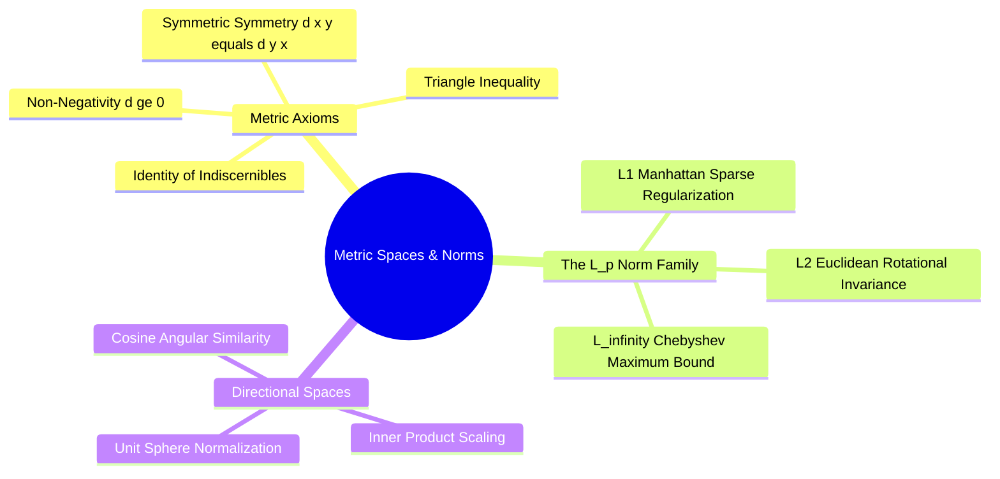

---
tags:
  - 3dsyntree
  - depth/essential
module: "02. Representation Learning and Latent Metric Spaces"
chapter: "Chapter 1. Discrete Embedding Spaces"
type: concept
---

# 3. Metric Spaces Distance Metrics and Norms

> [!abstract] Mathematical Core
> A metric space is a set $\mathcal{M}$ paired with a distance function $d(x, y)$ satisfying four foundational axioms. Understanding the geometric properties of different norms ($L_1$, $L_2$, $L_\infty$) and cosine similarity is required to evaluate similarities accurately in high-dimensional representation spaces.

## 1. What It Is

A **metric space** is a set $\mathcal{M}$ paired with a distance function $d: \mathcal{M} \times \mathcal{M} \to \mathbb{R}^+$ that satisfies four axioms for all $x, y, z \in \mathcal{M}$:

1. **Non-Negativity**: $d(x, y) \ge 0$
2. **Identity of Indiscernibles**: $d(x, y) = 0 \iff x = y$
3. **Symmetry**: $d(x, y) = d(y, x)$
4. **Triangle Inequality**:
   $$d(x, z) \le d(x, y) + d(y, z)$$

A **norm** on a real vector space $\mathcal{V}$ is a function $\|\cdot\|: \mathcal{V} \to \mathbb{R}^+$ that assigns a length to each vector, satisfying:
- Absolute scalability: $\|\alpha \mathbf{x}\| = |\alpha| \|\mathbf{x}\|$
- Subadditivity (triangle inequality): $\|\mathbf{x} + \mathbf{y}\| \le \|\mathbf{x}\| + \|\mathbf{y}\|$
- Definiteness: $\|\mathbf{x}\| = 0 \iff \mathbf{x} = \mathbf{0}$

Every norm induces a valid metric: $d(\mathbf{x}, \mathbf{y}) = \|\mathbf{x} - \mathbf{y}\|$.

## 2. Why It Exists

To compare representations in machine learning—whether matching a chemical query against a synthon catalog or measuring structural similarity between molecules—we need consistent ways to quantify distance.

Different distance metrics behave differently in high-dimensional spaces:
- Standard Euclidean distance ($L_2$) can be distorted by differences in vector length.
- Cosine similarity measures angular alignment while ignoring vector magnitudes.
- Tanimoto distance measures overlap between discrete bit vectors.

Choosing the appropriate metric ensures that the geometric distance between representations reflects their true physical or chemical similarity.

## 3. How It Works

### 3.1 The $L_p$ Norm Family

For a vector $\mathbf{x} \in \mathbb{R}^d$, the $L_p$ norm is defined as:

$$\|\mathbf{x}\|_p = \left( \sum_{i=1}^d |x_i|^p \right)^{1/p}$$

- **$L_1$ Norm (Manhattan)**: $\|\mathbf{x}\|_1 = \sum_{i=1}^d |x_i|$. Encourages sparsity when used as a regularization penalty.
- **$L_2$ Norm (Euclidean)**: $\|\mathbf{x}\|_2 = \sqrt{\sum_{i=1}^d x_i^2}$. Measures standard straight-line distance; invariant under orthogonal rotations $\mathrm{SO}(d)$.
- **$L_\infty$ Norm (Chebyshev)**: $\|\mathbf{x}\|_\infty = \max_{i=1}^d |x_i|$. Measures the maximum single-coordinate deviation.

### 3.2 Cosine Similarity and Angular Metrics

**Cosine similarity** measures the angle $\theta$ between two non-zero vectors:

$$\cos(\theta) = \frac{\mathbf{u} \cdot \mathbf{v}}{\|\mathbf{u}\|_2 \|\mathbf{v}\|_2} = \frac{\sum u_i v_i}{\sqrt{\sum u_i^2} \sqrt{\sum v_i^2}} \in [-1, 1]$$

While widely used, raw cosine similarity is **not** a valid metric:
- It violates the identity of indiscernibles: two vectors pointing in the same direction with different lengths ($\mathbf{u}$ and $2\mathbf{u}$) have $\cos(\theta) = 1$, giving $1 - \cos(\theta) = 0$ even though $\mathbf{u} \neq 2\mathbf{u}$.

To construct a true metric from cosine similarity, vectors must be normalized to the unit sphere:

$$\hat{\mathbf{u}} = \frac{\mathbf{u}}{\|\mathbf{u}\|_2}, \quad \hat{\mathbf{v}} = \frac{\mathbf{v}}{\|\mathbf{v}\|_2}$$

Evaluating the squared Euclidean distance between these normalized vectors:

$$\|\hat{\mathbf{u}} - \hat{\mathbf{v}}\|_2^2 = \|\hat{\mathbf{u}}\|_2^2 + \|\hat{\mathbf{v}}\|_2^2 - 2 \hat{\mathbf{u}} \cdot \hat{\mathbf{v}} = 1 + 1 - 2 \cos(\theta) = 2(1 - \cos(\theta))$$

On the unit sphere, Euclidean distance is monotonically related to cosine similarity, turning normalized dot products into valid metric comparisons.



## 4. What It Consists Of

- **Metric Function ($d(x, y)$)**: A distance function satisfying the four metric axioms.
- **Unit Hypersphere ($S^{d-1}$)**: The set of all vectors with Euclidean norm equal to 1.
- **Angular Geodesic**: The shortest path between two points along the surface of a hypersphere: $\theta = \arccos(\hat{\mathbf{u}} \cdot \hat{\mathbf{v}})$.

## 5. What You Must Understand

> [!warning] Pitfall: The Curse of Dimensionality Flattening Distances
> As dimensionality $d \to \infty$, the distance between the nearest neighbor and the furthest neighbor in an independently distributed dataset converges to zero:
> $$\lim_{d \to \infty} \frac{d_{\max} - d_{\min}}{d_{\min}} = 0$$
> In very high dimensions, Euclidean distances lose their discriminative power. To maintain meaningful distance metrics, representations must be projected into lower-dimensional manifolds using techniques like the Johnson-Lindenstrauss lemma.

## 6. Prerequisites

- Linear algebra (inner products, Cauchy-Schwarz inequality, vector projections).

## 7. Project Connection

In `syntree/chemistry/synthon_encoder.py`, all synthon embeddings are projected and normalized to the unit sphere:
```python
norms = np.linalg.norm(embedded, axis=1, keepdims=True)
norms[norms == 0.0] = 1.0
embeddings = torch.from_numpy((embedded / norms).astype(np.float32))
```
Normalizing to unit length ensures that dot-product similarity matching in the cross-attention head corresponds directly to Euclidean distance in the metric space.

## 8. Required Depth

**Essential**: Provides the mathematical foundation for representation learning and vector retrieval across the project.

## 9. Further Dependencies

- [[1. The Johnson-Lindenstrauss Lemma]]
- [[3. Norm Preservation and Distortion Bounds in Practice]]
