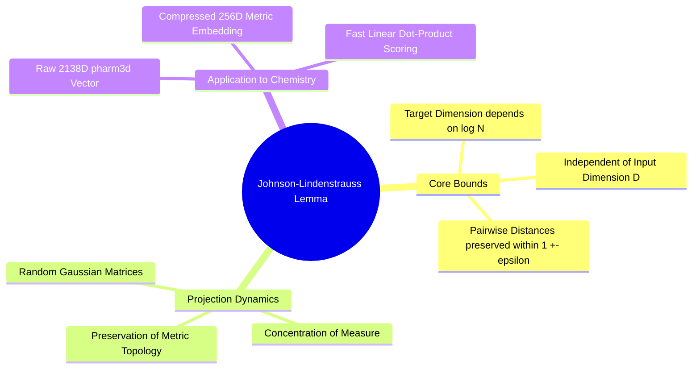

---
tags:
  - 3dsyntree
  - depth/essential
module: "02. Representation Learning and Latent Metric Spaces"
chapter: "Chapter 2. Dimensionality Reduction and Random Projections"
type: concept
---

# 1. The Johnson-Lindenstrauss Lemma

> [!abstract] Mathematical Core
> The Johnson-Lindenstrauss (JL) Lemma states that any set of $N$ points in a high-dimensional space $\mathbb{R}^D$ can be projected into a lower-dimensional space $\mathbb{R}^d$ (where $d \ll D$) while preserving all pairwise Euclidean distances within a factor of $1 \pm \epsilon$. The required target dimension $d$ depends logarithmically on the number of points $N$, independent of the original dimension $D$.

## 1. What It Is

Let $\epsilon \in (0, 1)$ define an acceptable distortion tolerance. For any finite subset $\mathcal{X} \subset \mathbb{R}^D$ containing $|\mathcal{X}| = N$ points, there exists a linear mapping $f: \mathbb{R}^D \to \mathbb{R}^d$ such that for all pairs $\mathbf{u}, \mathbf{v} \in \mathcal{X}$:

$$(1 - \epsilon) \|\mathbf{u} - \mathbf{v}\|_2^2 \le \|f(\mathbf{u}) - f(\mathbf{v})\|_2^2 \le (1 + \epsilon) \|\mathbf{u} - \mathbf{v}\|_2^2$$

The minimum target dimension $d$ required to guarantee this bound satisfies:

$$d \ge \frac{8 \ln(N)}{\epsilon^2}$$

Crucially, this lower bound on $d$ depends only on the number of points $N$ and the distortion parameter $\epsilon$. It is completely independent of the original data dimensionality $D$.

## 2. Why It Exists

In computational chemistry, molecular fingerprints and descriptors often span thousands of dimensions. For example, our raw `pharm3d` descriptors concatenate Morgan circular fingerprints, 3D shape metrics, electrostatic charge moments, and directional handle vectors, resulting in a vector of dimension $D = 2138$.

Using these 2138-dimensional vectors directly in cross-attention mechanisms introduces significant overhead:
- Attention memory scales with vector length.
- Weight matrices require more parameters, increasing the risk of overfitting on smaller datasets.

We need to compress these descriptors to a smaller dimension (such as $d = 256$) while ensuring that molecules with similar physical properties remain close together in the projected space. The JL Lemma proves that such a compression can be achieved using a linear projection without distorting pairwise chemical relationships.

## 3. How It Works

### 3.1 The Geometry of High-Dimensional Random Projections

A projection matrix $\mathbf{A} \in \mathbb{R}^{D \times d}$ can be constructed by sampling its entries independently from a Gaussian distribution:

$$A_{ij} \sim \mathcal{N}\left(0, \frac{1}{d}\right)$$

Applying this matrix to a vector $\mathbf{x} \in \mathbb{R}^D$ yields a projected vector $\mathbf{z} \in \mathbb{R}^d$:

$$\mathbf{z} = \mathbf{x} \mathbf{A}$$

Let $\mathbf{w} = \mathbf{u} - \mathbf{v}$ denote the difference vector between two points. The squared Euclidean norm of the projected difference is:

$$\|\mathbf{z}_{\mathbf{u}} - \mathbf{z}_{\mathbf{v}}\|_2^2 = \|\mathbf{w} \mathbf{A}\|_2^2 = \sum_{j=1}^d \left( \sum_{i=1}^D w_i A_{ij} \right)^2$$

Each term $X_j = \sum_{i=1}^D w_i A_{ij}$ is a sum of independent Gaussian variables, which itself follows a normal distribution:

$$X_j \sim \mathcal{N}\left(0, \frac{\|\mathbf{w}\|_2^2}{d}\right)$$

Rescaling these variables:

$$Q = \frac{d}{\|\mathbf{w}\|_2^2} \|\mathbf{w} \mathbf{A}\|_2^2 = \sum_{j=1}^d \left( \frac{\sqrt{d} X_j}{\|\mathbf{w}\|_2} \right)^2 \sim \chi^2(d)$$

The scaled norm follows a **Chi-squared ($\chi^2$) distribution** with $d$ degrees of freedom.

### 3.2 Concentration of Measure

For a Chi-squared random variable with $d$ degrees of freedom, the probability that the variable deviates significantly from its mean ($d$) decays exponentially:

$$\mathbb{P}\left( |Q - d| \ge \epsilon d \right) \le 2 e^{-\frac{d}{8} \epsilon^2}$$

Substituting $Q = \frac{d}{\|\mathbf{w}\|_2^2} \|\mathbf{w}\mathbf{A}\|_2^2$ into this inequality:

$$\mathbb{P}\left( \left| \frac{\|\mathbf{w}\mathbf{A}\|_2^2}{\|\mathbf{w}\|_2^2} - 1 \right| \ge \epsilon \right) \le 2 e^{-\frac{d \epsilon^2}{8}}$$

For a dataset of $N$ points, there are $\binom{N}{2} = \frac{N(N-1)}{2} < \frac{N^2}{2}$ unique pairs of points. Applying the **Union Bound** across all pairs:

$$\mathbb{P}(\text{any pair suffers distortion } > \epsilon) \le \frac{N^2}{2} \cdot 2 e^{-\frac{d \epsilon^2}{8}} = N^2 e^{-\frac{d \epsilon^2}{8}}$$

To ensure this failure probability is strictly bounded by a small value $\delta \in (0, 1)$:

$$N^2 e^{-\frac{d \epsilon^2}{8}} \le \delta \implies 2 \ln(N) - \frac{d \epsilon^2}{8} \le \ln(\delta) \implies d \ge \frac{8 \ln(N) + 8 \ln(1/\delta)}{\epsilon^2}$$

This proves that the target dimension $d$ scales as $O\left(\frac{\ln N}{\epsilon^2}\right)$, confirming that high-dimensional distance geometry can be preserved in a much smaller space.

## 4. What It Consists Of

- **Distortion Parameter ($\epsilon$)**: The maximum allowed fractional change in squared Euclidean distances ($0 < \epsilon < 1$).
- **Chi-Squared Tail Concentration**: The probability bound governing how sums of squared Gaussian variables concentrate near their expected value.
- **Random Gaussian Matrix**: A projection operator populated with independent Gaussian entries scaled by $\frac{1}{\sqrt{d}}$.

## 5. What You Must Understand

> [!warning] Pitfall: Standard Random Projections Skew Directional Orthogonality
> While an unconstrained Gaussian matrix preserves distances *in expectation*, its columns are not strictly orthogonal ($\mathbf{A}^T \mathbf{A} \neq \mathbf{I}$). For finite dimensions, random deviations can introduce skew into the projected space. To preserve geometric relationships more accurately, practical implementations use **QR decomposition** to orthonormalize the projection matrix before use.

## 6. Prerequisites

- [[3. Metric Spaces Distance Metrics and Norms]]
- Advanced probability theory (Gaussian distributions, Chi-squared distributions, and union bounds).

## 7. Project Connection

In `syntree/chemistry/synthon_encoder.py`, the system compresses raw 2138-dimensional chemical descriptors down to $d = 256$ dimensions. This projection runs on CPU and is fully deterministic, preserving relative chemical similarities across the 50,000 building blocks in the catalog without requiring a learned neural encoder.

## 8. Required Depth

**Essential**: This lemma provides the mathematical justification for our feature compression pipeline and synthon retrieval heads.

## 9. Further Dependencies

- [[2. QR Decomposition and Orthonormal Projection Operators]]
- [[3. Norm Preservation and Distortion Bounds in Practice]]

## Cross-Domain Links

- [[Chemistry/06. Cheminformatics and Algorithms/Chapter 2. High Dimensional Descriptors and Retrieval/1. Johnson Lindenstrauss and QR Projections|1. Johnson Lindenstrauss and QR Projections]] (Chemistry vault) — the lemma justifies compressing 2138-D `pharm3d` descriptors to 256-D with $\sqrt{D/d}$ scale preservation.
