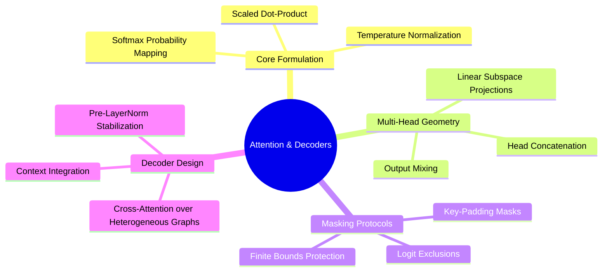

---
tags:
  - moc
  - 3dsyntree
module: "03. Attention Mechanisms and Transformer Decoders"
type: moc
---

# 0. Attention and Transformers MOC

> [!abstract] Module Overview
> Mathematical formulations of scaled dot-product attention, multi-head projections, causal and padding masks, and decoder blocks used for structural conditioning.

## Detailed Chapters

- **Chapter 1. Attention Formulations**
  - [[1. Scaled Dot-Product Attention as Soft Dictionary Lookup]]
  - [[2. Multi-Head Projections and Subspace Specialization]]
  - [[3. Mathematical Foundations of Attention Masking]]
- **Chapter 2. Modern Decoder Architectures**
  - [[1. Pre-LayerNorm vs Post-LayerNorm Dynamics]]
  - [[2. Cross-Attention over Heterogeneous Spatial Memory]]
  - [[3. Contextual Query Formation from Handle States]]
