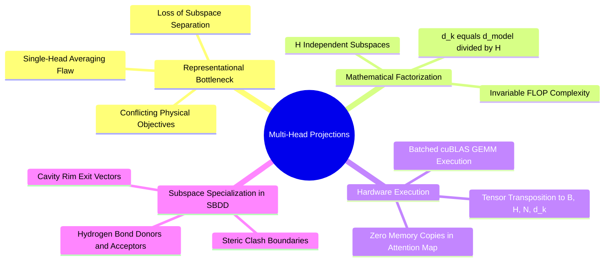

---
tags:
  - 3dsyntree
  - depth/essential
module: "03. Attention Mechanisms and Transformer Decoders"
chapter: "Chapter 1. Attention Formulations"
type: concept
---

# 2. Multi-Head Projections and Subspace Specialization

> [!abstract] Mathematical Core
> Multi-Head Attention divides the model's feature space into $H$ independent subspaces: $d_k = d / H$. This allows the model to attend to multiple different types of structural information simultaneously (such as steric boundaries, hydrogen bonds

```text
Multi-Head Attention Partitioning:
Latent Context Vector z_t [B, d=256]
                 |
                 +--> Head 1 Projection W_Q1, W_K1 [d_k=32] ---> Focus: Hydrophobic Steric Bounds
                 +--> Head 2 Projection W_Q2, W_K2 [d_k=32] ---> Focus: Charged Salt-Bridge Anchors
                 +--> Head 3 Projection W_Q3, W_K3 [d_k=32] ---> Focus: Directional H-Bond Donors
                 +--> Head 4 Projection W_Q4, W_K4 [d_k=32] ---> Focus: Backbone Carbonyl Trajectories
                 ...
                 +--> Head 8 Projection W_Q8, W_K8 [d_k=32] ---> Focus: Solvent Rim Exit Vectors
                 |
All 8 Heads Concatenated: [B, 8 * 32 = 256] ---> Out Projection W_O ---> Combined Context [B, 256]
```

## 1. What It Is

Instead of performing a single attention function with $d_{\text{model}}$-dimensional queries, keys, and values, **Multi-Head Attention (MHA)** projects the queries, keys, and values $H$ times with different, learned linear projections to $d_k$, $d_k$, and $d_v$ dimensions, respectively:

$$\text{MultiHead}(\mathbf{Q}, \mathbf{K}, \mathbf{V}) = \text{Concat}(\text{head}_1, \dots, \text{head}_H)\mathbf{W}^O$$

where each individual head is evaluated via scaled dot-product attention:

$$\text{head}_i = \text{Attention}(\mathbf{Q}\mathbf{W}_i^Q, \; \mathbf{K}\mathbf{W}_i^K, \; \mathbf{V}\mathbf{W}_i^V)$$

The projection parameter dimensions are strictly constrained:
- $\mathbf{W}_i^Q \in \mathbb{R}^{d_{\text{model}} \times d_k}$
- $\mathbf{W}_i^K \in \mathbb{R}^{d_{\text{model}} \times d_k}$
- $\mathbf{W}_i^V \in \mathbb{R}^{d_{\text{model}} \times d_v}$
- $\mathbf{W}^O \in \mathbb{R}^{H d_v \times d_{\text{model}}}$

In 3D-SynTree, we set $d_{\text{model}} = 256$, $H = 8$, and $d_k = d_v = d_{\text{model}} / H = 32$.

## 2. Why It Exists

A single attention head averages all information into one set of weights:

$$\alpha_j = \frac{\exp(\mathbf{q} \cdot \mathbf{k}_j / \sqrt{d})}{\sum_m \exp(\mathbf{q} \cdot \mathbf{k}_m)}$$

If an active reactive handle sits near both an aspartate carboxylate (demanding electrostatic engagement) and an aromatic phenylalanine wall (demanding parallel $\pi$-stacking alignment), a single-head attention mechanism must average these two distinct physical signals into one composite vector. This creates an **attentional bottleneck**: the query must compromise between looking for a salt-bridge partner or finding an open hydrophobic cavity.

By splitting $d_{\text{model}} = 256$ into 8 parallel 32-dimensional subspaces, each head is parameterized by independent linear transformation matrices ($\mathbf{W}_i^Q, \mathbf{W}_i^K$). This allows distinct heads to specialize in fundamentally different physical phenomena:
1. Head 1 tracks steric clash limits (high weights on close-range boundary atoms).
2. Head 2 tracks hydrogen-bonding partners (high weights on polar heteroatoms).
3. Head 3 tracks solvent accessibility (high weights on the outer pocket rim).

## 3. How It Works

### 3.1 Subspace Factorization and Parameter Efficiency

Notice that the total computational cost of multi-head attention is identical to single-head attention with full dimensionality.

For a single head of size $D$:
$$\text{Cost}(\mathbf{Q}\mathbf{K}^T) = N \cdot M \cdot D \text{ operations}$$

For $H$ heads of size $d_k = D / H$:
$$\text{Cost} = H \times (N \cdot M \cdot d_k) = H \cdot N \cdot M \cdot \left(\frac{D}{H}\right) = N \cdot M \cdot D \text{ operations}$$

By maintaining $d_k = d_{\text{model}} / H$, multi-head attention increases representational capacity without increasing floating-point operation (FLOP) count.

### 3.2 Tensor Layout During Execution

To execute multi-head attention efficiently on GPU hardware without running iterative loops over heads, tensors are reshaped and transposed into a single batched 4D tensor:

```python
# Input query: [Batch_Size, Query_Len, d_model] = [B, 1, 256]
# Project:
Q = self.q_proj(query) # [B, 1, 256]

# Reshape into multiple heads:
# [B, 1, H=8, d_k=32] -> transpose(1, 2) -> [B, H=8, 1, d_k=32]
Q = Q.view(B, -1, self.num_heads, self.head_dim).transpose(1, 2)
K = K.view(B, -1, self.num_heads, self.head_dim).transpose(1, 2)
V = V.view(B, -1, self.num_heads, self.head_dim).transpose(1, 2)

# Parallel Batched Matrix Multiplication across all B and H simultaneously:
# [B, 8, 1, 32] x [B, 8, 32, M] -> [B, 8, 1, M]
scores = torch.matmul(Q, K.transpose(-2, -1)) / math.sqrt(self.head_dim)
```

By transposing the head dimension to dimension 1, the GPU's batched matrix multiplication (`torch.bmm` / cuBLAS GEMM) treats $B \times H$ as an expanded batch dimension, executing all 8 attention heads in parallel within a single hardware kernel.

## 4. What It Consists Of

- **Head Count ($H = 8$)**: Number of parallel projection subspaces.
- **Head Dimension ($d_k = 32$)**: Size of the individual subspace allocated to each attention head.
- **Output Projection ($\mathbf{W}^O \in \mathbb{R}^{256 \times 256}$)**: Mixes the concatenated outputs from all 8 heads back into a unified latent vector.

## 5. What You Must Understand

> [!warning] Pitfall: $d_{\text{model}}$ Must Be Exactly Divisible by $H$
> If a configuration specifies $d_{\text{model}} = 250$ and $H = 8$, the integer division $d_k = 250 / 8 = 31.25$ fails. PyTorch will raise an explicit exception: `ValueError: embed_dim must be divisible by num_heads`. Always design hidden dimensions as powers of two or clean multiples of the chosen head count.

## 6. Prerequisites

- [[1. Scaled Dot-Product Attention as Soft Dictionary Lookup]]
- [[1. Memory Layouts Contiguity and Strides]]

## 7. Project Connection

In `syntree/models/policy.py`, multi-head cross-attention decodes the pocket context vector:
```python
self.cross_attention = nn.MultiheadAttention(
    embed_dim=hidden_dim, # 256
    num_heads=num_heads,  # 8
    dropout=dropout,      # 0.1
    batch_first=True
)
```
In `syntree/models/synthon_head.py`, custom multi-head attention scores the catalog embeddings:
```python
q = self.q_proj(query).view(b, self.num_heads, self.head_dim)
keys = self.k_proj(synthon_embeddings).view(k, self.num_heads, self.head_dim)
scores = torch.einsum("bhd,khd->bhk", q, keys) / math.sqrt(self.head_dim)
```

## 8. Required Depth

**Essential**: Multi-head subspace projections are used in both the spatial pocket decoder and the catalog synthon retrieval heads.

## 9. Further Dependencies

- [[1. Pre-LayerNorm vs Post-LayerNorm Dynamics]]
- [[2. Cross-Attention over Heterogeneous Spatial Memory]]

## Concept Mind Map


