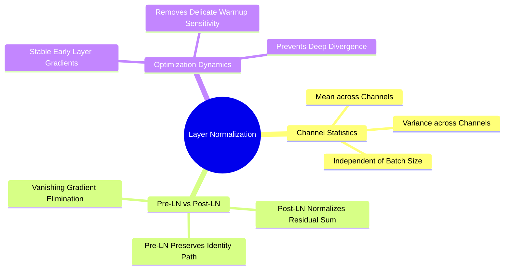

---
tags:
  - 3dsyntree
  - depth/essential
module: "03. Attention Mechanisms and Transformer Decoders"
chapter: "Chapter 2. Modern Decoder Architectures"
type: concept
---

# 1. Pre-LayerNorm vs Post-LayerNorm Dynamics

> [!abstract] Mathematical Core
> Layer Normalization standardizes activations across feature channels: $\text{LN}(\mathbf{x}) = \frac{\mathbf{x} - \mu}{\sqrt{\sigma^2 + \epsilon}} \odot \mathbf{\gamma} + \mathbf{\beta}$. Placing LayerNorm on the residual branch before sub-layer operations (**Pre-LN**) preserves an unimpeded gradient highway along the main identity path, preventing vanishing gradients in deep Transformer decoders.

## 1. What It Is

In deep neural networks with residual connections, Layer Normalization can be integrated in two distinct configurations:

1. **Post-LayerNorm (Original Transformer / Vaswani et al., 2017)**:
   Normalization is applied **after** the residual addition:
   $$\mathbf{x}_{l+1} = \text{LayerNorm}(\mathbf{x}_l + \text{SubLayer}(\mathbf{x}_l))$$

2. **Pre-LayerNorm (Modern Transformer standard / Xiong et al., 2020)**:
   Normalization is applied **before** the sub-layer on the residual branch, while the main path remains untouched:
   $$\mathbf{x}_{l+1} = \mathbf{x}_l + \text{SubLayer}(\text{LayerNorm}(\mathbf{x}_l))$$

```text
Post-LN Architecture:
x_l ---> [ SubLayer ] ---> (+) ---> [ LayerNorm ] ---> x_{l+1}
  |                         ^
  +-------------------------+

Pre-LN Architecture (Our Design):
x_l -------------------------------------------> (+) ---> x_{l+1} (Direct Identity Path!)
  |                                               ^
  +---> [ LayerNorm ] ---> [ SubLayer ] ----------+
```

## 2. Why It Exists

In deep Post-LN architectures, gradients passing through the normalization layer during backpropagation are scaled down by the running variance:

$$\frac{\partial \mathbf{x}_{l+1}}{\partial \mathbf{x}_l} \approx \frac{1}{\sqrt{\sigma_l^2 + \epsilon}}$$

As layer depth $L$ increases, this repeated normalization attenuates backpropagated gradients, causing vanishing gradients in early layers. To prevent divergence, Post-LN models require delicate learning-rate warmup schedules and precise initialization schemes.

Pre-LN solves this by providing a clean identity path:

$$\mathbf{x}_L = \mathbf{x}_0 + \sum_{l=0}^{L-1} \text{SubLayer}(\text{LayerNorm}(\mathbf{x}_l))$$

Evaluating the gradient of the final state $\mathbf{x}_L$ with respect to an early layer's activations $\mathbf{x}_l$:

$$\frac{\partial \mathbf{x}_L}{\partial \mathbf{x}_l} = \mathbf{I} + \sum_{j=l}^{L-1} \frac{\partial \text{SubLayer}(\text{LayerNorm}(\mathbf{x}_j))}{\partial \mathbf{x}_l}$$

The presence of the identity matrix $\mathbf{I}$ ensures that gradients flow back to early layers without decay, keeping training stable even without complex learning-rate schedules.

## 3. How It Works

### 3.1 Layer Normalization Formulation

Unlike Batch Normalization (which computes statistics across the batch dimension), Layer Normalization computes mean and variance **across the feature channels** for each individual sample:

$$\mu = \frac{1}{d} \sum_{i=1}^d x_i, \quad \sigma^2 = \frac{1}{d} \sum_{i=1}^d (x_i - \mu)^2$$

$$\hat{x}_i = \frac{x_i - \mu}{\sqrt{\sigma^2 + \epsilon}}$$

$$\text{LN}(\mathbf{x}) = \hat{\mathbf{x}} \odot \mathbf{\gamma} + \mathbf{\beta}$$

where $\mathbf{\gamma}, \mathbf{\beta} \in \mathbb{R}^d$ are learned affine parameters initialized to $\mathbf{\gamma} = \mathbf{1}$ and $\mathbf{\beta} = \mathbf{0}$.



### 3.2 Gradient Flow in Pre-LN vs Post-LN

1. **In Post-LN**:
   Every layer divides incoming signals by $\sqrt{\sigma^2 + \epsilon}$. In an 8-layer network, gradients flowing to layer 1 are scaled by $\prod_{l=1}^8 \frac{1}{\sigma_l}$. If activation variance grows even slightly across layers ($\sigma_l > 1$), early layers receive near-zero gradients.
2. **In Pre-LN**:
   The gradient consists of an unattenuated identity term plus the sub-layer contributions:
   $$\nabla_{\mathbf{x}_0} \mathcal{L} = \nabla_{\mathbf{x}_L} \mathcal{L} + \sum_{l=0}^{L-1} \nabla \text{SubLayer}_l$$
   Gradients propagate through the identity connection without decay, maintaining stable parameter updates throughout training.

## 4. What It Consists Of

- **Channel-Wise Standardizer**: Computes mean and variance across feature dimensions for each individual token.
- **Learnable Affine Scales ($\mathbf{\gamma}$)**: Multiplicative parameters initialized to 1.0.
- **Learnable Affine Biases ($\mathbf{\beta}$)**: Additive parameters initialized to 0.0.
- **Direct Residual Highway**: The un-normalized identity connection bypassing the sub-layer computation.

## 5. What You Must Understand

> [!warning] Pitfall: Final LayerNorm Required in Pre-LN
> Because Pre-LN sums un-normalized sub-layer outputs directly into the residual stream:
> $$\mathbf{x}_L = \mathbf{x}_0 + \sum \Delta \mathbf{x}_l$$
> the variance of the final activations $\mathbf{x}_L$ can grow with depth. To keep inputs to downstream classification heads well-conditioned, Pre-LN architectures must apply a **final LayerNorm** right before the output heads:
> $$\mathbf{z}_{\text{final}} = \text{LayerNorm}(\mathbf{x}_L)$$

## 6. Prerequisites

- [[1. Scaled Dot-Product Attention as Soft Dictionary Lookup]]
- [[2. Multi-Head Projections and Subspace Specialization]]

## 7. Project Connection

In `syntree/models/policy.py`, the handle query projection uses LayerNorm to stabilize activations before cross-attention:
```python
# Pre-normalization of query state before cross-attention
query_input = torch.cat([chemical_handle_features, global_features], dim=-1)
query = self.handle_norm(self.handle_proj(query_input))
```
In `syntree/models/bipartite.py`, the final pooled context vector is normalized using a trailing LayerNorm:
```python
scalar = self.layer_norm(self.dropout(scalar))
```

## 8. Required Depth

**Essential**: Pre-LN residual connections are required to prevent vanishing gradients in our deep Transformer decoders.

## 9. Further Dependencies

- [[2. Cross-Attention over Heterogeneous Spatial Memory]]
- [[3. Contextual Query Formation from Handle States]]

## Cross-Domain Links

- [[Chemistry/07. Geometric Deep Learning and Equivariance/Chapter 2. Equivariant Architectures for Structure Based Design/3. Cross Attention Decoders for SBDD|3. Cross Attention Decoders for SBDD]] (Chemistry vault) — why the decoder uses pre-LayerNorm for stable deep decoding.
