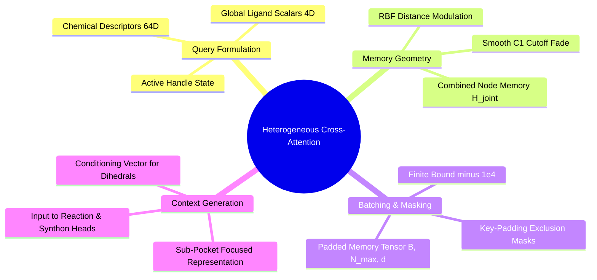

---
tags:
  - 3dsyntree
  - depth/essential
module: "03. Attention Mechanisms and Transformer Decoders"
chapter: "Chapter 2. Modern Decoder Architectures"
type: concept
---

# 2. Cross-Attention over Heterogeneous Spatial Memory

> [!abstract] Mathematical Core
> In structure-based drug design, the cross-attention decoder maps a fixed-size chemical query from the active attachment handle $\mathbf{q} \in \mathbb{R}^d$ across the variable-sized memory matrix of the joint protein-ligand graph $\mathbf{K}, \mathbf{V} \in \mathbb{R}^{N_{\text{total}} \times d}$, extracting a pocket-conditioned context vector.

## 1. What It Is

Let $\mathbf{q} \in \mathbb{R}^{1 \times d}$ represent the query vector encoding the active attachment handle.

Let $\mathbf{H}_{\text{joint}} \in \mathbb{R}^{N_{\text{total}} \times d}$ denote the node representations output by the `BipartitePaiNN` backbone over the combined protein-ligand graph:

$$\mathbf{H}_{\text{joint}} = \begin{bmatrix} \mathbf{s}_1^P \\ \vdots \\ \mathbf{s}_{N_P}^P \\ \mathbf{s}_1^L \\ \vdots \\ \mathbf{s}_{N_L}^L \end{bmatrix} \in \mathbb{R}^{N_{\text{total}} \times d}, \quad N_{\text{total}} = N_P + N_L$$

**Cross-attention over heterogeneous spatial memory** computes:

$$\mathbf{K} = \mathbf{H}_{\text{joint}} \mathbf{W}_K, \quad \mathbf{V} = \mathbf{H}_{\text{joint}} \mathbf{W}_V, \quad \mathbf{Q} = \mathbf{q} \mathbf{W}_Q$$

$$\mathbf{z}_{\text{context}} = \text{Attention}(\mathbf{Q}, \mathbf{K}, \mathbf{V}) = \text{Softmax}\left( \frac{\mathbf{Q} \mathbf{K}^T}{\sqrt{d_k}} + \mathbf{M}_{\text{pad}} \right) \mathbf{V} \in \mathbb{R}^{1 \times d}$$

The output $\mathbf{z}_{\text{context}}$ is a fixed-size vector that summarizes the entire spatial environment from the perspective of the attachment handle.

## 2. Why It Exists

Different chemical attachment handles need to attend to different regions of the pocket:
- An amine handle needs to identify nearby hydrogen-bond acceptors and negative charges to position an incoming carbonyl group.
- An aryl halide handle needs to evaluate open, hydrophobic subpockets to accommodate an aromatic ring.

Simple global pooling (such as mean pooling over all atoms) averages the entire pocket into a single vector, losing track of local spatial geometry.

Cross-attention allows the active handle to query spatial memory dynamically, focusing attention on the local subpocket surrounding the reaction site.

## 3. How It Works

### 3.1 Spatial Distance Encoding in Memory Keys

To ensure that attention weights reflect continuous physical distances from the handle, we enrich the memory keys with **radial basis function (RBF) distance encodings**.

For each atom $j \in \{1, \dots, N_{\text{total}}\}$ in the joint graph, we evaluate its physical distance to the handle's 3D coordinates:

$$d_j = \|\mathbf{x}_j - \mathbf{x}_{\text{handle}}\|_2$$

This scalar distance is expanded across $K = 16$ Gaussian basis functions modulated by a cosine cutoff envelope:

$$\mathbf{rbf}_j = \text{RBF}(d_j) \odot f_{\text{cut}}(d_j) \in \mathbb{R}^{16}$$

This spatial feature is projected and added directly to the atom's memory representation before computing keys:

$$\mathbf{h}_j^{\text{spatial}} = \mathbf{s}_j + \text{MLP}_{\text{dist}}(\mathbf{rbf}_j) \in \mathbb{R}^d$$

$$\mathbf{K}_j = \mathbf{h}_j^{\text{spatial}} \mathbf{W}_K$$

```text
Spatial Memory Key Formation:
Atom j Feature s_j [d] ---------------------------------------------> (+) ---> Spatial Memory h_j [d] ---> Key K_j
                                                                        ^
Atom Distance d_j ---> [ Gaussian RBF (16) ] ---> [ Linear Proj (d) ] --+
```

This ensures that attention weights decrease naturally for atoms far from the attachment site, focusing model capacity on the immediate chemical environment.

### 3.2 Handling Variable Graph Sizes with Key-Padding Masks

In batched training, different complexes contain different numbers of atoms ($N_b \in [100, 750]$). 

To process complexes in parallel, all graphs in the mini-batch are padded to the maximum atom count:

$$N_{\max} = \max_{b=1}^B N_b$$

$$\mathbf{H}_{\text{padded}} \in \mathbb{R}^{B \times N_{\max} \times d}$$

To prevent the attention mechanism from attending to dummy padding positions, we apply a **key-padding mask**:

$$
\mathbf{M}_{\text{pad}}[b, j] = \begin{cases}
0.0 & \text{if position $j$ corresponds to a real atom in complex $b$} \\ 
-10^4 & \text{if position $j$ is a dummy padding position} 
\end{cases}
$$

Positions with a $-10^4$ penalty evaluate to zero after softmax:

$$\exp\left( \frac{\mathbf{q} \mathbf{k}_j^T}{\sqrt{d}} - 10^4 \right) \approx 0.0$$

This guarantees that padding dummy atoms do not influence the computed context vector or its gradients.

## 4. What It Consists Of

- **Active Handle Query ($\mathbf{Q}$)**: A $[B, 1, d]$ tensor encoding the functional group chosen for attachment.
- **Spatial Memory Tensor ($\mathbf{H}_{\text{padded}}$)**: A $[B, N_{\max}, d]$ tensor containing representations of all protein and ligand atoms.
- **Key-Padding Mask ($\mathbf{M}_{\text{pad}}$)**: A $[B, N_{\max}]$ boolean or floating-point mask excluding padding positions.
- **Output Context Vector ($\mathbf{z}_{\text{context}}$)**: A $[B, d]$ tensor summarizing pocket geometry for downstream policy heads.

## 5. What You Must Understand

> [!warning] Pitfall: Failing to Apply the Padding Mask
> Omitting the key-padding mask allows the softmax function to allocate attention weight to uninitialized padding rows. The context vector will then incorporate noise from dummy atoms, degrading model performance on smaller complexes that require more padding.

## 6. Prerequisites

- [[1. Scaled Dot-Product Attention as Soft Dictionary Lookup]]
- [[3. Mathematical Foundations of Attention Masking]]
- [[2. Bipartite Protein-Ligand Graph Construction]]

## 7. Project Connection

In `syntree/models/policy.py`, this spatial cross-attention mechanism is implemented in `SynTreePolicy.forward()`:
```python
# 1. Compute handle-to-atom distances and radial features
handle_dist = torch.linalg.vector_norm(all_pos - per_atom_handle, dim=-1).clamp(min=0.0, max=self.cutoff)
radial = self.spatial_distance_proj(self.rbf(handle_dist))
joint_s = joint_s + radial

# 2. Pack nodes into a padded [B, max_atoms, d] tensor
padded[union_batch, local_idx] = joint_s
key_padding_mask = (valid == 0.0) # True for padding positions

# 3. Query spatial memory via cross-attention
context, _ = self.cross_attention(query, padded, padded, key_padding_mask=key_padding_mask)
context = context.squeeze(1) # [B, d]
```

## 8. Required Depth

**Essential**: This cross-attention layer is the primary interface connecting our 3D equivariant backbone to downstream decision heads.

## 9. Further Dependencies

- [[3. Contextual Query Formation from Handle States]]
- [[1. Autoregressive Molecule Assembly Formulations]]

## Concept Mind Map



## Cross-Domain Links

- [[Chemistry/07. Geometric Deep Learning and Equivariance/Chapter 2. Equivariant Architectures for Structure Based Design/3. Cross Attention Decoders for SBDD|3. Cross Attention Decoders for SBDD]] (Chemistry vault) — the decoder design and its cross-attention implementation over spatial memory.
