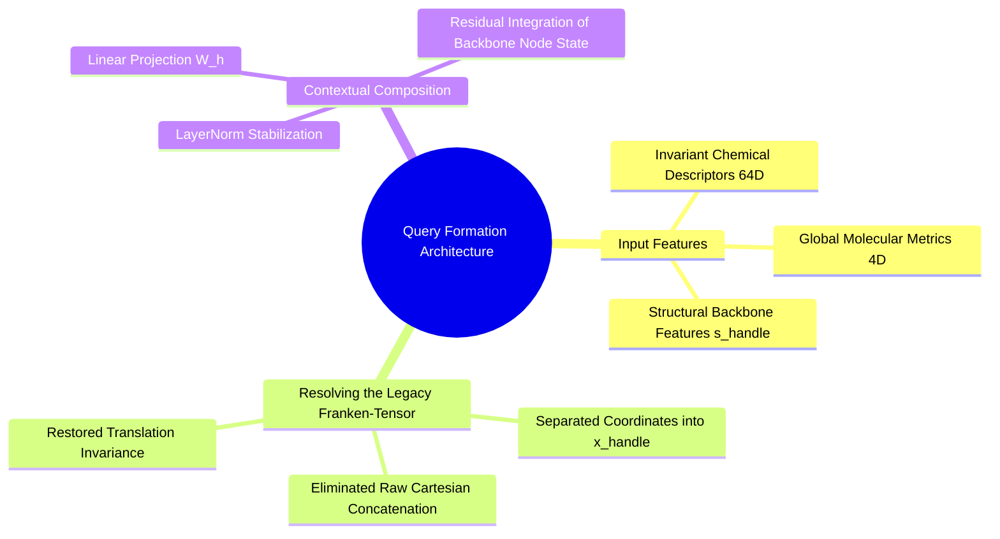

---
tags:
  - 3dsyntree
  - depth/essential
module: "03. Attention Mechanisms and Transformer Decoders"
chapter: "Chapter 2. Modern Decoder Architectures"
type: concept
---

# 3. Contextual Query Formation from Handle States

> [!abstract] Mathematical Core
> The attention query vector must encode both the local chemical state of the active handle and the global status of the growing molecule. By combining 64-dimensional invariant chemical descriptors, 4-dimensional global ligand state metrics, and local structural features from the backbone, we form a unified query vector $\mathbf{q} \in \mathbb{R}^d$.

## 1. What It Is

**Contextual Query Formation** is the mapping that converts an active attachment handle into the query vector $\mathbf{q} \in \mathbb{R}^d$ used to attend over spatial memory:

$$\mathbf{q} = \text{LayerNorm}\left( \mathbf{W}_h [\mathbf{h}_{\text{chem}} \,\|\, \mathbf{h}_{\text{global}}] \right) + \mathbf{W}_{\text{node}} \mathbf{s}_{\text{handle}}$$

where:
- $\mathbf{h}_{\text{chem}} \in \mathbb{R}^{64}$ represents the invariant chemical descriptors of the handle atom.
- $\mathbf{h}_{\text{global}} \in \mathbb{R}^4$ contains global properties of the growing ligand:
  $$\mathbf{h}_{\text{global}} = \begin{bmatrix} \frac{\text{MW}}{500.0}, & \frac{N_{\text{heavy}}}{50.0}, & \frac{V_{\text{lig}}}{V_{\text{poc}}}, & \mathbb{I}(\text{HasLigand}) \end{bmatrix}$$
- $\mathbf{s}_{\text{handle}} \in \mathbb{R}^d$ is the node feature vector extracted for the handle atom by the `BipartitePaiNN` backbone.
- $\mathbf{W}_h \in \mathbb{R}^{d \times 68}$ and $\mathbf{W}_{\text{node}} \in \mathbb{R}^{d \times d}$ are linear projection matrices.

## 2. Why It Exists

To select the next chemical building block effectively, the query vector must capture two distinct scales of information:

1. **Local Chemical Compatibility**:
   The query must encode the handle's functional group type (e.g., primary amine vs. carboxylic acid) so the attention layer can identify chemically compatible reactions.
2. **Global Molecular Context**:
   The query must also track how much of the molecule has already been built. A primary amine on a small fragment (MW 120 Da) should continue growing, whereas the same primary amine on a mature molecule (MW 480 Da) that fills the cavity should trigger a terminal cap or `STOP` action.

Combining local chemical features with global molecular metrics provides the context needed to balance local reactivity against overall molecular growth.

## 3. How It Works

### 3.1 Resolving the 67-Dimensional "Franken-Tensor"

In earlier iterations of the codebase, data loaders concatenated 64 invariant chemical features with the handle's raw 3D Cartesian coordinates $[x, y, z]$:

$$\mathbf{h}_{\text{legacy}} = [\mathbf{h}_{\text{chem}} \,\|\, x, y, z] \in \mathbb{R}^{67}$$

This created a severe architectural flaw:
- Applying a standard linear layer to raw Cartesian coordinates treats spatial positions as arbitrary feature values:
  $$\mathbf{z} = \mathbf{W} \mathbf{h}_{\text{legacy}}$$
- If the molecular complex is translated by $\mathbf{t} \in \mathbb{R}^3$, the coordinate values change ($x' = x + t_x$), altering the output $\mathbf{z}$.
- This broke translation invariance, causing the model to output different query vectors depending on where the complex was placed in space.

We resolved this by strictly separating chemical features from spatial coordinates:
1. Invariant chemical descriptors are stored in a dedicated 64-dimensional tensor:
   $$\mathbf{h}_{\text{chem}} \in \mathbb{R}^{64}$$
2. Cartesian coordinates are stored in a separate spatial position tensor:
   $$\mathbf{x}_{\text{handle}} \in \mathbb{R}^3$$
3. Spatial coordinates are used exclusively to evaluate translation-invariant distances ($d_j = \|\mathbf{x}_j - \mathbf{x}_{\text{handle}}\|_2$), preserving rotational and translational symmetries.



### 3.2 The Direct Termination Projection

In addition to forming the attention query, the 4-dimensional global feature vector directly modulates the terminal `STOP` logit:

$$\text{bias}_{\text{stop}} = \text{MLP}_{\text{stop}}(\mathbf{h}_{\text{global}}) \in \mathbb{R}^1$$

Evaluating its role in synthon selection:

$$\mathbf{z}_{\text{synthon}} = [\mathbf{z}_{\text{catalog}}, \; z_{\text{stop}} + \text{bias}_{\text{stop}}]$$

This gives the network a direct, unconstrained pathway to trigger the `STOP` action once the molecule reaches drug-like size ($\text{MW} \ge 250\text{ Da}$ and $\frac{V_{\text{lig}}}{V_{\text{poc}}} \ge 0.40$), without requiring the cross-attention layer to compute molecular volume from raw atomic memory.

## 4. What It Consists Of

- **Handle Chemical Descriptors ($\mathbb{R}^{64}$)**: A vector encoding element type, valence, degree, and functional handle class.
- **Global Ligand Metrics ($\mathbb{R}^4$)**: Normalized molecular weight, heavy atom count, cavity volume ratio, and presence flag.
- **Handle Node State ($\mathbf{s}_{\text{handle}} \in \mathbb{R}^d$)**: The localized representation computed for the handle atom by the `BipartitePaiNN` encoder.
- **Stop Bias MLP**: A small neural network mapping global size metrics directly to a termination logit bias.

## 5. What You Must Understand

> [!warning] Pitfall: Initializing Node Projections
> When adding the handle node state to the query vector:
> $$\mathbf{q} = \mathbf{q}_{\text{base}} + \mathbf{W}_{\text{node}} \mathbf{s}_{\text{handle}}$$
> the weight matrix $\mathbf{W}_{\text{node}}$ should be **initialized to zero** (`nn.init.zeros_`). This ensures that at the start of training, the query vector is driven by the stable base chemical descriptors, preventing uncalibrated backbone representations from disrupting early attention training.

## 6. Prerequisites

- [[3. Node-Type Feature Multiplexing and Edge Partitioning]]
- [[2. Cross-Attention over Heterogeneous Spatial Memory]]

## 7. Project Connection

In `syntree/models/policy.py`, query formation is implemented inside `SynTreePolicy.forward()`:
```python
# 1. Combine invariant chemical descriptors and global molecular metrics
query_input = torch.cat([chemical_handle_features, global_features], dim=-1) # [B, 68]
query = self.handle_norm(self.handle_proj(query_input)) # [B, 256]

# 2. Add the localized handle representation from the backbone
if handle_union_index is not None and has_ligand:
    handle_node_scalar = joint_s[handle_union_index + num_pocket]
    query = query + self.handle_node_proj(handle_node_scalar)

# 3. Shape for cross-attention
query = query.unsqueeze(1) # [B, 1, 256]
```

## 8. Required Depth

**Essential**: Contextual query formation directly governs how the policy queries spatial memory to guide molecular generation.

## 9. Further Dependencies

- [[1. Scaled Dot-Product Attention as Soft Dictionary Lookup]]
- [[1. Autoregressive Molecule Assembly Formulations]]

## Cross-Domain Links

- [[Chemistry/04. Structural Biology and Protein Targets/Chapter 2. Binding Sites and Data Integrity/2. Pharmacophores and Interaction Hotspots|2. Pharmacophores and Interaction Hotspots]] (Chemistry vault) — handle-centered queries attend to exactly the key interactions encoded by pharmacophore hotspots.
