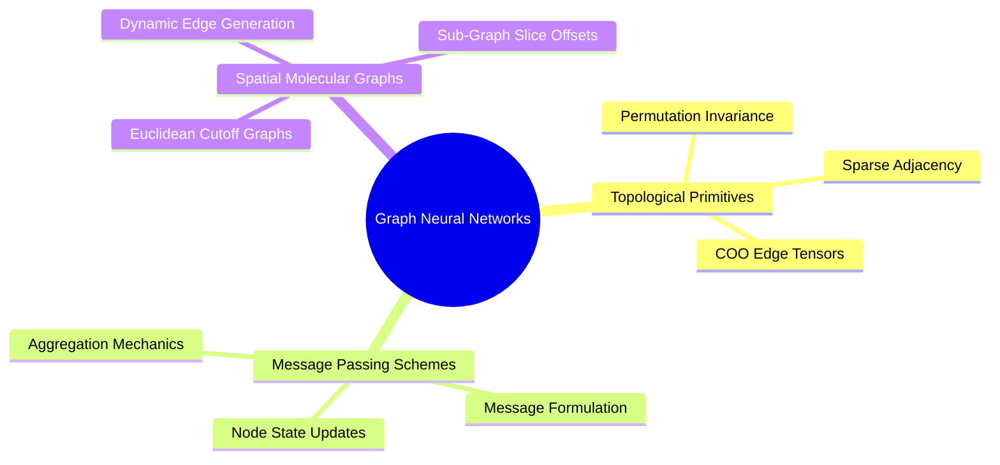

---
tags:
  - moc
  - 3dsyntree
module: "04. Graph Neural Networks and Message Passing"
type: moc
---

# 0. Graph Neural Networks MOC

> [!abstract] Module Overview
> Mathematical foundations of Graph Neural Networks (GNNs), message passing schemes, permutation symmetries, and computational graph complexity on spatial molecular structures.

## Detailed Chapters

- **Chapter 1. Spatial Graph Representations**
  - [[1. Graph Topology Adjacency and Sparse Representation]]
  - [[2. Node and Edge Feature Multiplexing]]
  - [[3. Permutation Invariance and Permutation Equivariance]]
- **Chapter 2. Message Passing Paradigms**
  - [[1. The Message-Passing Neural Network Formalism]]
  - [[2. Aggregation Functions and Information Bottlenecks]]
  - [[3. Computational Complexity of Spatial Radius Graphs]]
