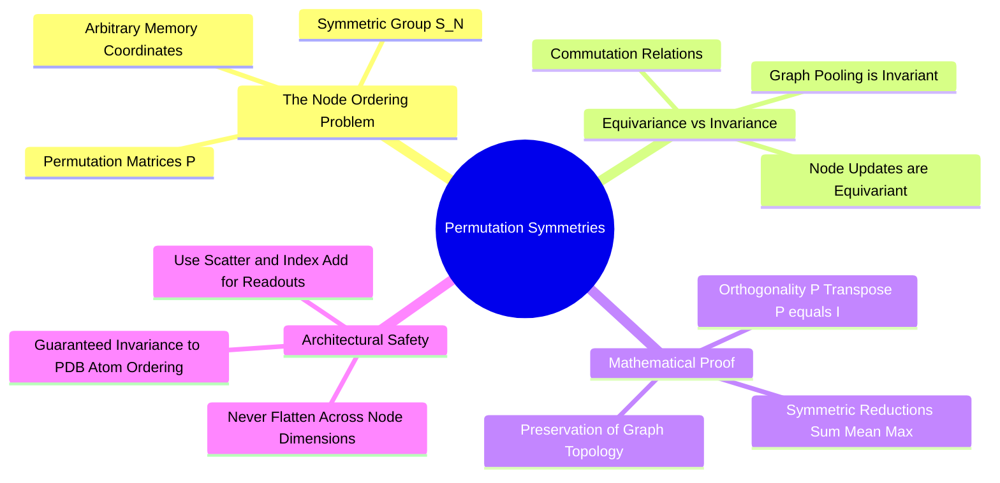

---
tags:
  - 3dsyntree
  - depth/essential
module: "04. Graph Neural Networks and Message Passing"
chapter: "Chapter 1. Spatial Graph Representations"
type: concept
---

# 3. Permutation Invariance and Permutation Equivariance

> [!abstract] Mathematical Core
> Graph operations must respect the arbitrary ordering of nodes in memory. A function is **permutation invariant** if reordering nodes does not change its output: $f(\mathbf{P}\mathbf{X}) = f(\mathbf{X})$. A function is **permutation equivariant** if reordering input nodes reorders the output states identically: $f(\mathbf{P}\mathbf{X}) = \mathbf{P} f(\mathbf{X})$.

## 1. What It Is

Let $\mathbf{X} \in \mathbb{R}^{N \times d}$ represent the node feature matrix of a graph with $N$ vertices, and let $\mathbf{A} \in \{0, 1\}^{N \times N}$ be its adjacency matrix.

A permutation of $N$ elements is defined by a **permutation matrix** $\mathbf{P} \in \{0, 1\}^{N \times N}$, which contains exactly one entry of 1 in each row and column:

$$\mathbf{P}^T \mathbf{P} = \mathbf{I}_N$$

Re-indexing the nodes of the graph transforms the data as:

$$\mathbf{X}' = \mathbf{P} \mathbf{X}, \quad \mathbf{A}' = \mathbf{P} \mathbf{A} \mathbf{P}^T$$

```text
Permutation Action on a 3-Node Graph:
Original Node
```

$$\mathbf{X}' = \mathbf{P} \mathbf{X}, \quad \mathbf{A}' = \mathbf{P} \mathbf{A} \mathbf{P}^T$$

An operation $f$ is:
- **Permutation Invariant** if:
  $$f(\mathbf{P} \mathbf{X}, \mathbf{P} \mathbf{A} \mathbf{P}^T) = f(\mathbf{X}, \mathbf{A})$$
- **Permutation Equivariant** if:
  $$f(\mathbf{P} \mathbf{X}, \mathbf{P} \mathbf{A} \mathbf{P}^T) = \mathbf{P} f(\mathbf{X}, \mathbf{A})$$

## 2. Why It Exists

In computational chemistry, an SDF or PDB file stores atoms as an indexed list: atom 0, atom 1, atom 2, and so on. This order is arbitrary. A chemist can write ethanol starting from the methyl carbon or from the hydroxyl oxygen. 

If a neural network is not permutation invariant/equivariant:
- Shuffling the rows of an SDF file would cause the model to predict a completely different binding affinity or select a different reaction handle.
- The model would be forced to memorize all $N!$ possible atom orderings through data augmentation, which is computationally impossible for realistic molecules ($50! \approx 3 \times 10^{64}$).

By designing message passing and pooling operations to be permutation equivariant and invariant by construction, the network treats isomorphic graphs identically regardless of file order.

## 3. How It Works

### 3.1 Proving Permutation Equivariance of Local Message Passing

Let $\mathbf{H} \in \mathbb{R}^{N \times d}$ denote node features, and let $\mathbf{A} \in \{0, 1\}^{N \times N}$ be the adjacency matrix. Consider a basic message-passing layer with linear transformation $\mathbf{W}$ and sum aggregation:

$$\mathbf{H}^{(t+1)} = \mathbf{A} \mathbf{H}^{(t)} \mathbf{W}$$

Now, apply a permutation matrix $\mathbf{P}$ to the input:

$$\mathbf{H}_{\text{perm}}^{(t)} = \mathbf{P} \mathbf{H}^{(t)}, \quad \mathbf{A}_{\text{perm}} = \mathbf{P} \mathbf{A} \mathbf{P}^T$$

Evaluate the forward pass on the permuted inputs:

$$\mathbf{H}_{\text{perm}}^{(t+1)} = \mathbf{A}_{\text{perm}} \mathbf{H}_{\text{perm}}^{(t)} \mathbf{W} = (\mathbf{P} \mathbf{A} \mathbf{P}^T) (\mathbf{P} \mathbf{H}^{(t)}) \mathbf{W}$$

Because $\mathbf{P}$ is orthogonal ($\mathbf{P}^T \mathbf{P} = \mathbf{I}$):

$$\mathbf{H}_{\text{perm}}^{(t+1)} = \mathbf{P} \mathbf{A} (\mathbf{P}^T \mathbf{P}) \mathbf{H}^{(t)} \mathbf{W} = \mathbf{P} \mathbf{A} \mathbf{I} \mathbf{H}^{(t)} \mathbf{W} = \mathbf{P} \left( \mathbf{A} \mathbf{H}^{(t)} \mathbf{W} \right) = \mathbf{P} \mathbf{H}^{(t+1)}$$

The output features are permuted by the exact same matrix $\mathbf{P}$. This proves that matrix multiplication with adjacency commutes with node reordering, establishing **permutation equivariance**.

### 3.2 Graph-Level Pooling and Invariance

To produce a single vector for an entire molecular graph (such as a global pocket context vector), node representations are aggregated across the node dimension using a symmetric reduction operator (sum, mean, or log-sum-exp):

$$\mathbf{h}_{\mathcal{G}} = \text{Pool}(\mathbf{H}) = \sum_{i=1}^N \mathbf{h}_i = \mathbf{1}^T \mathbf{H}$$

Evaluating this pooling on permuted node states:

$$\mathbf{h}_{\mathcal{G}, \text{perm}} = \mathbf{1}^T (\mathbf{P} \mathbf{H})$$

Because every column of a permutation matrix contains exactly one entry of 1:

$$\mathbf{1}^T \mathbf{P} = \mathbf{1}^T \implies \mathbf{h}_{\mathcal{G}, \text{perm}} = \mathbf{1}^T \mathbf{H} = \mathbf{h}_{\mathcal{G}}$$

The pooled graph representation is completely identical, establishing **permutation invariance**.

## 4. What It Consists Of

- **Permutation Matrix ($\mathbf{P}$)**: A binary orthogonal matrix representing an element of the symmetric group $S_N$.
- **Equivariant Node Updating**: Layer transformations that commute with row-shuffling operators.
- **Symmetric Graph Readout**: Reduction functions that satisfy $f(x_{\pi(1)}, \dots, x_{\pi(N)}) = f(x_1, \dots, x_N)$ for any permutation $\pi$.

## 5. What You Must Understand

> [!warning] Pitfall: Flattening Node Arrays Destroys Permutation Equivariance
> Flattening a node feature matrix into a single vector (`x.view(-1)`) and passing it through a standard Linear layer immediately destroys permutation equivariance. The weights of the linear layer become tied to specific atom indices, making the network sensitive to arbitrary file ordering. Graph readouts must always use symmetric pooling operators.

## 6. Prerequisites

- [[1. Graph Topology Adjacency and Sparse Representation]]
- Linear algebra (orthogonal matrices, trace properties).

## 7. Project Connection

In `syntree/models/bipartite.py`, global context vectors are generated using a permutation-invariant segmented sum:
```python
pooled = torch.zeros(num_graphs, self.hidden_dim, device=scalar.device, dtype=scalar.dtype)
pooled.index_add_(0, all_batch, scalar)
counts = torch.zeros(num_graphs, device=scalar.device, dtype=scalar.dtype)
counts.index_add_(0, all_batch, torch.ones_like(all_batch, dtype=scalar.dtype))
pooled = pooled / counts.clamp(min=1).unsqueeze(-1)
```
This guarantees that the pooled pocket context vector remains identical regardless of how atoms are ordered in the input PDB file.

## 8. Required Depth

**Essential**: Permutation symmetry is a fundamental mathematical property of all graph neural networks.

## 9. Further Dependencies

- [[1. The Message-Passing Neural Network Formalism]]
- [[2. Aggregation Functions and Information Bottlenecks]]

## Concept Mind Map


