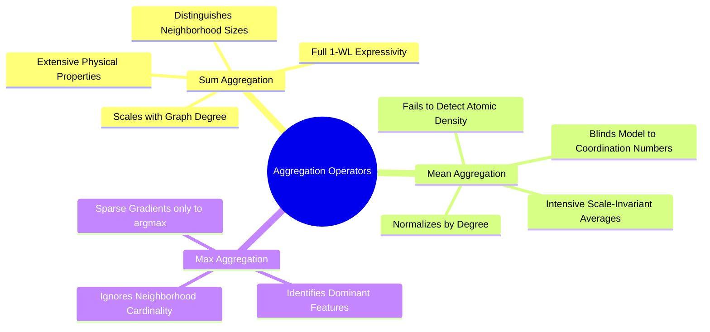
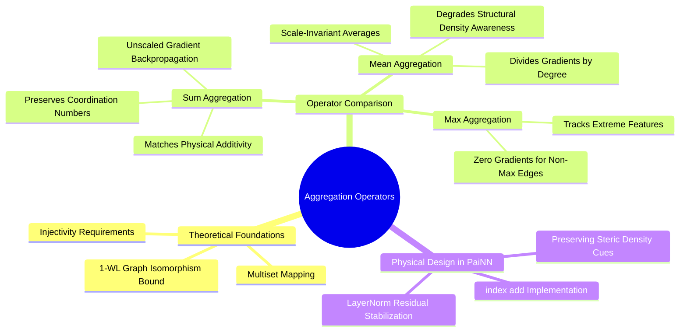

---
tags:
  - 3dsyntree
  - depth/essential
module: "04. Graph Neural Networks and Message Passing"
chapter: "Chapter 2. Message Passing Paradigms"
type: concept
---

# 2. Aggregation Functions and Information Bottlenecks

> [!abstract] Mathematical Core
> The aggregation operator $\bigoplus$ maps a variable-sized multiset of neighbor messages to a fixed-size vector. The choice of operator—Sum, Mean, or Max—determines the mathematical properties of the network, controlling its sensitivity to structural density and its susceptibility to gradient vanishing.

## 1. What It Is

In a Message-Passing Neural Network, node $i$ collects messages from its neighborhood $\mathcal{N}(i)$:

$$\mathbf{m}_i = \bigoplus_{j \in \mathcal{N}(i)} \mathbf{m}_{ij}$$

The operator $\bigoplus$ takes a **multiset** (an unordered collection that allows duplicate elements) of arbitrary cardinality and outputs a single vector in $\mathbb{R}^d$.

The three standard aggregation operators are:
1. **Sum**: $\mathbf{m}_i^{\text{sum}} = \sum_{j \in \mathcal{N}(i)} \mathbf{m}_{ij}$
2. **Mean**: $\mathbf{m}_i^{\text{mean}} = \frac{1}{|\mathcal{N}(i)|} \sum_{j \in \mathcal{N}(i)} \mathbf{m}_{ij}$
3. **Max**: $\mathbf{m}_i^{\text{max}} = \max_{j \in \mathcal{N}(i)} \mathbf{m}_{ij}$ (evaluated element-wise)

## 2. Why It Exists

Different chemical and physical tasks depend on different structural cues:
- In energy calculations, potential energies are extensive quantities that scale with the total number of interactions, which requires **Sum** aggregation.
- In image classification or normalized feature extraction, scale-invariant averages are often preferred, leading to **Mean** aggregation.

Choosing the wrong aggregation operator creates an **information bottleneck** that limits what the network can learn:
- Mean aggregation cannot distinguish between a dense binding pocket and an open surface loop if the average neighbor features match.
- Max aggregation tracks only the single most extreme neighbor, discarding information from all other contacts.

## 3. How It Works

### 3.1 The Multisets That Separate Aggregators

As proven by Xu et al. (2019) in the Graph Isomorphism Network (GIN), the choice of aggregation operator directly determines which structural configurations a network can differentiate:



Consider two distinct local atomic configurations:
- Neighborhood 1: Two identical carbon atoms, $\mathcal{X}_1 = \{\mathbf{c}, \mathbf{c}\}$.
- Neighborhood 2: Three identical carbon atoms, $\mathcal{X}_2 = \{\mathbf{c}, \mathbf{c}, \mathbf{c}\}$.

Evaluating each aggregation operator:
- **Mean Aggregation**:
  $$\text{Mean}(\mathcal{X}_1) = \frac{\mathbf{c} + \mathbf{c}}{2} = \mathbf{c}, \quad \text{Mean}(\mathcal{X}_2) = \frac{\mathbf{c} + \mathbf{c} + \mathbf{c}}{3} = \mathbf{c}$$
  $$\text{Mean}(\mathcal{X}_1) = \text{Mean}(\mathcal{X}_2)$$
  Mean aggregation **fails** to distinguish between an atom bonded to two carbons versus one bonded to three carbons.
- **Max Aggregation**:
  $$\text{Max}(\mathcal{X}_1) = \mathbf{c}, \quad \text{Max}(\mathcal{X}_2) = \mathbf{c} \implies \text{Max}(\mathcal{X}_1) = \text{Max}(\mathcal{X}_2)$$
  Max aggregation also **fails** to detect the difference in coordination number.
- **Sum Aggregation**:
  $$\text{Sum}(\mathcal{X}_1) = 2\mathbf{c}, \quad \text{Sum}(\mathcal{X}_2) = 3\mathbf{c} \implies \text{Sum}(\mathcal{X}_1) \neq \text{Sum}(\mathcal{X}_2)$$
  Sum aggregation cleanly separates the two configurations.

Sum aggregation is the only standard linear operator that can distinguish different multisets, matching the full discriminative power of the 1-WL graph isomorphism test.

### 3.2 Gradient Flow Dynamics During Aggregation

Evaluating how gradients flow back through the aggregation step:
$$\frac{\partial \mathcal{L}}{\partial \mathbf{m}_{ij}} = \frac{\partial \mathcal{L}}{\partial \mathbf{m}_i} \frac{\partial \mathbf{m}_i}{\partial \mathbf{m}_{ij}}$$

1. **For Sum Aggregation**:
   $$\frac{\partial \mathbf{m}_i^{\text{sum}}}{\partial \mathbf{m}_{ij}} = \mathbf{I} \implies \nabla_{\mathbf{m}_{ij}} \mathcal{L} = \nabla_{\mathbf{m}_i} \mathcal{L}$$
   Gradients flow back with equal strength across all incoming edges. However, for nodes with high degrees ($|\mathcal{N}(i)| > 50$), accumulated gradients can grow large, requiring gradient norm clipping.
2. **For Mean Aggregation**:
   $$\frac{\partial \mathbf{m}_i^{\text{mean}}}{\partial \mathbf{m}_{ij}} = \frac{1}{|\mathcal{N}(i)|} \mathbf{I} \implies \nabla_{\mathbf{m}_{ij}} \mathcal{L} = \frac{1}{|\mathcal{N}(i)|} \nabla_{\mathbf{m}_i} \mathcal{L}$$
   Gradients are scaled down by node degree, which can cause vanishing gradients in dense graphs.
3. **For Max Aggregation**:
   $$\frac{\partial \mathbf{m}_i^{\text{max}}[k]}{\partial \mathbf{m}_{ij}[k]} = \begin{cases} 1 & \text{if } j = \arg\max_{m} \mathbf{m}_{im}[k] \\ 0 & \text{otherwise} \end{cases}$$
   Only the single winning neighbor receives a gradient update for feature $k$; all other edges receive zero gradient.

## 4. What It Consists Of

- **Multiset**: An unordered mathematical collection that allows repeated elements.
- **Injective Mapping**: A function that maps distinct inputs to distinct outputs without collisions.
- **1-WL Bound**: The upper bound on expressivity for standard message-passing networks.

## 5. What You Must Understand

> [!warning] Pitfall: Degree Unbalance in Sum Aggregation
> In spatial radius graphs with large cutoff radii ($r_{\text{cut}} = 6.5\text{ \AA}$), an atom in the core of a protein may have 60 neighbors, while a surface atom has only 5. Sum aggregation causes the magnitude of $\mathbf{m}_i$ to be 12 times larger for core atoms. Without LayerNorm or residual connections, this imbalance can lead to activation explosion in deep networks.

## 6. Prerequisites

- [[1. The Message-Passing Neural Network Formalism]]
- [[3. Permutation Invariance and Permutation Equivariance]]

## 7. Project Connection

In `syntree/models/equivariant.py`, `PaiNNInteraction` uses **Sum aggregation** via `index_add_` for both scalar and vector messages:
```python
agg_s.index_add_(0, row, msg_s)
agg_v.index_add_(0, row, msg_v)
```
This ensures the model remains sensitive to local atomic coordination numbers and steric density in binding pockets.

## 8. Required Depth

**Essential**: Choosing the correct aggregation operator is required to preserve structural sensitivity in message-passing networks.

## 9. Further Dependencies

- [[1. PaiNN Interaction Block and Directional Message Passing]]
- [[2. Bipartite Protein-Ligand Graph Construction]]

## Concept Mind Map


