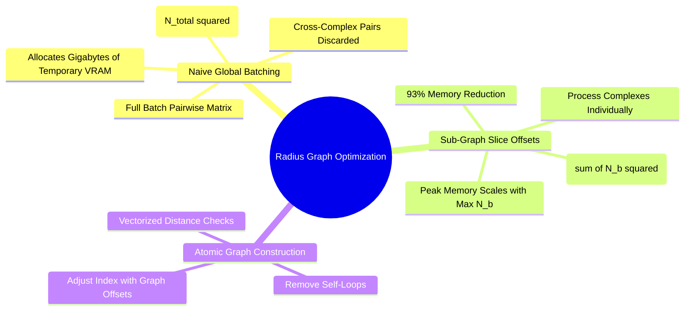

---
tags:
  - 3dsyntree
  - depth/essential
module: "04. Graph Neural Networks and Message Passing"
chapter: "Chapter 2. Message Passing Paradigms"
type: concept
---

# 3. Computational Complexity of Spatial Radius Graphs

> [!abstract] Mathematical Core
> Constructing edge connections using a spatial cutoff radius $r_{\text{cut}}$ requires evaluating distance matrices over 3D coordinates. Naive implementations scale quadratically as $O(N_{\text{total}}^2)$ across a batch. By processing graphs independently using sub-graph slice offsets, memory complexity drops to $O(\sum_b N_b^2)$, preventing GPU out-of-memory errors.

## 1. What It Is

Given a set of 3D atomic coordinates $\mathbf{X} \in \mathbb{R}^{N \times 3}$, a **radius graph** constructs directed edges between all pairs of atoms whose Euclidean distance falls within a specified interaction cutoff $r_{\text{cut}}$:

$$\mathcal{E} = \left\{ (i, j) \mid \|\mathbf{x}_i - \mathbf{x}_j\|_2 \le r_{\text{cut}}, \; i \neq j \right\}$$

In batched execution across $B$ independent complexes, edges must connect atoms within the same complex, while cross-talk between different complexes must be strictly prevented:

$$\mathcal{E}_{\text{batch}} = \left\{ (i, j) \mid \|\mathbf{x}_i - \mathbf{x}_j\|_2 \le r_{\text{cut}}, \; i \neq j, \; \text{batch}[i] = \text{batch}[j] \right\}$$

## 2. Why It Exists

In structural biology, macromolecules are held together by both covalent bonds and non-covalent spatial interactions (such as hydrogen bonds, salt bridges, and van der Waals contacts). 

Relying solely on 2D chemical bonds misses these spatial interactions. To capture them, models construct dynamic edges based on a 3D distance cutoff ($r_{\text{cut}} = 5.0\text{ \AA}$).

However, constructing these edges naively by computing a global pairwise distance matrix across an entire mini-batch causes memory consumption to explode.

## 3. How It Works

### 3.1 The Memory Explosion of Naive Global Distance Matrices

Consider a training batch of $B = 16$ protein-ligand complexes. Each complex contains an average of $N_b = 600$ atoms, giving:

$$N_{\text{total}} = 16 \times 600 = 9{,}600 \text{ atoms}$$

A naive implementation computes pairwise distances across the entire concatenated coordinate tensor:

```python
# Naive Pairwise Distance Evaluation
diff = pos.unsqueeze(0) - pos.unsqueeze(1) # [9600, 9600, 3]
dist = torch.norm(diff, dim=-1)            # [9600, 9600]
adj = (dist <= r_cut) & (batch.unsqueeze(0) == batch.unsqueeze(1))
```

Evaluating memory consumption for this naive calculation:
$$\text{Elements} = 9{,}600 \times 9{,}600 \times 3 = 276{,}480{,}000 \text{ floats}$$
In FP32 precision ($4\text{ bytes per float}$):
$$\text{Memory} = 276{,}480{,}000 \times 4 \approx \mathbf{1.106 \text{ GB}}$$

Computing this full distance matrix allocates over **1.1 GB of VRAM** for a single operation. When scaling to larger models or higher atom caps, this quadratic $O(N_{\text{total}}^2)$ footprint quickly leads to out-of-memory errors on 16 GB GPUs like the Tesla T4.

### 3.2 Sub-Graph Slice Offsets: The $O(\sum_b N_b^2)$ Solution

Because atoms in different complexes never interact, evaluating cross-complex distances is completely unnecessary:

```text
Global Distance Matrix (O(N_total^2)) - 93.75% Wasted Computation:
+-------------------+-------------------+
| Complex 1 x Comp 1| Complex 1 x Comp 2| <- Wasted cross-complex evaluations!
| (Valid Edges)     | (Always Discarded)|
+-------------------+-------------------+
| Complex 2 x Comp 1| Complex 2 x Comp 2|
| (Always Discarded)| (Valid Edges)     |
+-------------------+-------------------+
```

By computing distance matrices on each sub-graph independently and accumulating edges with appropriate index offsets, memory scales as $O(\sum_b N_b^2)$:

$$\text{Memory} = B \times (N_b \times N_b \times 3) = 16 \times (600 \times 600 \times 3) = 17{,}280{,}000 \text{ floats} \approx \mathbf{69.1 \text{ MB}}$$

This reduces peak memory consumption by **over 93%**, making larger batches and models feasible on standard hardware.



### 3.3 Optimized Implementation

Here is the optimized radius graph algorithm implemented in `syntree/models/equivariant.py`:

```python
def build_radius_graph(pos: torch.Tensor, batch: torch.Tensor, cutoff: float, loop: bool = False) -> torch.Tensor:
    num_graphs = int(batch.max().item()) + 1 if batch.numel() > 0 else 1
    
    # 1. Sort by batch index to ensure contiguous memory slices per graph
    is_monotonic = bool((batch[1:] >= batch[:-1]).all().item()) if batch.numel() > 1 else True
    if not is_monotonic:
        perm = torch.argsort(batch, stable=True)
        pos_sorted = pos[perm]
        batch_sorted = batch[perm]
    else:
        perm = None
        pos_sorted = pos
        batch_sorted = batch

    # 2. Compute slice boundaries using node counts
    counts = torch.bincount(batch_sorted, minlength=num_graphs)
    starts = torch.cumsum(counts, dim=0) - counts
    
    rows, cols = [], []
    for g in range(num_graphs):
        n_g = int(counts[g].item())
        if n_g <= 1:
            continue
        start_g = int(starts[g].item())
        
        # Slice coordinates for sub-graph g
        pos_g = pos_sorted[start_g : start_g + n_g]
        
        # Evaluate pairwise distances within sub-graph g only
        dist_g = torch.cdist(pos_g, pos_g)
        adj_g = dist_g <= cutoff
        if not loop:
            adj_g.fill_diagonal_(False)
            
        row_g, col_g = torch.nonzero(adj_g, as_tuple=True)
        
        # Offset local indices to global batch coordinates
        rows.append(row_g + start_g)
        cols.append(col_g + start_g)

    if not rows:
        return torch.zeros((2, 0), dtype=torch.long, device=pos.device)

    edge_index = torch.stack([torch.cat(rows), torch.cat(cols)], dim=0)
    
    # Map back to original indices if inputs were re-ordered
    if perm is not None:
        edge_index = perm[edge_index]
        
    return edge_index
```

## 4. What It Consists Of

- **Spatial Cutoff Radius ($r_{\text{cut}}$)**: The distance threshold (typically $5.0\text{ \AA}$) defining atomic interactions.
- **Sub-Graph Slice Index**: The starting and ending offsets that map each individual graph to its segment within the packed batch tensor.
- **Coordinate Distance Kernel (`torch.cdist`)**: An optimized internal operator that evaluates Euclidean distances across coordinate blocks without allocating separate difference tensors.

## 5. What You Must Understand

> [!warning] Pitfall: Non-Monotonic Batch Indices
> When pocket and ligand nodes are concatenated (`cat([pocket_pos, ligand_pos])`), the resulting batch indices are often interleaved rather than sorted by graph. Attempting to slice sub-graphs without sorting first will group unrelated atoms together, corrupting the graph structure. Always verify index monotonicity or sort explicitly before slicing.

## 6. Prerequisites

- [[1. Memory Layouts Contiguity and Strides]]
- [[3. Advanced Tensor Slicing and Scatter-Gather Operations]]

## 7. Project Connection

In `syntree/models/equivariant.py` and `syntree/models/bipartite.py`, this optimized `build_radius_graph` is called at the start of every forward pass. This memory optimization is critical for fitting batches of up to 700 pocket atoms within the 15 GB VRAM budget of a Tesla T4 GPU.

## 8. Required Depth

**Essential**: Without sub-graph slicing, the model's memory footprint would scale quadratically with batch size, preventing stable training on standard GPU hardware.

## 9. Further Dependencies

- [[1. The Message-Passing Neural Network Formalism]]
- [[2. Bipartite Protein-Ligand Graph Construction]]

## Cross-Domain Links

- [[Chemistry/04. Structural Biology and Protein Targets/Chapter 2. Binding Sites and Data Integrity/1. Binding Pockets and Cavity Extraction|1. Binding Pockets and Cavity Extraction]] (Chemistry vault) — slicing per-pocket sub-graphs reduces $O(N_{\text{total}}^2)$ distance-matrix memory to $O(\sum_b N_b^2)$.
