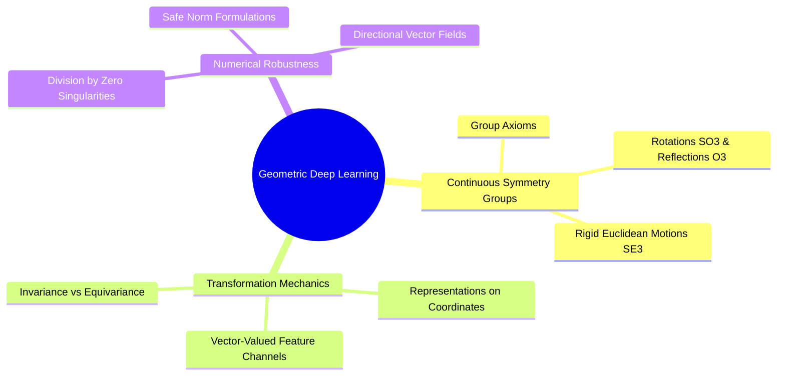

---
tags:
  - moc
  - 3dsyntree
module: "05. Geometric Deep Learning and Lie Groups"
type: moc
---

# 0. Geometric Deep Learning MOC

> [!abstract] Module Overview
> Mathematical foundations of continuous spatial symmetries, matrix Lie groups, group representations, and invariant/equivariant mappings over 3D Cartesian coordinates.

## Detailed Chapters

- **Chapter 1. Continuous Symmetry Groups**
  - [[1. Group Theory Axioms and Matrix Lie Groups]]
  - [[2. Orthogonal and Euclidean Groups O(3) SO(3) E(3) SE(3)]]
  - [[3. Group Actions on Coordinate and Feature Manifolds]]
- **Chapter 2. Equivariant Tensor Field Representations**
  - [[1. Scalar Invariants vs Cartesian Vector Equivariance]]
  - [[2. Irreducible Representations vs Cartesian Feature Vectors]]
  - [[3. Non-Singular Vector Norms and Directional Regularization]]
