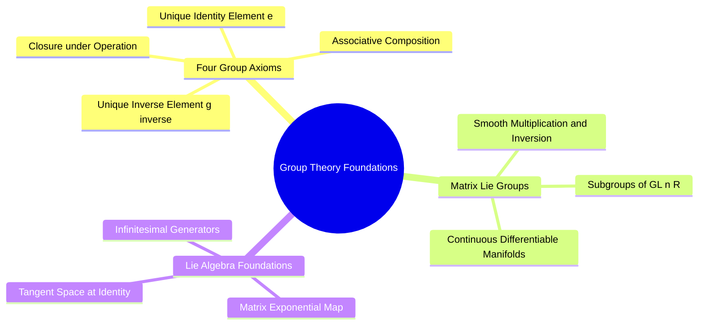

---
tags:
  - 3dsyntree
  - depth/essential
module: "05. Geometric Deep Learning and Lie Groups"
chapter: "Chapter 1. Continuous Symmetry Groups"
type: concept
---

# 1. Group Theory Axioms and Matrix Lie Groups

> [!abstract] Mathematical Core
> Symmetries in physical systems are formalized using the algebraic language of **Group Theory**. A group is an algebraic structure consisting of a set $\mathcal{G}$ and an operation $\cdot$ that satisfies four foundational axioms: Closure, Associativity, Identity, and Invertibility. A **Lie group** is a group that is also a smooth, differentiable manifold.

## 1. What It Is

A **group** is a tuple $(\mathcal{G}, \cdot)$ composed of a set of elements $\mathcal{G}$ and a binary operation $\cdot: \mathcal{G} \times \mathcal{G} \to \mathcal{G}$ that satisfies four axioms:

1. **Closure**:
   $$\forall g_1, g_2 \in \mathcal{G}, \quad g_1 \cdot g_2 \in \mathcal{G}$$
2. **Associativity**:
   $$\forall g_1, g_2, g_3 \in \mathcal{G}, \quad (g_1 \cdot g_2) \cdot g_3 = g_1 \cdot (g_2 \cdot g_3)$$
3. **Identity Element**:
   $$\exists e \in \mathcal{G} \quad \text{such that} \quad \forall g \in \mathcal{G}, \quad e \cdot g = g \cdot e = g$$
4. **Inverse Element**:
   $$\forall g \in \mathcal{G}, \quad \exists g^{-1} \in \mathcal{G} \quad \text{such that} \quad g \cdot g^{-1} = g^{-1} \cdot g = e$$

A **Matrix Lie Group** is a subgroup of the general linear group $\mathrm{GL}(n, \mathbb{R})$ (invertible $n \times n$ matrices) that forms a smooth manifold. In a Lie group, group multiplication and inversion are smooth, differentiable mappings, allowing us to compute derivatives with respect to transformation parameters.

## 2. Why It Exists

Physical laws are symmetric under spatial transformations:
- A protein-ligand complex has the same binding affinity regardless of how it is rotated or translated in space.
- A model's predictions should not depend on the arbitrary coordinate frame chosen to record atom positions.

Group theory provides the formal mathematical language needed to specify these spatial symmetries. It allows us to prove that neural network architectures will preserve physical symmetries under all possible continuous rotations and translations.

## 3. How It Works

### 3.1 The General Linear Group $\mathrm{GL}(n, \mathbb{R})$

The parent group of all real matrix transformations is the **General Linear Group**:

$$\mathrm{GL}(n, \mathbb{R}) = \left\{ \mathbf{A} \in \mathbb{R}^{n \times n} \mid \det(\mathbf{A}) \neq 0 \right\}$$

- **Operation**: Standard matrix multiplication.
- **Identity**: The $n \times n$ identity matrix $\mathbf{I}_n$.
- **Inverse**: The matrix inverse $\mathbf{A}^{-1}$, which is guaranteed to exist because $\det(\mathbf{A}) \neq 0$.

### 3.2 Lie Algebras and the Matrix Exponential

Every matrix Lie group $\mathcal{G}$ has an associated **Lie algebra** $\mathfrak{g}$, which corresponds to the tangent space of the manifold evaluated at the identity element $e = \mathbf{I}$.

The Lie algebra consists of the **infinitesimal generators** of the group. We can map elements from the Lie algebra $\mathbf{X} \in \mathfrak{g}$ to the Lie group $\mathbf{A} \in \mathcal{G}$ using the **matrix exponential**:

$$\exp(\mathbf{X}) = \sum_{k=0}^\infty \frac{1}{k!} \mathbf{X}^k = \mathbf{I} + \mathbf{X} + \frac{1}{2}\mathbf{X}^2 + \frac{1}{6}\mathbf{X}^3 + \dots$$

For example, in the rotation group $\mathrm{SO}(3)$:
- The Lie algebra $\mathfrak{so}(3)$ consists of $3 \times 3$ **skew-symmetric matrices** ($\mathbf{X}^T = -\mathbf{X}$).
- Exponentiating a skew-symmetric matrix yields a valid 3D rotation matrix $\mathbf{R} \in \mathrm{SO}(3)$.

This connection allows us to optimize rotations smoothly during training by computing derivatives in the linear space of the Lie algebra.

## 4. What It Consists Of

- **Group Operation ($\cdot$)**: The associative rule used to combine two group elements.
- **Identity ($e$)**: The do-nothing element that leaves any group member unchanged.
- **Lie Algebra ($\mathfrak{g}$)**: The tangent vector space evaluated at the identity element, capturing local infinitesimal transformations.
- **Exponential Map ($\exp$)**: The mathematical bridge that projects elements from the linear Lie algebra back onto the curved Lie group manifold.

## 5. What You Must Understand

> [!warning] Pitfall: Matrix Multiplication Is Non-Abelian (Non-Commutative)
> A group is **Abelian** if its operation commutes: $g_1 \cdot g_2 = g_2 \cdot g_1$. The group of 3D rotations $\mathrm{SO}(3)$ is **non-Abelian**:
> $$\mathbf{R}_x(\theta) \mathbf{R}_y(\phi) \neq \mathbf{R}_y(\phi) \mathbf{R}_x(\theta)$$
> Rotating a molecule $90^\circ$ around the x-axis and then $90^\circ$ around the y-axis produces a completely different orientation than applying those rotations in the reverse order. Architectural derivations must never assume that spatial transformations commute.

## 6. Prerequisites

- Linear algebra (matrix multiplication, determinants, matrix inverses, and matrix transposes).

## 7. Project Connection

The symmetries of 3D space dictate the architecture of our encoders and loss functions:
- The coordinate representations in `syntree/models/bipartite.py` are designed to respect the continuous Euclidean group $\mathrm{SE}(3)$.
- The dihedral angle prediction heads in `syntree/models/torsion_head.py` are formulated over the circle group $\mathrm{SO}(2)$.

## 8. Required Depth

**Essential**: Provides the mathematical framework for all geometric deep learning and symmetry principles in the project.

## 9. Further Dependencies

- [[2. Orthogonal and Euclidean Groups O(3) SO(3) E(3) SE(3)]]
- [[3. Group Actions on Coordinate and Feature Manifolds]]

## Cross-Domain Links

- [[Chemistry/07. Geometric Deep Learning and Equivariance/Chapter 1. Symmetry Groups and Equivariant Foundations/1. Group Theory E3 SE3 SO3 and SO2|1. Group Theory E3 SE3 SO3 and SO2]] (Chemistry vault) — the symmetry groups of physical space, here formalized axiomatically as matrix Lie groups.
