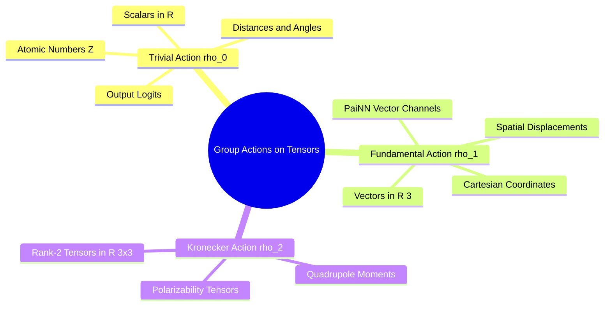

---
tags:
  - 3dsyntree
  - depth/essential
module: "05. Geometric Deep Learning and Lie Groups"
chapter: "Chapter 1. Continuous Symmetry Groups"
type: concept
---

# 3. Group Actions on Coordinate and Feature Manifolds

> [!abstract] Mathematical Core
> A group action defines how elements of an abstract mathematical group transform the points, features, and tensors in a computational system. Understanding group actions allows us to formalize how scalar features, vector channels, and coordinate tensors must transform under continuous spatial rotations.

## 1. What It Is

Let $(\mathcal{G}, \cdot)$ be a group and let $\mathcal{M}$ be a set or smooth manifold (such as Euclidean space $\mathbb{R}^3$ or a feature space $\mathbb{R}^d$).

A **group action** of $\mathcal{G}$ on $\mathcal{M}$ is a mapping $\alpha: \mathcal{G} \times \mathcal{M} \to \mathcal{M}$ (often written as $g \cdot x$) that satisfies two conditions for all $x \in \mathcal{M}$:

1. **Identity Compatibility**:
   $$e \cdot x = x$$
2. **Composition Compatibility**:
   $$\forall g_1, g_2 \in \mathcal{G}, \quad g_1 \cdot (g_2 \cdot x) = (g_1 \cdot g_2) \cdot x$$

```text
The Group Action Concept:
Abstract Group Element g in SE(3)
              |
              v (Action Representation rho(g))
Transformed State: x' = rho(g)[x]
```

## 2. Why It Exists

In deep learning, neural networks process multiple types of data simultaneously:
- Continuous 3D coordinates: $\mathbf{x}_i \in \mathbb{R}^3$
- Chemical scalar features (atomic numbers, charges): $s_i \in \mathbb{R}$
- Directional spatial features (forces, dipoles): $\vec{\mathbf{v}}_i \in \mathbb{R}^3$

When a 3D rotation $\mathbf{R} \in \mathrm{SO}(3)$ is applied to a molecule, these different data types transform differently:
- Atomic coordinates rotate: $\mathbf{x}_i \mapsto \mathbf{R} \mathbf{x}_i$.
- Scalar charges remain unchanged: $q_i \mapsto q_i$.
- Directional vectors rotate alongside the coordinates: $\vec{\mathbf{v}}_i \mapsto \mathbf{R} \vec{\mathbf{v}}_i$.

Group actions provide the formal mathematical framework needed to define and verify these different transformation behaviors across all layers of an equivariant network.

## 3. How It Works

### 3.1 Group Representations

When the space $\mathcal{M}$ is a vector space $\mathcal{V} \cong \mathbb{R}^K$, the group action is typically expressed as an invertible linear transformation:

$$\rho: \mathcal{G} \to \mathrm{GL}(\mathcal{V})$$

where $\rho(g)$ is a $K \times K$ matrix that satisfies the homomorphism property:

$$\rho(g_1 \cdot g_2) = \rho(g_1) \rho(g_2)$$

The mapping $\rho$ is called a **linear representation** of the group $\mathcal{G}$.

### 3.2 Canonical Representations of $\mathrm{SO}(3)$

1. **The Trivial Representation ($\rho_0$, Scalar Channels)**:
   The group element acts as the identity mapping for all $g \in \mathrm{SO}(3)$:
   $$\rho_0(\mathbf{R}) = 1.0 \implies s' = \rho_0(\mathbf{R}) s = s$$
   Scalars are invariant under group actions. Features like atomic numbers, formal charges, interatomic distances, and classification logits transform under the trivial representation.
2. **The Vector / Fundamental Representation ($\rho_1$, Vector Channels)**:
   The group element acts via standard $3 \times 3$ matrix multiplication:
   $$\rho_1(\mathbf{R}) = \mathbf{R} \implies \mathbf{x}' = \rho_1(\mathbf{R}) \mathbf{x} = \mathbf{R} \mathbf{x}$$
   Vectors transform equivariantly. Spatial displacement vectors, atomic forces, dipole moments, and PaiNN vector channels transform under the fundamental representation.
3. **Higher-Order Tensors ($\rho_2, \dots$)**:
   Tensors of rank 2 (such as quadrupole moments and polarizability tensors) transform under the Kronecker product representation:
   $$\mathbf{T}' = \mathbf{R} \mathbf{T} \mathbf{R}^T$$



## 4. What It Consists Of

- **Base Manifold ($\mathcal{M}$)**: The mathematical space where points or feature representations reside.
- **Group Action Map ($\alpha$)**: The function defining how abstract group elements transform points in $\mathcal{M}$.
- **Representation Matrix ($\rho(g)$)**: The concrete matrix operator that executes the transformation on a given vector space.

## 5. What You Must Understand

> [!warning] Pitfall: Treating Vector Channels as Batched Independent Scalars
> If a vector channel $\vec{\mathbf{v}} \in \mathbb{R}^{3 \times d}$ is flattened into a 1D vector of length $3d$ and passed through an ordinary MLP:
> $$\mathbf{h} = \text{Linear}(\text{flatten}(\vec{\mathbf{v}}))$$
> the layer applies arbitrary linear combinations across the spatial coordinates. This breaks the fundamental group action $\rho_1(\mathbf{R})$, destroying rotational equivariance. Spatial axes must only be transformed through valid group representations.

## 6. Prerequisites

- [[1. Group Theory Axioms and Matrix Lie Groups]]
- [[2. Orthogonal and Euclidean Groups O(3) SO(3) E(3) SE(3)]]

## 7. Project Connection

In `syntree/models/bipartite.py`, `BipartitePaiNN` maintains node representations that combine both trivial ($\rho_0$) and fundamental ($\rho_1$) representations:
- Scalars $\mathbf{s}_i \in \mathbb{R}^d$ transform under $\rho_0$ (invariant).
- Vectors $\vec{\mathbf{v}}_i \in \mathbb{R}^{3 \times d}$ transform under $\rho_1$ (equivariant).
This ensures that the backbone extracts rich directional features while preserving rotational symmetry.

## 8. Required Depth

**Essential**: Defines the formal mathematical framework used to construct equivariant feature representations.

## 9. Further Dependencies

- [[1. Scalar Invariants vs Cartesian Vector Equivariance]]
- [[2. Irreducible Representations vs Cartesian Feature Vectors]]

## Cross-Domain Links

- [[Chemistry/03. Spatial Chemistry and Force Fields/Chapter 2. Conformer Generation and Energy Models/4. The Kabsch Algorithm and Rigid Alignment|4. The Kabsch Algorithm and Rigid Alignment]] (Chemistry vault) — the closed-form SVD superposition is the canonical $\mathrm{SE}(3)$ group action on molecular coordinates.
