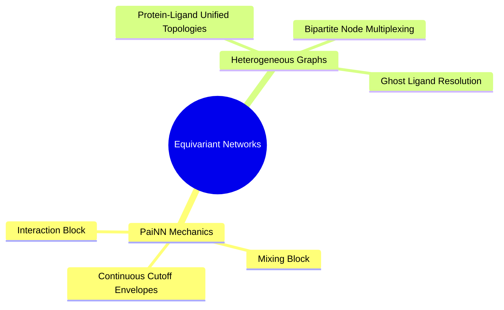

---
tags:
  - moc
  - 3dsyntree
module: "06. Equivariant Architectures: PaiNN and Bipartite Graphs"
type: moc
---

# 0. Equivariant Architectures MOC

> [!abstract] Module Overview
> Architecture and design of the Polarizable Atom Interaction Network (PaiNN), continuous radial basis functions, and bipartite heterogeneous protein-ligand graphs.

## Detailed Chapters

- **Chapter 1. Polarizable Atom Interaction Networks**
  - [[1. PaiNN Interaction Block and Directional Message Passing]]
  - [[2. PaiNN Mixing Block and Invariant-Equivariant Gating]]
  - [[3. Continuous Cosine Cutoffs and Radial Basis Envelopes]]
- **Chapter 2. Heterogeneous Molecular Modeling**
  - [[1. The Ghost Ligand Problem in Molecular Design]]
  - [[2. Bipartite Protein-Ligand Graph Construction]]
  - [[3. Node-Type Feature Multiplexing and Edge Partitioning]]
