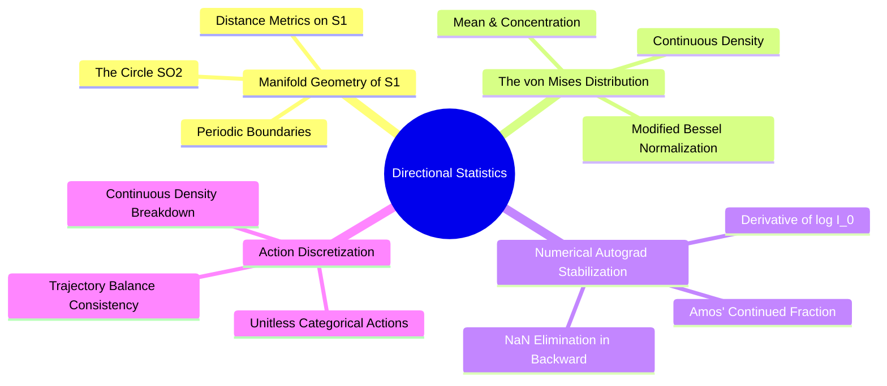

---
tags:
  - moc
  - 3dsyntree
module: "07. Directional Statistics and Torsion Manifolds"
type: moc
---

# 0. Directional Statistics MOC

> [!abstract] Module Overview
> Mathematical foundations of circular statistics on the Riemannian manifold $\mathrm{SO}(2)$, the von Mises distribution, Amos' continued fraction approximation, and categorical dihedral action spaces.

## Detailed Chapters

- **Chapter 1. Riemannian Geometry of the Circle**
  - [[1. The Topology of SO(2) and the Seam Discontinuity]]
  - [[2. The von Mises Distribution on S1]]
  - [[3. Modified Bessel Functions of the First Kind]]
- **Chapter 2. Torsion Prediction and Optimization**
  - [[1. The Amos Ratio Approximation and Gradient Stabilization]]
  - [[2. Measure-Theoretic Collapse of Continuous-Discrete TB]]
  - [[3. Categorical Dihedral Discretization vs Continuous Heads]]
