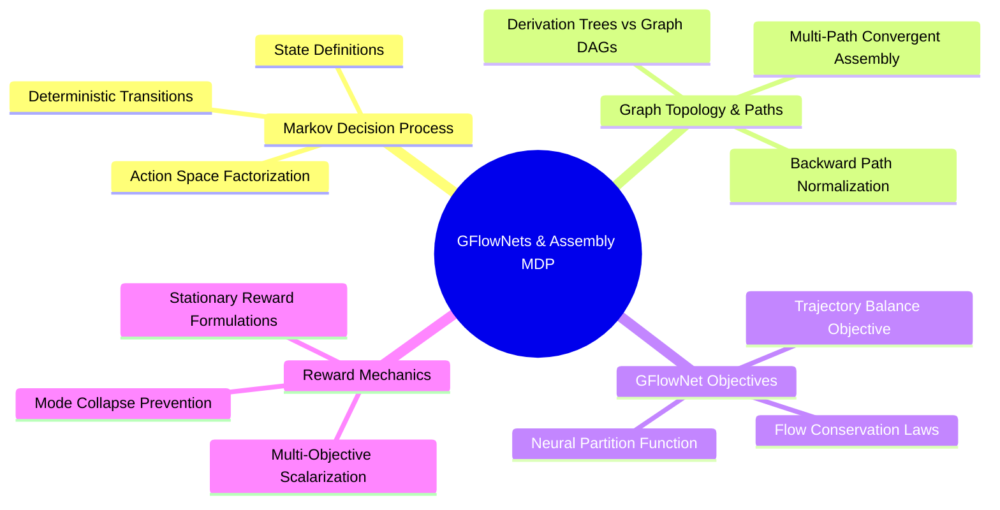

---
tags:
  - moc
  - 3dsyntree
module: "08. Generative Modeling, MDPs, and GFlowNets"
type: moc
---

# 0. GFlowNets and Generative Modeling MOC

> [!abstract] Module Overview
> Mathematical formulations of Markov Decision Processes for molecular synthesis, Directed Acyclic Graph (DAG) state spaces, Generative Flow Networks (GFlowNets), and the Trajectory Balance objective.

## Detailed Chapters

- **Chapter 1. Discrete Markov Decision Processes**
  - [[1. Autoregressive Molecule Assembly Formulations]]
  - [[2. Derivation Trees vs Molecular Graph DAGs]]
  - [[3. Action Space Factorization and Masking Operators]]
- **Chapter 2. Generative Flow Networks**
  - [[1. Flow Networks Flow Consistency and Markovian Flow]]
  - [[2. The Trajectory Balance Objective]]
  - [[3. Multi-Path Convergent Assembly and Backward Policies]]
  - [[4. Stationary Terminal Rewards vs Batch-Relative Drift]]
