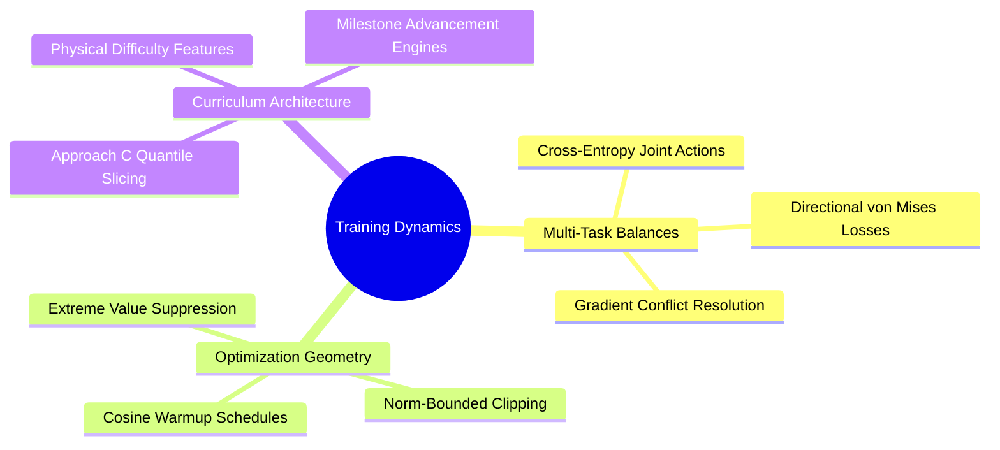

---
tags:
  - moc
  - 3dsyntree
module: "09. Training Dynamics, Optimization, and Curriculum Learning"
type: moc
---

# 0. Training Dynamics MOC

> [!abstract] Module Overview
> Dynamics of multi-task loss optimization, gradient clipping in non-Euclidean spaces, and automated difficulty-stratified curriculum learning over structural protein datasets.

## Detailed Chapters

- **Chapter 1. Multi-Task Optimization**
  - [[1. Multi-Task Joint Loss Balancing and Gradients]]
  - [[2. Cosine Annealing Warmup and Optimization Dynamics]]
  - [[3. Gradient Norm Clipping and Extreme Value Geometry]]
- **Chapter 2. Curriculum Strategies**
  - [[1. Physical Difficulty Quantification in Structural Pockets]]
  - [[2. Approach C Quantile-Balanced Curriculum Architecture]]
  - [[3. Milestone-Driven Advancement and State Resumption]]
