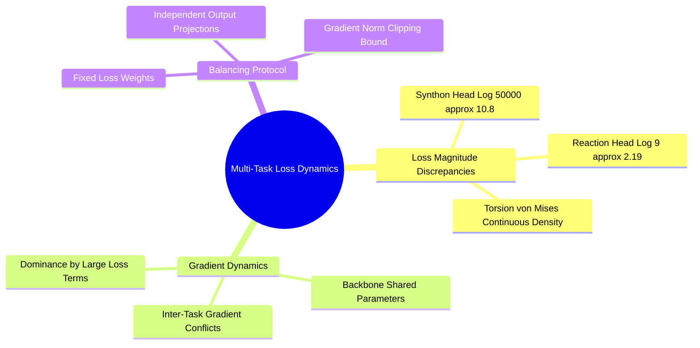

---
tags:
  - 3dsyntree
  - depth/essential
module: "09. Training Dynamics, Optimization, and Curriculum Learning"
chapter: "Chapter 1. Multi-Task Optimization"
type: concept
---

# 1. Multi-Task Joint Loss Balancing and Gradients

> [!abstract] Mathematical Core
> Stage-1 behavioral cloning optimizes a multi-task composite loss combining discrete classification (cross-entropy) and continuous circular density modeling (von Mises NLL). Balancing these loss terms with appropriate scaling weights is critical for preventing gradient interference between different tasks.

## 1. What It Is

In Stage-1 behavioral cloning, the policy is trained to imitate expert retrosynthetic trajectories across multiple simultaneous objectives:
1. **Reaction Family Classification**: Choosing the correct reaction family $r_t \in \{0, \dots, F-1\}$.
2. **Synthon Selection**: Identifying the correct building block $B_t \in \{0, \dots, K-1\}$ or selecting the `STOP` action ($K$).
3. **Dihedral Angle Prediction**: Predicting the continuous junction dihedral angle $\phi_t \in [-\pi, \pi)$ that matches the observed crystal pose.

The composite training loss is a weighted sum:

$$\mathcal{L}_{\text{total}} = w_{\text{syn}} \mathcal{L}_{\text{synthon}} + w_{\text{rxn}} \mathcal{L}_{\text{reaction}} + w_{\text{tor}} \mathcal{L}_{\text{torsion}}$$

where each component evaluates:

$$\mathcal{L}_{\text{synthon}} = -\log P(a_t^* = B_t^* \mid s_t)$$

$$\mathcal{L}_{\text{reaction}} = -\log P(r_t^* \mid s_t)$$

$$\mathcal{L}_{\text{torsion}} = -\kappa \cos(\phi^* - \mu) + \log(2\pi) + \log I_0(\kappa)$$

## 2. Why It Exists

Each loss component operates on a different scale and exhibits different gradient dynamics:
- The synthon selection loss begins around $\log(50{,}000) \approx 10.8$ nats, generating strong initial gradients.
- The reaction family loss operates over only 9 classes, starting around $\log(9) \approx 2.19$ nats.
- The von Mises loss is a continuous circular density whose scale depends heavily on the concentration parameter $\kappa$.

If these losses are summed directly without balancing weights, the synthon head's large initial gradients will dominate the shared representations in the `BipartitePaiNN` backbone. This can disrupt early learning in the reaction and torsion heads, leading to training instability.

## 3. How It Works

### 3.1 Analyzing Gradient Conflicts

Evaluating the gradient of the total loss with respect to the shared backbone parameters $\mathbf{W}_{\text{backbone}}$:

$$\nabla_{\mathbf{W}} \mathcal{L}_{\text{total}} = w_{\text{syn}} \nabla_{\mathbf{W}} \mathcal{L}_{\text{synthon}} + w_{\text{rxn}} \nabla_{\mathbf{W}} \mathcal{L}_{\text{reaction}} + w_{\text{tor}} \nabla_{\mathbf{W}} \mathcal{L}_{\text{torsion}}$$

If the inner product between two task gradients is negative:

$$\langle \nabla_{\mathbf{W}} \mathcal{L}_{\text{synthon}}, \; \nabla_{\mathbf{W}} \mathcal{L}_{\text{torsion}} \rangle < 0$$

The tasks are in **gradient conflict**—updating the backbone to satisfy synthon selection degrades the representations needed for torsion prediction, and vice versa.



### 3.2 Handling the Terminal STOP Condition

When a molecule reaches its target size, the trajectory ends with a terminal `STOP` action.

At this terminal step:
- The synthon head is evaluated against target index $K$ (`STOP`).
- No reaction is performed, and no new bond is created.
- As a result, **there is no valid reaction family or junction dihedral angle to supervise**.

If dummy targets (such as reaction class 0 and dihedral $0.0$) are included in the loss during `STOP` steps, the model will learn incorrect correlations.

To prevent this, the loss computation applies a **non-stop mask**:

$$\text{non\_stop}_i = \mathbb{I}(\text{target\_stop}_i = \text{False})$$

$$\mathcal{L}_{\text{reaction}} = \frac{\sum_{i=1}^B \text{non\_stop}_i \cdot \text{CE}(\mathbf{z}_{\text{rxn}, i}, r_i^*)}{\sum_{i=1}^B \text{non\_stop}_i + \epsilon}$$

$$\mathcal{L}_{\text{torsion}} = \frac{\sum_{i=1}^B \text{non\_stop}_i \cdot \mathcal{L}_{\text{VM}}(\mu_i, \kappa_i, \phi_i^*)}{\sum_{i=1}^B \text{non\_stop}_i + \epsilon}$$

This ensures that reaction and torsion parameters are updated only on steps where an actual chemical attachment occurs.

## 4. What It Consists Of

- **Task Weight Multipliers**: Static hyperparameter scalars ($w_{\text{syn}} = 1.0, w_{\text{rxn}} = 0.5, w_{\text{tor}} = 0.5$) that balance gradient contributions across tasks.
- **Non-Stop Indicator ($\text{non\_stop}$)**: A boolean mask that excludes terminal `STOP` steps from reaction and torsion loss calculations.
- **Shared Backbone Gradient**: The sum of backpropagated task gradients flowing into the `BipartitePaiNN` encoder.

## 5. What You Must Understand

> [!warning] Pitfall: Unmasked Terminal Steps Cause Prediction Collapse
> If the non-stop mask is omitted, the model is penalized for failing to predict dummy reaction and dihedral targets on terminal `STOP` steps. Because approximately $48\%$ of trajectory steps in the dataset are terminal steps, this spurious penalty pushes the reaction and torsion heads toward uninformative constant predictions.

## 6. Prerequisites

- [[2. Vectorized Computational Graphs and Jacobians]]
- [[2. The von Mises Distribution on S1]]

## 7. Project Connection

In `syntree/engine/trainer.py`, the multi-task loss is computed inside the main training loop:
```python
# Compute individual loss components
reaction_per_sample = F.cross_entropy(preds["reaction_logits"], batch.target_reaction_family_idx, reduction="none")
non_stop = ~target_stop.bool()
l_reaction = reaction_per_sample[non_stop].mean() if non_stop.any() else torch.zeros_like(l_synthon)

l_synthon = self.criterion(preds["synthon_logits"], target_action)
l_torsion = -ContinuousTorsionHead.log_prob(
    preds["torsion_mu"][non_stop], preds["torsion_kappa"][non_stop], batch.target_dihedral[non_stop]
).mean() if non_stop.any() else torch.zeros_like(l_synthon)

# Weighted combination
loss = (1.0 * l_synthon + 0.5 * l_reaction + 0.5 * l_torsion) / self.accum_steps
```

## 8. Required Depth

**Essential**: This multi-task loss formulation defines the core optimization objective for Stage-1 training.

## 9. Further Dependencies

- [[2. Cosine Annealing Warmup and Optimization Dynamics]]
- [[3. Gradient Norm Clipping and Extreme Value Geometry]]
