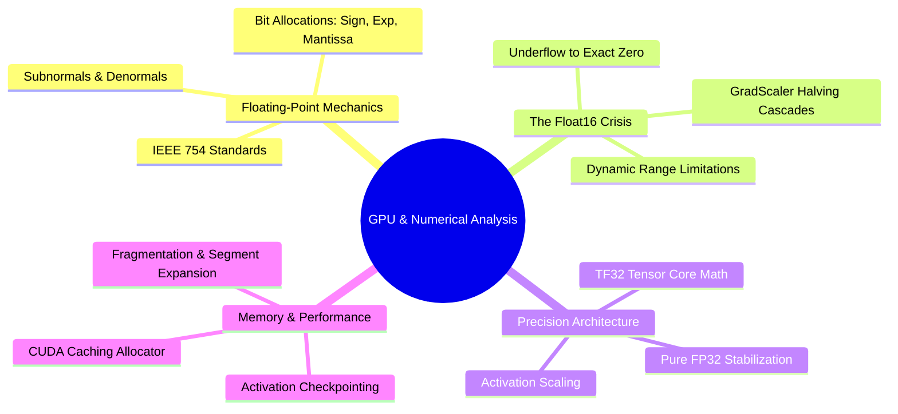

---
tags:
  - moc
  - 3dsyntree
module: "10. Numerical Analysis and High-Performance GPU Engineering"
type: moc
---

# 0. Numerical Analysis and GPU Engineering MOC

> [!abstract] Module Overview
> Floating-point arithmetic under IEEE 754, numerical analysis of gradient scaling and underflow, VRAM allocation mechanics, and GPU optimization on NVIDIA architectures.

## Detailed Chapters

- **Chapter 1. Precision Dynamics and Numerics**
  - [[1. IEEE 754 Floating-Point Formats FP32 FP16 BF16]]
  - [[2. Underflow Denormals and GradScaler Scale Collapse]]
  - [[3. Saturation Clamps and Numerical Boundary Engineering]]
- **Chapter 2. Hardware-Aware Pipeline Execution**
  - [[1. GPU Memory Topologies and Allocation Boundaries]]
  - [[2. Activation Checkpointing and O(1) Layer Scaling]]
  - [[3. In-Memory RAM Sharding vs Dynamic Remote Streaming]]
