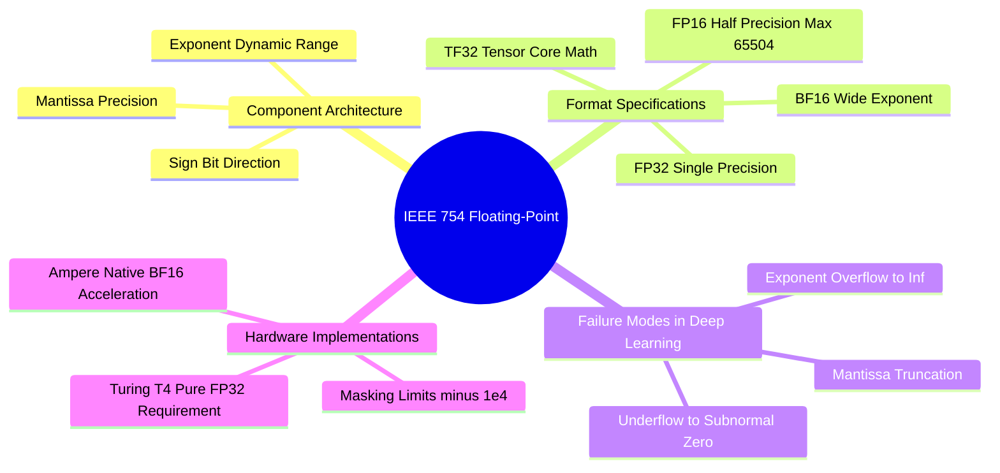

---
tags:
  - 3dsyntree
  - depth/essential
module: "10. Numerical Analysis and High-Performance GPU Engineering"
chapter: "Chapter 1. Precision Dynamics and Numerics"
type: concept
---

# 1. IEEE 754 Floating-Point Formats FP32 FP16 BF16

> [!abstract] Mathematical Core
> Digital computation represents real numbers using the IEEE 754 floating-point standard: $x = (-1)^s \times 2^{e - \text{bias}} \times (1 + m)$. The allocation of bits between the exponent ($e$) and the mantissa ($m$) determines the trade-off between dynamic range and numerical precision.

## 1. What It Is

Any finite floating-point number is represented in binary hardware by three fields:
1. **Sign bit ($s$)**: A single bit indicating positive ($0$) or negative ($1$).
2. **Exponent field ($e$)**: An unsigned integer biased by $B = 2^{k-1} - 1$ that shifts the scale of the number powers of two.
3. **Mantissa / Fraction field ($m$)**: Unsigned fractional bits representing the significant digits (with an implicit leading 1 for normalized numbers).

$$x = (-1)^s \times 2^{e - \text{bias}} \times \left(1 + \sum_{i=1}^p m_i 2^{-i}\right)$$

```text
Bit Allocations:
FP32 (32 bits): [s (1)] [e e e e e e e e (8)] [m m m ... m m m (23)]
FP16 (16 bits): [s (1)] [e e e e e (5)]       [m m m m m m m m m m (10)]
BF16 (16 bits): [s (1)] [e e e e e e e e (8)] [m m m m m m m (7)]
TF32 (19 bits): [s (1)] [e e e e e e e e (8)] [m m m m m m m m m m (10)] (Internal Tensor Core Only)
```

## 2. Why It Exists

Computer memory and arithmetic circuits operate on finite bit-widths. In deep learning:
- Multiplications in matrix tensor cores scale in latency and power roughly as $O(m^2)$, where $m$ is the mantissa bit width.
- Memory bandwidth across the PCIe bus and VRAM channels scales linearly with bit width ($16\text{ bits}$ moves twice as fast as $32\text{ bits}$).

We reduce numerical precision to accelerate model training and lower memory overhead. However, changing bit allocations alters the dynamic range and can lead to numerical instability:
- Reducing the exponent causes underflow (vanishing to zero) or overflow (exploding to infinity).
- Reducing the mantissa introduces rounding noise and truncates small parameter updates.

## 3. How It Works

### 3.1 Structural Comparison of Numerical Formats

| Format | Total Bits | Exponent Bits | Mantissa Bits | Exponent Bias | Smallest Normal ($V_{\min}$) | Largest Normal ($V_{\max}$) | Relative Precision ($\epsilon_{\text{mach}}$) |
| :--- | :--- | :--- | :--- | :--- | :--- | :--- | :--- |
| **FP32** | 32 | 8 | 23 | 127 | $1.175 \times 10^{-38}$ | $3.402 \times 10^{38}$ | $2^{-23} \approx 1.19 \times 10^{-7}$ |
| **FP16** | 16 | 5 | 10 | 15 | $6.104 \times 10^{-5}$ | **$65{,}504$** | $2^{-10} \approx 9.77 \times 10^{-4}$ |
| **BF16** | 16 | 8 | 7 | 127 | $1.175 \times 10^{-38}$ | $3.389 \times 10^{38}$ | $2^{-7} \approx 7.81 \times 10^{-3}$ |
| **TF32** | 19 | 8 | 10 | 127 | $1.175 \times 10^{-38}$ | $3.402 \times 10^{38}$ | $2^{-10} \approx 9.77 \times 10^{-4}$ |

### 3.2 Analysis of the Formats

1. **Float16 (Half Precision)**:
   - Allocates only 5 bits to the exponent, giving a dynamic range of $[-14, 15]$.
   - The maximum representable number is $65{,}504$. Any activation, logit, or squared vector norm exceeding $65{,}504$ overflows directly to `+inf`.
   - The minimum normalized positive number is $6.104 \times 10^{-5}$. Any gradient smaller than this underflows to zero unless scaled by a `GradScaler`.
2. **Bfloat16 (Brain Floating Point)**:
   - Uses an 8-bit exponent matching FP32, providing the same dynamic range ($10^{-38}$ to $10^{38}$).
   - Because its dynamic range matches FP32, **BF16 does not require a `GradScaler`**—it will not underflow or overflow on standard neural network gradients.
   - However, it allocates only 7 bits to the mantissa, increasing machine epsilon to $\approx 7.8 \times 10^{-3}$. Small gradient updates can be truncated to zero if the learning rate is very small.
3. **TF32 (TensorFloat-32)**:
   - An internal execution format used on NVIDIA Ampere and newer architectures (Compute Capability $\ge 8.0$, e.g., A100, RTX 6000 Ada).
   - Combines the 8-bit exponent of FP32 with the 10-bit mantissa of FP16, maintaining dynamic range while accelerating matrix multiplication on tensor cores.
   - Tensors are stored in memory as standard FP32 and converted to TF32 only during core math operations.

### 3.3 The Hardware Boundary: Turing (Tesla T4) vs. Ampere/Ada

- **Tesla T4 (Compute Capability 7.5 / Turing)**: Lacks native hardware instructions for BF16. Attempting to use BF16 on a T4 forces PyTorch to emulate the operations in software, slowing down execution, or fall back to FP16 with an unstable dynamic `GradScaler`.
- **RTX 6000 Ada / A100 (Compute Capability $\ge 8.0$)**: Features dedicated hardware for BF16 and TF32, making low-precision training fast and stable.

## 4. What It Consists Of

- **Machine Epsilon ($\epsilon_{\text{mach}}$)**: The smallest relative difference between two distinct floating-point numbers: $\epsilon = 2^{-p}$.
- **Subnormal / Denormal Range**: Numbers smaller than $2^{\text{emin}}$ represented without an implicit leading 1, which suffer from reduced precision.
- **Special Encodings**: Dedicated bit patterns reserved for zero ($e=0, m=0$), infinity ($e=\text{all 1s}, m=0$), and NaN ($e=\text{all 1s}, m \neq 0$).

## 5. What You Must Understand

> [!warning] Pitfall: Why Masking with `-1e9` Crashes in FP16
> In mathematical formulas, invalid actions are often masked with $-10^9$. In FP16, the maximum representable negative number is $-65{,}504$. Casting $-10^9$ to FP16 overflows directly to `float('-inf')`. If an entire row is masked out, evaluating a softmax produces $\frac{e^{-\infty}}{\sum e^{-\infty}} = \frac{0}{0} = \mathbf{NaN}$. This `NaN` then spreads to all downstream weights and gradients.

## 6. Prerequisites

- Basic binary representation and scientific notation.

## 7. Project Connection

In Issue #10 (`[MATH-04]`), we audited precision across our target hardware environments. Because our primary supported execution environment is the **Tesla T4**, we disabled mixed-precision FP16 and enforced **Pure FP32**:
```python
# In syntree/utils/hardware.py
if device.type == "cuda" and compute_capability < 8.0:
    # Force single precision on T4 GPUs
    selected_precision = "fp32"
    use_amp = False
```

## 8. Required Depth

**Essential**: Understanding floating-point limitations is necessary to prevent numerical overflow, underflow, and `NaN` crashes during training.

## 9. Further Dependencies

- [[2. Underflow Denormals and GradScaler Scale Collapse]]
- [[3. Saturation Clamps and Numerical Boundary Engineering]]

## Concept Mind Map



## Cross-Domain Links

- [[Chemistry/10. Benchmarking and Wet Lab Translation/Chapter 2. Wet Lab Translation/2. SPR Kinetics and X-Ray Complex Confirmation|2. SPR Kinetics and X-Ray Complex Confirmation]] (Chemistry vault) — wet-lab confirmation demands reproducible numerics - the motivation for the pure-FP32 policy on Tesla T4.
