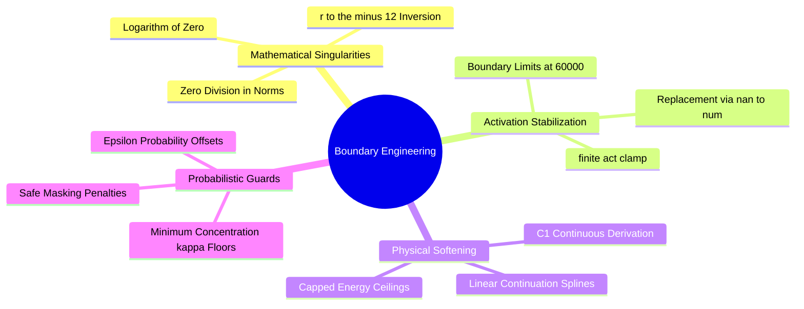

---
tags:
  - 3dsyntree
  - depth/supporting
module: "10. Numerical Analysis and High-Performance GPU Engineering"
chapter: "Chapter 1. Precision Dynamics and Numerics"
type: concept
---

# 3. Saturation Clamps and Numerical Boundary Engineering

> [!abstract] Mathematical Core
> Unbounded mathematical operations (such as raw division, exponentiation, and power laws) frequently encounter numerical singularities during training. **Numerical boundary engineering** applies protective clamps, non-singular approximations, and saturation functions to guarantee that activations and loss terms remain finite without distorting gradients in valid operating ranges.

## 1. What It Is

Numerical boundary engineering is the systematic design of safety bounds around floating-point calculations in neural networks. It uses three main operations:

1. **Domain Clamping**: Restricting the input domain of unstable functions:
   $$\text{clamp}(x, x_{\min}, x_{\max}) = \max(x_{\min}, \min(x, x_{\max}))$$
2. **Smooth Soft-Clipping**: Using smooth, non-linear saturation functions to prevent activations from growing arbitrarily large:
   $$f_{\text{sat}}(x) = \alpha \tanh\left(\frac{x}{\alpha}\right)$$
3. **Non-Zero Shift Adjustments**: Offsetting denominators and logarithmic arguments away from zero:
   $$\log(x) \to \log(x + \epsilon) \quad \text{or} \quad \frac{1}{x} \to \frac{1}{x + \epsilon}$$

## 2. Why It Exists

In structural biology models, physical calculations can easily encounter extreme configurations during generative rollouts:
- Two atoms may be placed in close proximity ($r_{ij} \to 0.05\text{ \AA}$), causing $r^{-12}$ Lennard-Jones potentials to evaluate to $10^{15}\text{ kcal/mol}$.
- A torsion head can predict high concentration values ($\kappa \to 100$), causing $e^{\kappa}$ terms in von Mises distributions to evaluate to $10^{43}$.
- Vector norm calculations in message-passing layers can evaluate at the origin ($\mathbf{x} = \mathbf{0}$), causing gradients to divide by zero.

Without explicit numerical boundaries, these physical calculations will produce `inf` and `NaN` values that halt training.

## 3. How It Works

### 3.1 Clamping Activation Boundaries (`finite_act_clamp`)

In deep equivariant architectures like PaiNN, residual updates across multiple layers can cause feature values to accumulate and grow:

$$\mathbf{s}^{(l+1)} = \mathbf{s}^{(l)} + \mathbf{\Delta} \mathbf{s}^{(l)}$$

If unchecked, activations can exceed the finite dynamic range of intermediate hardware formats. 

To prevent this, `3D-SynTree` applies a saturation clamp at layer boundaries:

```python
FP16_ACT_CLAMP = 60000.0 # Bounded safely below 65,504

def finite_act_clamp(x: torch.Tensor) -> torch.Tensor:
    """Clamps activations within safe numerical limits."""
    if not x.is_floating_point():
        return x
    # Convert non-finite values to valid clamped bounds
    x = torch.nan_to_num(x, nan=0.0, posinf=FP16_ACT_CLAMP, neginf=-FP16_ACT_CLAMP)
    return x.clamp(min=-FP16_ACT_CLAMP, max=FP16_ACT_CLAMP)
```

This clamp ensures that:
- Any `NaN` value accidentally introduced by an upstream operation is zeroed out before it can propagate.
- Any value exceeding $60{,}000$ is saturated to the boundary, preventing overflow during subsequent linear layers.

### 3.2 Bounding the Soft-Core Lennard-Jones Potential

The classical Lennard-Jones 6-12 potential diverges sharply as $r \to 0$:

$$V(r) = 4\epsilon \left[ \left(\frac{\sigma}{r}\right)^{12} - \left(\frac{\sigma}{r}\right)^6 \right] \implies \lim_{r \to 0} V(r) = +\infty$$

Its gradient also explodes:

$$\nabla_r V(r) \propto r^{-13} \implies \lim_{r \to 0} \nabla_r V(r) = -\infty$$

In `syntree/chemistry/conformer.py`, we implement a **$C^1$-continuous linear continuation** below a threshold distance $r_{\text{switch}} = c \cdot \sigma$ (where $c = 0.8$):

```text
Potential Profile:
For r >= c * sigma:  Evaluate exact Lennard-Jones 6-12 potential
For r <  c * sigma:  Replace with linear continuation: V_switch + slope * (r - c * sigma)
```

At $r = 0.8 \sigma$, evaluating the potential:
$$x = \frac{\sigma}{0.8 \sigma} = 1.25, \quad x^6 \approx 3.815, \quad x^{12} \approx 14.55$$
$$V_{\text{switch}} = 4\epsilon (14.55 - 3.815) = 42.94 \epsilon$$
The slope matches the true derivative at the switch point:
$$\text{slope} = \left. \frac{dV}{dr} \right|_{r = c\sigma} = \frac{24\epsilon}{\sigma} \left( c^{-7} - 2c^{-13} \right)$$

By switching to a linear function below $0.8 \sigma$, the maximum energy and gradient remain bounded even if two atoms overlap completely ($r \to 0$), preventing gradient explosions during reinforcement learning.



## 4. What It Consists Of

- **`torch.nan_to_num`**: A PyTorch operator that replaces `NaN`, `+inf`, and `-inf` with finite values.
- **$C^1$-Continuous Spline**: A function composed of multiple segments whose values and first derivatives match at the boundary points.
- **Logarithmic Offset ($\epsilon$)**: A small positive constant (such as $10^{-8}$) added to arguments of `torch.log` to prevent evaluation at zero.

## 5. What You Must Understand

> [!warning] Pitfall: Hard Clamps Zero Out Gradients in Backpropagation
> Applying a hard clamp:
> $$y = \text{clamp}(x, -10.0, 10.0)$$
> sets the derivative to zero for any value outside the threshold:
> $$\frac{\partial y}{\partial x} = \begin{cases} 1 & \text{if } |x| \le 10.0 \\ 0 & \text{if } |x| > 10.0 \end{cases}$$
> If a model's activations are pushed beyond the clamp boundary, gradients vanish, preventing the network from learning to correct the large values. Clamps should be used as protective safety nets at extreme boundaries, not as a replacement for proper normalization layers.

## 6. Prerequisites

- [[1. IEEE 754 Floating-Point Formats FP32 FP16 BF16]]
- [[3. Non-Singular Vector Norms and Directional Regularization]]

## 7. Project Connection

In `syntree/models/equivariant.py`, the outputs of the interaction and mixing blocks are protected using `finite_act_clamp`:
```python
scalar = finite_act_clamp(scalar + agg_s)
vector = finite_act_clamp(vector + agg_v)
```
In `syntree/chemistry/conformer.py`, pairwise interaction energies are bounded using linear continuations to ensure stable scoring during policy rollouts.

## 8. Required Depth

**Supporting**: These numerical guards ensure that unexpected atomic configurations do not produce non-finite values that interrupt training runs.

## 9. Further Dependencies

- [[1. PaiNN Interaction Block and Directional Message Passing]]
- [[2. Underflow Denormals and GradScaler Scale Collapse]]

## Cross-Domain Links

- [[Chemistry/10. Benchmarking and Wet Lab Translation/Chapter 1. Computational Benchmarking/1. PoseBusters Physical Sanity Filters|1. PoseBusters Physical Sanity Filters]] (Chemistry vault) — clamped activations and bounded soft-core potentials prevent unphysical geometries from passing sanity filters.
