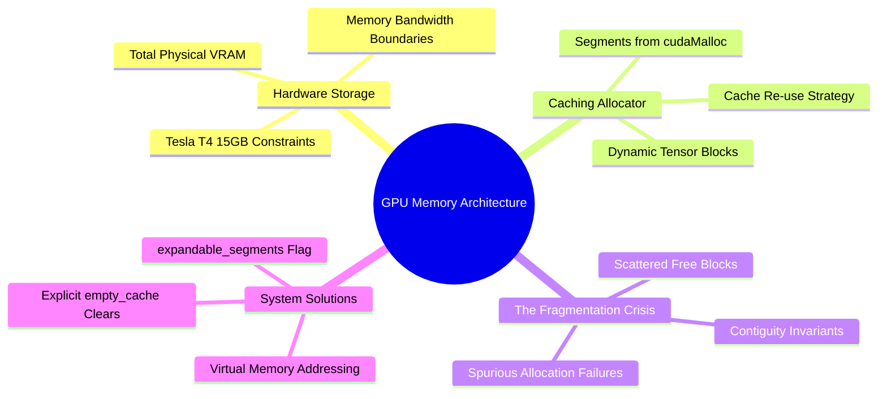

---
tags:
  - 3dsyntree
  - depth/essential
module: "10. Numerical Analysis and High-Performance GPU Engineering"
chapter: "Chapter 2. Hardware-Aware Pipeline Execution"
type: concept
---

# 1. GPU Memory Topologies and Allocation Boundaries

> [!abstract] Mathematical Core
> The PyTorch CUDA caching allocator manages physical GPU VRAM by allocating memory in variable-sized blocks called segments. If allocation patterns fluctuate, the pool can suffer from **virtual memory fragmentation**, causing allocation failures even when total free memory appears sufficient. Setting `expandable_segments:True` allows the allocator to allocate memory in virtual memory pages, eliminating fragmentation.

## 1. What It Is

When a deep learning model allocates a tensor on a GPU (`tensor.to('cuda')`), PyTorch does not call the slow system allocator `cudaMalloc` directly for every operation. Instead, it uses a **caching allocator**:
1. It requests large contiguous blocks of physical VRAM from the NVIDIA driver using `cudaMalloc` (creating a **Memory Segment**).
2. It divides these segments into smaller blocks to satisfy individual tensor allocations.
3. When a tensor is freed or goes out of scope, its memory is returned to PyTorch's internal cache rather than being returned to the GPU driver.
4. Future tensor allocations reuse these cached blocks, avoiding the latency of driver-level memory allocations.

```text
Physical GPU VRAM (e.g., 15 GB on Tesla T4):
+-------------------------------------------------------------+
| Allocated Segment 1 (2 GB) | Allocated Segment 2 (4 GB)     | Unallocated (9 GB)
| [Block A][Free][Block B]   | [Block C][Free][Block D]       |
+-------------------------------------------------------------+
```

## 2. Why It Exists

Calling `cudaMalloc` directly synchronizes the entire GPU pipeline, pausing parallel execution and degrading throughput.

However, because molecular graphs vary in size (ranging from 100 to 700 atoms per pocket), memory requirements fluctuate from batch to batch. Over time, allocating and freeing differently sized blocks can cause **memory fragmentation**:
- The cache may contain enough total free bytes to satisfy an allocation, but those bytes are scattered across multiple non-contiguous gaps.
- If no single contiguous block is large enough to fit the requested tensor, the allocator must request a new segment from the driver.
- If the driver cannot find a large enough block of unallocated VRAM, it throws a `torch.cuda.OutOfMemoryError`—even if the total free memory shown by `nvidia-smi` appears sufficient.

## 3. How It Works

### 3.1 Understanding CUDA Memory Statistics

To diagnose memory behavior, PyTorch provides distinct tracking metrics:

```python
allocated = torch.cuda.memory_allocated() # Bytes actively held by live Tensor objects
reserved  = torch.cuda.memory_reserved()  # Total bytes held by PyTorch's caching allocator
max_alloc = torch.cuda.max_memory_allocated() # Peak allocation since last reset
```

- **Allocated Memory**: The actual memory consumed by active tensors.
- **Reserved Memory**: The total memory requested from the NVIDIA driver by the caching allocator (both active tensors and free cached blocks).
- **Driver Free Memory**: The memory completely untouched by PyTorch: $\text{Total VRAM} - \text{Reserved}$.

An Out-of-Memory (OOM) error occurs when:

$$\text{Requested Allocation} > (\text{Total VRAM} - \text{Reserved}) + \text{Largest Contiguous Free Block in Cache}$$

```text
The Fragmentation Failure Scenario:
Free Cached Memory:       500 MB (Composed of ten 50 MB non-contiguous blocks)
Driver Free Memory:       100 MB
Requested Tensor:         120 MB Contiguous Block

Result:
Total Free Space = 500 MB + 100 MB = 600 MB.
Largest Available Block = 100 MB.
Allocation fails! -> OutOfMemoryError: Tried to allocate 120.00 MiB (GPU has 600 MiB total capacity).
```

### 3.2 Resolving Fragmentation: `expandable_segments:True`

In PyTorch 2.1+, NVIDIA introduced support for virtual memory allocation via the driver flag:

```bash
export PYTORCH_CUDA_ALLOC_CONF=expandable_segments:True
```

How this fixes memory fragmentation:
- Without this flag, physical memory allocations must be contiguous in physical VRAM addresses.
- With expandable segments enabled, PyTorch uses the low-level CUDA Virtual Memory Management APIs (`cuMemCreate`, `cuMemMap`).
- The allocator maps multiple non-contiguous physical memory pages into a single **contiguous range of virtual addresses**.
- A 120 MB tensor can now be constructed by combining multiple scattered 50 MB physical blocks into one continuous virtual memory space.

This eliminates fragmentation-induced OOM failures, allowing models to utilize nearly 100% of available VRAM on GPUs like the Tesla T4.

## 4. What It Consists Of

- **Caching Allocator**: PyTorch's internal memory management layer that pools GPU memory to avoid slow `cudaMalloc` calls.
- **Segments**: Large contiguous blocks of physical VRAM allocated from the operating system and sliced into smaller tensor buffers.
- **Virtual Memory Mapping**: Dynamically mapping disjoint physical memory pages into a unified virtual address space.
- **`empty_cache()`**: An explicit call that releases unoccupied cached blocks back to the GPU driver, resetting the allocator pool.

## 5. What You Must Understand

> [!warning] Pitfall: `expandable_segments` Must Be Set Before Initializing CUDA
> The configuration string `PYTORCH_CUDA_ALLOC_CONF` must be set **before PyTorch initializes its CUDA context**. Setting it in Python after calling `import torch` or allocating a CUDA tensor has no effect:
> ```python
> # Correct setup in main.py:
> import os
> os.environ["PYTORCH_CUDA_ALLOC_CONF"] = "expandable_segments:True"
> import torch # Context initializes with expandable segments active
> ```

## 6. Prerequisites

- Basic operating system memory concepts (virtual memory, page tables, fragmentation).

## 7. Project Connection

In `main.py`, 3D-SynTree configures the memory allocator at the very top of the script:
```python
import os
os.environ.setdefault("PYTORCH_CUDA_ALLOC_CONF", "expandable_segments:True")
import torch
```
In Stage-2 reinforcement learning (`syntree/engine/rl.py`), where small rollout graphs frequently interleave with larger batch updates, this configuration eliminated the intermediate OOM errors on our 15 GB Tesla T4 environment.

## 8. Required Depth

**Essential**: This configuration is required to maintain memory stability when training on variable-sized molecular graphs.

## 9. Further Dependencies

- [[2. Activation Checkpointing and O(1) Layer Scaling]]
- [[3. In-Memory RAM Sharding vs Dynamic Remote Streaming]]

## Concept Mind Map


