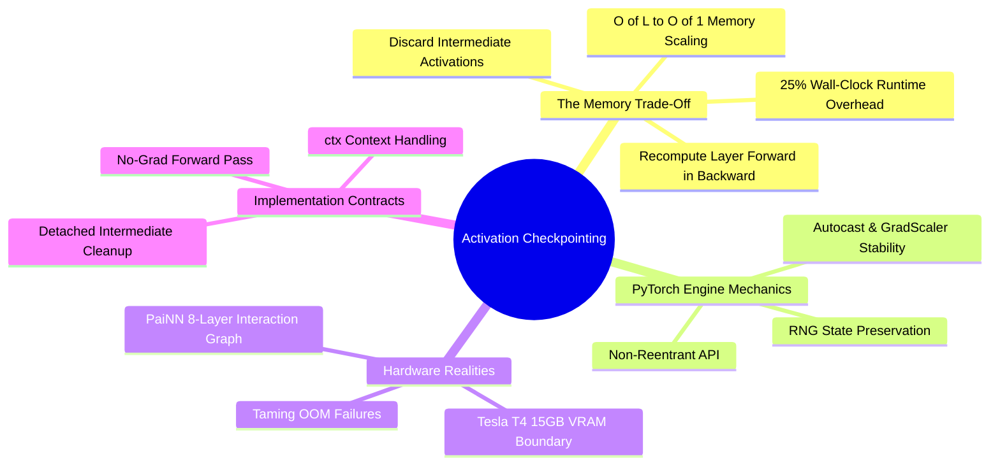

---
tags:
  - 3dsyntree
  - depth/essential
module: "10. Numerical Analysis and High-Performance GPU Engineering"
chapter: "Chapter 2. Hardware-Aware Pipeline Execution"
type: concept
---

# 2. Activation Checkpointing and O(1) Layer Scaling

> [!abstract] Mathematical Core
> Backpropagation requires intermediate layer activations from the forward pass to compute gradients. Storing all activations across deep networks scales memory consumption linearly with depth: $O(L)$. **Activation checkpointing** trades compute for memory: it discards intermediate activations during the forward pass and recomputes them on demand during the backward pass, reducing peak activation memory to $O(1)$ relative to depth.

## 1. What It Is

In standard neural network execution, evaluating the forward pass across $L$ successive layers stores every intermediate activation tensor $\mathbf{h}_l$ in memory:

$$\mathbf{h}_0 \xrightarrow{\text{Layer } 1} \mathbf{h}_1 \xrightarrow{\text{Layer } 2} \mathbf{h}_2 \dots \xrightarrow{\text{Layer } L} \mathbf{h}_L$$

During the backward pass, computing parameter gradients for Layer $l$ requires access to its input activation $\mathbf{h}_{l-1}$:

$$\frac{\partial \mathcal{L}}{\partial \mathbf{W}_l} = \nabla_{\mathbf{h}_l} \mathcal{L} \cdot \left( \frac{\partial \mathbf{h}_l}{\partial \mathbf{W}_l} \right) = \nabla_{\mathbf{h}_l} \mathcal{L} \cdot \mathbf{h}_{l-1}^T$$

To ensure these inputs are available, standard backpropagation retains all intermediate activations in VRAM until the backward pass reaches them, leading to an $O(L)$ memory footprint.

**Activation checkpointing** (also known as gradient checkpointing) changes this lifecycle:
1. During the forward pass, intermediate activations within checkpointed blocks are **discarded from memory** as soon as the next layer finishes computing. Only the inputs to designated checkpoint boundaries are retained.
2. During the backward pass, when gradients reach a checkpointed block, the engine **re-runs the forward pass for that block from its saved input**, reconstructing the required intermediate activations on the fly.
3. Once the block's gradients are computed, the reconstructed activations are immediately freed from memory.

```text
Standard Forward / Backward Memory Lifecycle:
Forward:  [Save h_0] -> [Save h_1] -> [Save h_2] -> ... -> [Save h_L]  (Memory scales as O(L))
Backward: [Use h_L]  -> [Use h_L-1]-> ... -> [Use h_0]                  (Memory slowly freed)

Activation Checkpointing Lifecycle:
Forward:  [Save h_0] -> [Discard h_1, h_2, ...] -> [Save h_boundary]   (Memory stays O(1)!)
Backward: Recompute [h_1, h_2] from h_0 on the fly -> Compute gradients -> Discard immediately
```

## 2. Why It Exists

In `3D-SynTree`, our backbone (`BipartitePaiNN`) uses 8 equivariant interaction and mixing layers operating over large joint graphs (often containing up to 700 pocket atoms and 50 ligand atoms).

Each layer stores:
- Scalar node features: $[N, d]$
- Vector node features: $[N, 3, d]$
- Directional edge messages: $[E, 3, d]$

With an interaction radius of $r_{\text{cut}} = 5.0\text{ \AA}$, a single graph can contain $E \approx 15{,}000$ edges. Storing all intermediate message tensors across all 8 layers for a batch of 12 complexes requires:

$$\text{Memory} \approx 8 \times 12 \times 15{,}000 \times 3 \times 256 \times 4\text{ bytes} \approx \mathbf{4.42 \text{ GB of VRAM}}$$

This activation footprint accounts for more than half of the available VRAM on a 15 GB Tesla T4 GPU, leaving little room for attention heads, large batch sizes, or optimizer states.

Activation checkpointing eliminates this bottleneck: by storing only the input to each layer and recomputing intermediate activations during backpropagation, activation memory is reduced to that of a single layer ($O(1)$ scaling), freeing up significant VRAM for training.

## 3. How It Works

### 3.1 The Compute-for-Memory Trade-Off

Activation checkpointing trades additional computation for reduced memory consumption:
- The forward pass for checkpointed layers is evaluated twice: once during the initial forward pass, and once during the backward pass.
- This adds roughly $20\%$ to $30\%$ to the total wall-clock time per training step.
- In exchange, peak activation memory drops by a factor proportional to the number of layers (reducing activation memory by $\approx 8\times$ in an 8-layer network).

This trade-off is often critical: it allows models to train on hardware that would otherwise encounter out-of-memory errors, avoiding the need to shrink batch sizes or prune layers.

### 3.2 Integration with PyTorch's Non-Reentrant Engine

Modern versions of PyTorch provide an updated checkpointing engine (`use_reentrant=False`) that avoids the limitations of the legacy implementation:

```python
import torch
from torch.utils.checkpoint import checkpoint

class CheckpointedPaiNNBlock(torch.nn.Module):
    def __init__(self, layers: torch.nn.ModuleList):
        super().__init__()
        self.layers = layers

    def forward(self, scalar, vector, edge_index, edge_vec, edge_dist, edge_rbf):
        for layer in self.layers:
            if self.training and torch.is_grad_enabled():
                # use_reentrant=False works cleanly with autocast and non-tensor inputs
                scalar, vector = checkpoint(
                    layer,
                    scalar,
                    vector,
                    edge_index,
                    edge_vec,
                    edge_dist,
                    edge_rbf,
                    use_reentrant=False
                )
            else:
                # Normal execution during evaluation or inference
                scalar, vector = layer(scalar, vector, edge_index, edge_vec, edge_dist, edge_rbf)
                
        return scalar, vector
```

The updated `use_reentrant=False` engine offers several advantages:
1. It supports mixed-precision training cleanly without requiring manual gradient scaling workarounds.
2. It handles non-tensor inputs (such as graph connectivity indices and metadata) without throwing errors.
3. It integrates properly with PyTorch's computational graph hooks and profiling tools.

## 4. What It Consists Of

- **Checkpoint Boundaries**: The specific inputs and layer boundaries where activations are retained during the forward pass.
- **Recomputation Hook**: An execution wrapper that intercepts the backward pass and re-runs the layer's forward pass before calculating gradients.
- **Detached Intermediate States**: Temporary activation tensors that are generated dynamically during the backward pass and freed immediately after use.

## 5. What You Must Understand

> [!warning] Pitfall: Stochastic Layers in Checkpointed Blocks Must Synchronize RNG States
> If a checkpointed block contains stochastic operations (such as Dropout or random noise

```python
# Continuation from Section 5: What You Must Understand
```

> [!warning] Pitfall: Stochastic Layers in Checkpointed Blocks Must Synchronize RNG States
> If a checkpointed block contains stochastic operations (such as Dropout or random coordinate perturbation), the forward pass recomputed during the backward pass will sample **different random numbers** unless the Random Number Generator (RNG) state is captured and restored. In PyTorch, pass `preserve_rng_state=True` to `checkpoint()` (default in `use_reentrant=False`), ensuring the forward pass during backpropagation exactly reproduces the forward pass computed during training.

> [!tip] Memory Hook
> **Trade compute to break the memory wall.** An 8-layer network with activation checkpointing runs 25% slower in compute time, but consumes the activation VRAM of a 1-layer network.

## 6. Prerequisites

- [[2. Vectorized Computational Graphs and Jacobians]]
- [[1. GPU Memory Topologies and Allocation Boundaries]]

## 7. Project Connection

In `syntree/models/bipartite.py`, `BipartitePaiNN` applies activation checkpointing across its 8 interaction and mixing blocks:
```python
for layer in self.layers:
    if self.gradient_checkpointing and self.training and torch.is_grad_enabled():
        scalar, vector = torch.utils.checkpoint.checkpoint(
            layer, scalar, vector, edge_index, edge_vec, edge_dist, edge_rbf,
            use_reentrant=False
        )
    else:
        scalar, vector = layer(scalar, vector, edge_index, edge_vec, edge_dist, edge_rbf)
```
This reduces activation memory from $\approx 4.4\text{ GB}$ down to $\approx 550\text{ MB}$, keeping peak training VRAM at $\approx 9.2\text{ GB}$ on a Tesla T4 GPU.

## 8. Required Depth

**Essential**: Without activation checkpointing, our 8-layer equivariant backbone cannot train on 15 GB GPUs without causing CUDA Out-of-Memory errors.

## 9. Further Dependencies

- [[1. GPU Memory Topologies and Allocation Boundaries]]
- [[1. PaiNN Interaction Block and Directional Message Passing]]

## Concept Mind Map


