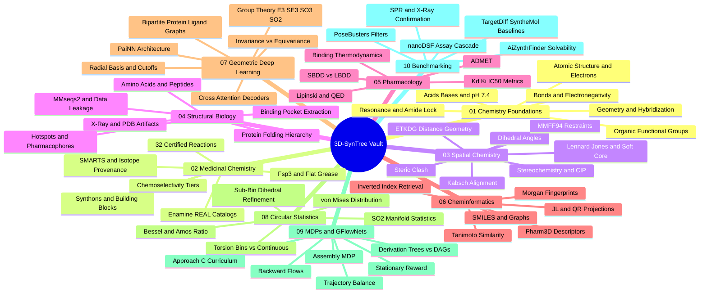

---
tags:
  - moc
  - 3dsyntree
module: "00. Master Index and System Map"
type: index
---

# 0. Master Vault Index

> [!abstract] Vault Mission
> This vault teaches you everything required to understand the 3D-SynTree drug-discovery AI project from absolute zero — atoms, bonds, proteins, pockets, thermodynamics, fingerprints, equivariant networks, circular statistics, and GFlowNets — with every concept explicitly connected back to the code, tensors, and design decisions of the system.

## How to Use This Vault

1. **Start with [[1. 3D-SynTree System Overview]]** to understand what the project is and the three problems it solves. Every note in this vault exists to explain one piece of that system.
2. **Follow the prerequisite order.** Open [[2. Prerequisite Knowledge Graph]] and respect the chains. Do not jump to GFlowNets or PaiNN before you are comfortable with hybridization, resonance, and bonding — the later notes silently assume them.
3. **Pick a track.** [[3. Study Tracks and Curriculum]] offers a 12-week full curriculum plus fast tracks for chemistry-first and ML-first readers.
4. **Read notes the structured way.** Every concept note has 9 numbered sections — see [[4. Vault Conventions and Note Schema]] for what each section means and how to study it.
5. **Use the graph, not just the folders.** Open Obsidian's Graph View, follow the backlinks panel (it shows everything that links INTO the note you are reading), and browse by tag (`moc`, `domain/...`, `depth/essential`).

## The Vault at a Glance

Every concept note in the vault, grouped by module. Module MOCs hold the detailed per-module maps.

## Module Directory

| Module | MOC | Mission | Concept Notes |
| --- | --- | --- | --- |
| 01. Chemistry Foundations | [[0. Chemistry Foundations MOC]] | Atoms, bonds, hybridization, functional groups, resonance, and pH 7.4 ionization — the vocabulary of every later module | 6 |
| 02. Medicinal Chemistry and Synthesis | [[0. Medicinal Chemistry and Synthesis MOC]] | Synthons, the 32 certified reactions, SMARTS and isotope provenance, chemoselectivity, Fsp3, and the Enamine REAL catalog | 6 |
| 03. Spatial Chemistry and Force Fields | [[0. Spatial Chemistry and Force Fields MOC]] | Stereochemistry, dihedrals, steric clash, Lennard-Jones potentials, ETKDG, MMFF94 restraints, and Kabsch alignment | 7 |
| 04. Structural Biology and Protein Targets | [[0. Structural Biology and Protein Targets MOC]] | Amino acids, protein folding, crystallography artifacts, pocket extraction, hotspots, and leakage-free dataset splits | 6 |
| 05. Pharmacology and Drug Discovery | [[0. Pharmacology and Drug Discovery MOC]] | Binding thermodynamics, Kd/Ki/IC50, drug-likeness rules, ADMET, and the SBDD vs LBDD paradigms | 5 |
| 06. Cheminformatics and Algorithms | [[0. Cheminformatics and Algorithms MOC]] | SMILES, Morgan fingerprints, Tanimoto similarity, JL/QR projections, pharm3d descriptors, and inverted-index retrieval | 6 |
| 07. Geometric Deep Learning and Equivariance | [[0. Geometric Deep Learning and Equivariance MOC]] | Group theory, invariance vs equivariance, radial bases, PaiNN, bipartite graphs, and cross-attention decoders | 6 |
| 08. Circular Statistics and Torsion Heads | [[0. Circular Statistics and Torsion Heads MOC]] | Statistics on SO(2), the von Mises distribution, Bessel functions and Amos' ratio, and torsion head design | 5 |
| 09. Markov Decision Processes and GFlowNets | [[0. Markov Decision Processes and GFlowNets MOC]] | The assembly MDP, derivation trees vs DAGs, trajectory balance, backward flows, stationary rewards, and curriculum learning | 6 |
| 10. Benchmarking and Wet Lab Translation | [[0. Benchmarking and Wet Lab Translation MOC]] | PoseBusters, AiZynthFinder, baseline comparisons, and the real-world assay cascade from synthesis to X-ray structures | 5 |

## The Three Problems This Project Solves

1. **The Synthesizability Wall** — continuous 3D diffusion models generate impossible molecular chimeras with under 20% retrosynthetic feasibility. 3D-SynTree enforces forward synthetic validity by construction. See [[1. 3D-SynTree System Overview]].
2. **The 3D Conformational Match** — 2D synthesis-tree models are synthesizable but blind to the binding cavity. 3D-SynTree predicts the junction dihedral directly inside the pocket.
3. **The Flat Grease Trap** — unconstrained reaction models default to flat, lipophilic biaryls. 3D-SynTree imposes $Fsp^3 \ge 0.40$ to force 3D saturation and drug-likeness.

## Quick Paths

- **Total beginner:** [[2. Prerequisite Knowledge Graph]] → start at [[1. Atomic Structure and Electrons]] and follow the chains.
- **Know chemistry, new to the ML:** jump to [[0. Geometric Deep Learning and Equivariance MOC]] after skimming [[2. Rotatable Bonds and Dihedral Angles]] and [[1. SMILES and Canonical Molecular Graphs]].
- **Know ML, new to chemistry:** follow the full order anyway — the science notes assume zero background and teach from scratch.
- **Only care about evaluation:** [[0. Benchmarking and Wet Lab Translation MOC]], backed by [[2. Kinetic and Affinity Metrics IC50 Kd Ki]] and [[3. X-Ray Crystallography and PDB Artifacts]].

## System Map Notes

- [[1. 3D-SynTree System Overview]] — what the system is, its architecture, and its key design parameters.
- [[2. Prerequisite Knowledge Graph]] — the strict dependency chains and the three learning spines.
- [[3. Study Tracks and Curriculum]] — the 12-week curriculum and focused study tracks.
- [[4. Vault Conventions and Note Schema]] — how every note is structured and how to extend the vault.
- [[5. Scope and Excluded Material]] — what this vault deliberately does not cover, and why.

## Cross-Domain Links

- [[AI/00. Master Index and System Map/0. Master AI Vault Index|0. Master AI Vault Index]] (AI vault) — the two companion vaults: scientific foundations on one side, AI and systems engineering on the other.
