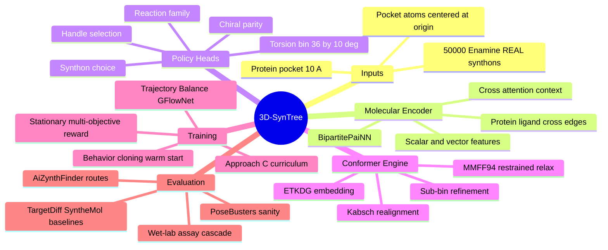

---
tags:
  - moc
  - 3dsyntree
  - topic/system-overview
module: "00. Master Index and System Map"
type: index
---

# 1. 3D-SynTree System Overview

> [!abstract] Core Idea
> 3D-SynTree is a structure-based, synthesis-constrained molecular generator: it grows a drug-like molecule one purchasable synthon at a time inside a protein binding pocket, choosing certified reactions, predicting only the junction torsion angle in 3D, and training the whole policy as a GFlowNet — so every design is simultaneously pocket-fitting, synthesizable, and three-dimensional.

## 1. What 3D-SynTree Is

3D-SynTree is an AI system for **de novo structure-based drug design (SBDD)**. Given a protein binding pocket (extracted as a 10 Å cavity from a crystal structure), it generates complete small molecules with three simultaneous guarantees:

1. **Synthetic validity by construction** — molecules are assembled from real building blocks in a curated 50,000-synthon subset of the Enamine REAL catalog, connected only through 32 certified medicinal-chemistry reactions. Every generated design ships with an actionable synthesis recipe (3–4 weeks, >80% success rate).
2. **3D pocket awareness** — every decision is conditioned on the joint protein-ligand 3D graph, and the geometry of each new fragment is embedded (ETKDG), realigned (Kabsch), and torsion-refined inside the pocket's electrostatic environment.
3. **Saturation and drug-likeness** — a hard $Fsp^3 \ge 0.40$ constraint (catalog filter 0.42) blocks the flat-aromatic "grease" that plagues reaction-based generators.

## 2. The Three Scientific Problems It Solves

### 2.1 The Synthesizability Wall

Continuous 3D diffusion models (TargetDiff, DiffSBDD) generate atoms and coordinates directly. The result: beautiful predicted poses, but under 20% of outputs survive retrosynthetic analysis — pentavalent carbons, unstable peroxides, extreme angle strain. A molecule you cannot synthesize is not a drug candidate; it is a rendering. 3D-SynTree enforces **forward synthetic validity**: it only executes reactions that medicinal chemists have certified to work, on building blocks you can actually purchase.

### 2.2 The 3D Conformational Match

2D forward-synthesis tree models (SynNet, SyntheMol) are synthesizable but operate blind to the binding cavity — they never see where the protein walls are. 3D-SynTree predicts the **exact dihedral angle around each newly formed single bond**, relaxing junction bonds with harmonic scaffold restraints in the protein's electrostatic field, so the growing molecule physically fits the cavity it is being designed for.

### 2.3 The Flat Grease Trap

Reaction-based generators default to unconstrained bi-aryl couplings (Suzuki and friends), producing flat, lipophilic sheets. These stack nicely in flat pockets and score well in silico, then fail in animals: poor solubility, fast liver clearance, promiscuous off-target binding. The $Fsp^3 \ge 0.40$ saturation constraint forces 3D shape, chiral vectors, and better pharmacokinetics.

## 3. The Architecture at a Glance

## 4. The Knowledge Domains Involved

The codebase extracts principles from four scientific pillars; each pillar maps to modules of this vault:

| Pillar | Concepts | Vault Modules |
| --- | --- | --- |
| Chemistry | SMARTS grammar, reaction disconnections, Enamine REAL synthons, Fsp3 saturation, MMFF94 restraints | [[0. Chemistry Foundations MOC]], [[0. Medicinal Chemistry and Synthesis MOC]], [[0. Spatial Chemistry and Force Fields MOC]] |
| Structural Biology | 10 Å binding pockets, residue protonation at pH 7.4, protein-ligand coordinates, PDB/SDF crystal artifacts, MMseqs2 clustering | [[0. Structural Biology and Protein Targets MOC]] |
| Geometry | SE(3) equivariance, PaiNN vector features, SO(2) circle torsions, von Mises distributions, Kabsch rigid alignment | [[0. Geometric Deep Learning and Equivariance MOC]], [[0. Circular Statistics and Torsion Heads MOC]] |
| Machine Learning | MDP and DAG semantics, GFlowNet trajectory balance, behavior cloning, multi-objective rewards, curriculum learning | [[0. Markov Decision Processes and GFlowNets MOC]], [[0. Cheminformatics and Algorithms MOC]] |

## 5. The Generation Loop Step by Step

One assembly step of the Markov Decision Process:

1. **State** — the protein pocket plus the current intermediate ligand in 3D, jointly encoded by `BipartitePaiNN` into a context vector.
2. **Action** — the hierarchical factorized action $(\text{handle}_t, r_t, B_t, c_t, \phi_t)$: which exposed reactive handle to extend, which certified reaction family to run, which catalog synthon to attach, which chiral parity to apply, and which 10° torsion bin to place the junction in — or STOP.
3. **Transition** — the reaction executes in RDKit; atoms are tracked by isotope provenance (core 1000+i, synthon 2000+j); the product is embedded with ETKDG, Kabsch-aligned onto the locked scaffold, sub-bin refined against steric clashes, and relaxed with MMFF94 under 50 kcal/mol/Ų harmonic restraints.
4. **Reward** — at termination, a stationary composite: docking score, soft-core Lennard-Jones contact energy, clash penalty, QED/Fsp3 drug-likeness, and key-interaction bonuses, exponentiated with temperature $T_{\text{reward}}$ and floored at $R_{\min} = 10^{-4}$.
5. **Learning** — Trajectory Balance trains the policy to sample molecules proportional to reward, preserving diversity across all high-reward modes instead of collapsing onto one.

Details: [[1. The Assembly MDP Formulation]] and [[3. Stationary Terminal Reward Formulation]].

## 6. Key Design Parameters

| Parameter | Value | Note |
| --- | --- | --- |
| Pocket extraction radius | 10.0 Å | Around the co-crystallized ligand centroid, centered at origin |
| Pocket size | 100–700 atoms | 200–800 typical; capped to prevent CUDA OOM |
| Catalog | 50,000 synthons | Curated from Enamine REAL (>38 billion virtual compounds) |
| Reaction grammar | 32 certified reactions | 10 reactive handle classes |
| Saturation constraint | Fsp3 ≥ 0.40 | Catalog filter at 0.42 with tanh-shaped reward |
| Torsion action space | 36 bins × 10° | Categorical for measure-consistent GFlowNet training |
| Sub-bin refinement | ±5.0° | Golden-section search on the soft-core clash potential |
| Message-passing cutoff | 5.0 Å | Cosine-smoothed radial basis expansion |
| Isotope provenance | 1000 / 2000 offsets | Core vs synthon atom lineage tracking |
| MMFF94 tether | 50 kcal/mol/Ų | Flat-bottom restraint on scaffold atoms |
| Training set | ~20,000 complexes | Cluster-split at <30% MMseqs2 sequence identity |
| Curriculum | 9 quantiles, 6 stages | Approach C difficulty scheduling |
| PoseBusters target | >80% pass rate | Versus <20% for unconstrained diffusion baselines |

## 7. Where to Go Next

- The molecule story: [[0. Chemistry Foundations MOC]] → [[0. Medicinal Chemistry and Synthesis MOC]].
- The protein story: [[0. Structural Biology and Protein Targets MOC]] → [[0. Pharmacology and Drug Discovery MOC]].
- The geometry story: [[0. Spatial Chemistry and Force Fields MOC]] → [[0. Geometric Deep Learning and Equivariance MOC]].
- The learning story: [[0. Circular Statistics and Torsion Heads MOC]] → [[0. Markov Decision Processes and GFlowNets MOC]].
- The reality check: [[0. Benchmarking and Wet Lab Translation MOC]].
- The full dependency order: [[2. Prerequisite Knowledge Graph]].
