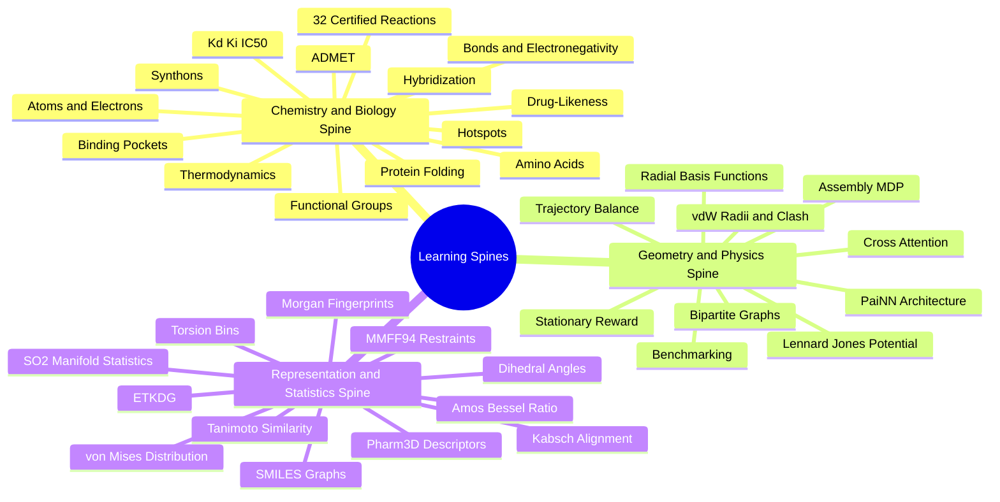

---
tags:
  - moc
  - 3dsyntree
  - topic/learning-paths
module: "00. Master Index and System Map"
type: index
---

# 2. Prerequisite Knowledge Graph

> [!abstract] Core Idea
> The vault's 58 concept notes form a directed dependency graph. This note lays out that graph as three parallel learning spines — the chemistry-biology spine, the geometry-physics spine, and the representation-statistics spine — that repeatedly merge into the same advanced notes (torsion prediction, GFlowNet training, benchmarking).

## 1. How to Read This Graph

- Every note's **Prerequisites** section lists the notes you should have mastered first; its **Further Dependencies** section shows what unlocks afterwards. The Obsidian **backlinks** panel of any note tells you exactly which notes cite it as a prerequisite — if a backlink confuses you, you have found a gap to close.
- Notes tagged `depth/essential` are mandatory. `depth/supporting` deepens specific components. `depth/advanced` is research-level analysis (safe to defer on a first pass).
- **Never skip ahead.** GFlowNet trajectory balance silently assumes the MDP formulation; the MDP assumes the reaction grammar; the reaction grammar assumes functional groups. One missing layer and every later note becomes memorization instead of understanding.

## 2. The Three Learning Spines

### Spine 1 — Chemistry and Biology (what molecules and targets are)

[[1. Atomic Structure and Electrons]] → [[2. Chemical Bonds and Electronegativity]] → [[3. Molecular Geometry and Hybridization]] → [[1. Organic Functional Groups]] → [[1. Building Blocks and Synthons]] → [[2. The 32 Certified Reaction Grammar]] → [[3. Reaction SMARTS and Isotope Provenance]], running in parallel with the ionization branch [[3. Acids Bases and pH 7.4 Ionization]] → [[1. Amino Acids and Peptide Backbones]] → [[2. Protein 3D Hierarchy and Folding]] → [[1. Binding Pockets and Cavity Extraction]] → [[2. Pharmacophores and Interaction Hotspots]] → [[1. Protein Ligand Binding Thermodynamics]] → [[2. Kinetic and Affinity Metrics IC50 Kd Ki]] → [[1. Lipinski Rules QED and Drug Likeness]] → [[2. ADMET Pharmacokinetics and Metabolic Stability]].

### Spine 2 — Geometry and Physics (how the AI sees 3D space)

[[3. Van der Waals Radii and Steric Clash]] → [[1. Lennard Jones and Soft Core Potentials]] → [[1. Group Theory E3 SE3 SO3 and SO2]] → [[2. Invariance vs Equivariance in Molecular Clouds]] → [[3. Radial Basis Functions and Cosine Cutoffs]] → [[1. PaiNN Polarizable Interaction Networks]] → [[2. Bipartite Heterogeneous Protein Ligand Graphs]] → [[3. Cross Attention Decoders for SBDD]] → [[1. The Assembly MDP Formulation]] → [[1. Trajectory Balance GFlowNets Theory]] → [[3. Stationary Terminal Reward Formulation]] → [[1. PoseBusters Physical Sanity Filters]].

### Spine 3 — Representation and Statistics (how molecules become numbers)

[[1. SMILES and Canonical Molecular Graphs]] → [[2. Morgan Circular Fingerprints]] → [[3. Tanimoto Similarity and Diversity]] → [[1. Johnson Lindenstrauss and QR Projections]] → [[2. Pharm3D Pharmacophore Descriptors]], running in parallel with the torsion branch [[2. Rotatable Bonds and Dihedral Angles]] → [[2. Distance Geometry and ETKDG]] → [[3. Molecular Mechanics and MMFF94 Restraints]] → [[4. The Kabsch Algorithm and Rigid Alignment]] → [[1. Statistics on Riemannian Manifolds SO2]] → [[2. The von Mises Distribution]] → [[3. Modified Bessel Functions and Amos Ratio]] → [[1. Categorical Binned vs Continuous Torsion Space]] → [[2. Sub Bin Pocket Conditioned Dihedral Refinement]].

## 3. Module-Internal Reading Order

The MOC of each module gives the full path; the essential order is:

| Module | Strict internal order |
| --- | --- |
| 01 | Atoms → Bonds → Hybridization → Functional Groups → Resonance → pH 7.4 |
| 02 | Synthons → 32 Reactions → SMARTS and Isotopes; Chemoselectivity → Fsp3 → Enamine REAL |
| 03 | Stereochemistry → Dihedrals → Steric Clash → Lennard Jones → ETKDG → MMFF94 → Kabsch |
| 04 | Amino Acids → Folding → X-Ray Artifacts → Pockets → Hotspots → MMseqs2 Leakage |
| 05 | Thermodynamics → Kd Ki IC50 → Lipinski and QED → ADMET → SBDD vs LBDD |
| 06 | SMILES → Morgan → Tanimoto → JL and QR → Pharm3D → Inverted Index |
| 07 | Group Theory → Equivariance → Radial Bases → PaiNN → Bipartite Graphs → Cross Attention |
| 08 | SO2 Manifolds → von Mises → Bessel and Amos → Torsion Bins → Sub-Bin Refinement |
| 09 | Assembly MDP → Trees vs DAGs → Trajectory Balance → Backward Flows → Stationary Reward → Curriculum |
| 10 | PoseBusters → AiZynthFinder → Baselines → nanoDSF Cascade → SPR and X-Ray |

## 4. Where the Spines Merge

- **[[1. Categorical Binned vs Continuous Torsion Space]]** merges Spine 3's circular statistics with Spine 2's GFlowNet training requirements (measure consistency in the Trajectory Balance loss).
- **[[3. Stationary Terminal Reward Formulation]]** merges all three spines: Lennard-Jones contact energy (Spine 2), pocket hotspots and drug-likeness (Spine 1), and descriptor-based property scoring (Spine 3).
- **[[1. The Assembly MDP Formulation]]** requires the reaction grammar (Spine 1), the pocket encoder (Spine 2), and synthon retrieval (Spine 3).
- **[[3. Baseline Comparisons TargetDiff SyntheMol]]** and the wet-lab notes are capstones requiring all spines.

## 5. The Zero-to-Hero Sequence

If you follow just one list, follow this one — it interleaves the three spines so each note arrives exactly when needed:

1. [[1. Atomic Structure and Electrons]]
2. [[2. Chemical Bonds and Electronegativity]]
3. [[3. Molecular Geometry and Hybridization]]
4. [[1. Organic Functional Groups]]
5. [[2. Resonance Conjugation and the Amide Planarity Lock]]
6. [[3. Acids Bases and pH 7.4 Ionization]]
7. [[1. Stereochemistry Chirality and CIP Rules]]
8. [[2. Rotatable Bonds and Dihedral Angles]]
9. [[3. Van der Waals Radii and Steric Clash]]
10. [[1. Building Blocks and Synthons]]
11. [[2. The 32 Certified Reaction Grammar]]
12. [[3. Reaction SMARTS and Isotope Provenance]]
13. [[1. Chemoselectivity and Reactivity Tiers]]
14. [[2. Fsp3 Saturation and the Flat Grease Trap]]
15. [[3. Enamine REAL Space and Catalogs]]
16. [[1. Lennard Jones and Soft Core Potentials]]
17. [[2. Distance Geometry and ETKDG]]
18. [[3. Molecular Mechanics and MMFF94 Restraints]]
19. [[4. The Kabsch Algorithm and Rigid Alignment]]
20. [[1. Amino Acids and Peptide Backbones]]
21. [[2. Protein 3D Hierarchy and Folding]]
22. [[3. X-Ray Crystallography and PDB Artifacts]]
23. [[1. Binding Pockets and Cavity Extraction]]
24. [[2. Pharmacophores and Interaction Hotspots]]
25. [[3. Homology MMseqs2 Clustering and Data Leakage]]
26. [[1. Protein Ligand Binding Thermodynamics]]
27. [[2. Kinetic and Affinity Metrics IC50 Kd Ki]]
28. [[1. Lipinski Rules QED and Drug Likeness]]
29. [[2. ADMET Pharmacokinetics and Metabolic Stability]]
30. [[3. Structure Based vs Ligand Based Drug Design]]
31. [[1. SMILES and Canonical Molecular Graphs]]
32. [[2. Morgan Circular Fingerprints]]
33. [[3. Tanimoto Similarity and Diversity]]
34. [[1. Johnson Lindenstrauss and QR Projections]]
35. [[2. Pharm3D Pharmacophore Descriptors]]
36. [[3. Hashed Inverted Indices for Synthon Retrieval]]
37. [[1. Group Theory E3 SE3 SO3 and SO2]]
38. [[2. Invariance vs Equivariance in Molecular Clouds]]
39. [[3. Radial Basis Functions and Cosine Cutoffs]]
40. [[1. PaiNN Polarizable Interaction Networks]]
41. [[2. Bipartite Heterogeneous Protein Ligand Graphs]]
42. [[3. Cross Attention Decoders for SBDD]]
43. [[1. Statistics on Riemannian Manifolds SO2]]
44. [[2. The von Mises Distribution]]
45. [[3. Modified Bessel Functions and Amos Ratio]]
46. [[1. Categorical Binned vs Continuous Torsion Space]]
47. [[2. Sub Bin Pocket Conditioned Dihedral Refinement]]
48. [[1. The Assembly MDP Formulation]]
49. [[2. Derivation Trees vs Molecular DAGs]]
50. [[1. Trajectory Balance GFlowNets Theory]]
51. [[2. Multi Path Probability and Backward Flows]]
52. [[3. Stationary Terminal Reward Formulation]]
53. [[4. Curriculum Learning Approach C Quantiles]]
54. [[1. PoseBusters Physical Sanity Filters]]
55. [[2. AiZynthFinder Retrosynthetic Solvability]]
56. [[3. Baseline Comparisons TargetDiff SyntheMol]]
57. [[1. Assay Cascade Strategy and nanoDSF]]
58. [[2. SPR Kinetics and X-Ray Complex Confirmation]]

> [!tip] Study Rhythm
> One note per study session is a good pace; the 12-week plan in [[3. Study Tracks and Curriculum]] turns this sequence into a schedule. After each note, open its **Concept Mind Map** and try to explain every branch from memory before moving on — the gate-check questions in each module MOC are your self-exam.
