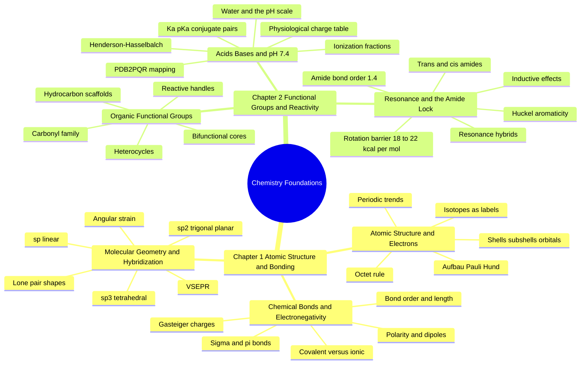

---
tags:
  - moc
  - domain/chemistry
  - 3dsyntree
module: "01. Chemistry Foundations"
type: moc
---

# 0. Chemistry Foundations MOC

> [!abstract] Module Mission
> This module builds chemistry from the atom up: subatomic particles and electron shells, then bonds and electronegativity, then the 3D geometry of molecules, then the functional groups that make molecules react, the resonance effects that lock parts of them flat, and the acid–base rules that fix every group's charge at physiological pH 7.4. Together these six notes supply the complete vocabulary needed to understand what 3D-SynTree is designing and why its geometric and synthesizability constraints exist.

Navigation: [[0. Master Vault Index]] · [[2. Prerequisite Knowledge Graph]] · [[3. Study Tracks and Curriculum]]

## Module Mind Map

## Chapter 1. Atomic Structure and Chemical Bonding

| Note | Focus | Required Depth | Key Prerequisites |
| --- | --- | --- | --- |
| [[1. Atomic Structure and Electrons]] | Protons, neutrons, electrons; quantum shells and orbitals; filling rules; octet rule; periodic trends; isotopes | Essential | None — self-contained entry point |
| [[2. Chemical Bonds and Electronegativity]] | Covalent vs ionic bonding, Lewis structures, formal charge, sigma/pi bonds, bond order and length, polarity, dipole moments, Gasteiger charges | Essential | [[1. Atomic Structure and Electrons]] |
| [[3. Molecular Geometry and Hybridization]] | VSEPR, sp3-sp2-sp hybridization, bond angles, lone-pair geometries, angular strain, Fsp3 | Essential | [[2. Chemical Bonds and Electronegativity]] |

## Chapter 2. Functional Groups and Reactivity

| Note | Focus | Required Depth | Key Prerequisites |
| --- | --- | --- | --- |
| [[1. Organic Functional Groups]] | Hydrocarbon scaffolds, all core functional groups (carbonyls, amides, sulfonamides, boronic acids, and more), heterocycles, reactive handles, bifunctional cores, terminal caps | Essential | [[2. Chemical Bonds and Electronegativity]], [[3. Molecular Geometry and Hybridization]] |
| [[2. Resonance Conjugation and the Amide Planarity Lock]] | Inductive effects, resonance delocalization, aromaticity and Hückel's rule, the amide/ester planarity lock with its 18–22 kcal/mol barrier | Essential | [[3. Molecular Geometry and Hybridization]], [[1. Organic Functional Groups]] |
| [[3. Acids Bases and pH 7.4 Ionization]] | Water chemistry, pH, Ka/pKa, Henderson–Hasselbalch with worked examples, ionization fractions, charge states of every drug-relevant group at pH 7.4, PDB2PQR mapping | Essential | [[2. Chemical Bonds and Electronegativity]], [[1. Organic Functional Groups]] |

## Learning Path Through This Module

1. [[1. Atomic Structure and Electrons]] — start at zero: what atoms are made of and why electron configuration dictates everything downstream.
2. [[2. Chemical Bonds and Electronegativity]] — put those valence electrons to work as bonds, and learn how unequal sharing creates the partial charges that drive molecular recognition.
3. [[3. Molecular Geometry and Hybridization]] — give bonds a 3D direction; this is where "flat vs 3D molecule" becomes computable (Fsp3) and where rotatable vs locked bonds first appear.
4. [[1. Organic Functional Groups]] — assemble the working vocabulary of drug chemistry: every group the system can react, retrieve, and reward.
5. [[2. Resonance Conjugation and the Amide Planarity Lock]] — the electronic effects that rigidify molecules, culminating in the amide lock that the conformer engine enforces as a hard constraint.
6. [[3. Acids Bases and pH 7.4 Ionization]] — the last ingredient: which groups carry real charges in the body, and why the pipeline must assign them explicitly.

## Why This Module Matters for 3D-SynTree

3D-SynTree designs molecules atom by atom inside a protein pocket, so its representation, its action space, and its reward are all written in the language of this module. The encoder consumes atomic numbers and formal charges (Note 1 and Note 6); the partial charges and hydrogen-bond/salt-bridge geometry that the reward scores are applied bond polarity (Notes 2 and 6); the torsion policy only exists because single bonds rotate while resonance-locked amides do not (Notes 3 and 5); and the entire catalog and the Fsp³ ≥ 0.40 anti-flatness constraint are hybridization accounting (Note 3). Every one of the 32 certified reactions in the grammar is a pairing of the functional groups of Note 4. Without this module, the project's core design decisions — planarity locks, charge projection, saturation filters, key-interaction bonuses — would be arbitrary rules instead of consequences of physics. For the system-level view of how these pieces fit together, see [[1. 3D-SynTree System Overview]].

## Gate Check

> [!question] Before moving on, can you...
> - Explain, from a neutral carbon atom's electron configuration, why carbon forms exactly four bonds and what geometry they adopt?
> - Predict whether a bond is non-polar, polar, or ionic from electronegativity values, and compute a formal charge for an atom in a given Lewis structure?
> - Take a molecular fragment and label every carbon as sp3, sp2, or sp — and say which bonds can rotate and which are locked?
> - Recite the state at pH 7.4 of a carboxylic acid, an aliphatic amine, an aniline, a sulfonate, a guanidinium, and an imidazole, and compute the ionization fraction of an acid with pKa 4.5 using Henderson–Hasselbalch?
> - Explain why an amide bond cannot rotate freely, quoting both the barrier height and the bond order that enforces it?

## Primary Reading

Lovering, F., Bikker, J., & Humblet, C. (2009). *Escape from Flatland: Increasing Saturation as an Approach to Improving Clinical Success*. **Journal of Medicinal Chemistry**, 52(21), 6752–6756.
