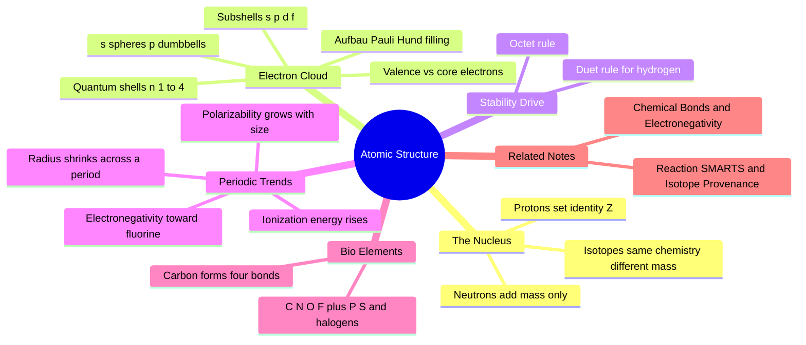

---
tags:
  - domain/chemistry
  - depth/essential
  - 3dsyntree
  - topic/atomic-structure
  - topic/periodic-trends
module: "01. Chemistry Foundations"
chapter: "Chapter 1. Atomic Structure and Chemical Bonding"
type: concept
---

# 1. Atomic Structure and Electrons

> [!abstract] Core Idea
> Every chemical property an atom has — what it bonds to, what 3D shape it makes, how it interacts with a protein — is fixed by two things: how many protons sit in its nucleus, and how its electrons arrange themselves in layered probability clouds around that nucleus.

Navigation: [[0. Chemistry Foundations MOC]] · [[0. Master Vault Index]]

## 1. What It Is

An **atom** is the smallest unit of a chemical element that still behaves like that element. It has two regions:

- The **nucleus**: a dense core at the center containing **protons** (particles with charge $+1$) and **neutrons** (uncharged particles). The nucleus holds essentially all of the atom's mass.
- The **electron cloud**: a much larger, fuzzy region occupied by **electrons** (charge $-1$, about 1/1836 the mass of a proton). Electrons do not orbit like planets; they occupy **orbitals** — three-dimensional probability clouds describing where an electron is likely to be found.

Three numbers describe an atom:

- The **atomic number** $Z$ = the number of protons. It *defines* which element the atom is: $Z=6$ is carbon, $Z=7$ is nitrogen, $Z=8$ is oxygen — always, everywhere.
- The **mass number** $A$ = protons + neutrons, counted in **atomic mass units** (amu, where one proton or neutron ≈ 1 amu).
- The net charge = protons − electrons. A neutral atom has equal numbers of both.

**Isotopes** are atoms of the *same* element (same $Z$) with *different* neutron counts, hence different masses: ${}^{12}\text{C}$ (6 neutrons) and ${}^{13}\text{C}$ (7 neutrons) are both carbon and react identically in chemistry.

## 2. Why It Exists

Isolated atoms are usually not the lowest-energy arrangement of matter. Electrons in an atom can only occupy specific **quantized energy levels** — a direct consequence of quantum mechanics — and an atom is most stable when its outermost (highest-energy) occupied level is filled or emptied to match a particularly stable configuration. Because only the outermost electrons can be gained, lost, or shared, atoms trade and share electrons with each other. That trading and sharing *is* chemistry: it creates every bond, every molecular shape, and every intermolecular interaction. If you understand which electrons are available and what configuration the atom is driving toward, you can predict essentially all reactivity — which is why this note is the root of the whole vault.

## 3. How It Works

### 3.1 Proton Count Is Identity, Neutron Count Is Just Mass

The number of protons determines the element and therefore its whole chemistry: carbon forms four bonds whether it is ${}^{12}\text{C}$ or ${}^{13}\text{C}$. Electrons determine the *state* (neutral atom, positive cation, negative anion), and since electrons can be transferred or shared, electron bookkeeping is what bonding is about. A neutral atom has $Z$ electrons; a cation has lost some, an anion has gained some.

### 3.2 Quantum Shells, Subshells, and Orbitals

Electrons occupy **shells** numbered by the principal quantum number $n = 1, 2, 3, 4, \dots$ (also called K, L, M, N). Shell $n$ holds at most $2n^2$ electrons. Each shell contains **subshells** labeled $s$, $p$, $d$, $f$, which hold at most 2, 6, 10, and 14 electrons respectively:

| Shell | Subshells available | Max electrons |
| --- | --- | --- |
| $n=1$ | $1s$ | 2 |
| $n=2$ | $2s, 2p$ | 8 |
| $n=3$ | $3s, 3p, 3d$ | 18 |

Each subshell is made of **orbitals**, each holding at most 2 electrons:

- An $s$ orbital is a **sphere** centered on the nucleus.
- The three $p$ orbitals ($p_x$, $p_y$, $p_z$) are **dumbbells** oriented along the $x$, $y$, and $z$ axes.
- $d$ and $f$ orbitals have more complex shapes (relevant mostly for metals, which drug molecules largely avoid).

> [!note] Orbital ≠ orbit
> An orbital is not a path. It is a 3D probability map: the electron is somewhere inside the cloud, and the cloud's *shape* is what matters for bonding, because bonds form where clouds overlap.

### 3.3 Filling Rules: Aufbau, Pauli, Hund

Three rules govern how electrons fill this ladder of orbitals:

1. **Aufbau principle**: fill the lowest-energy subshell first ($1s$, then $2s$, then $2p$, then $3s$, then $3p$, ...).
2. **Pauli exclusion principle**: no two electrons in an atom can be in the same state; each orbital holds at most 2 electrons, and they must have opposite spins.
3. **Hund's rule**: within a subshell, electrons occupy separate orbitals singly before pairing up.

### 3.4 Ground-State Configurations of the Biologically Relevant Elements

> [!example] Writing electron configurations
> Carbon, $Z=6$: fill $1s$ (2 electrons), $2s$ (2), then $2p$ (2) → $1s^2\, 2s^2\, 2p^2$. The 2 inner electrons are core; the 4 in $n=2$ are the chemically active **valence** electrons — which is exactly why carbon forms four bonds.

| Element | $Z$ | Configuration | Valence electrons |
| --- | --- | --- | --- |
| H | 1 | $1s^1$ | 1 |
| C | 6 | $1s^2\, 2s^2\, 2p^2$ | 4 |
| N | 7 | $1s^2\, 2s^2\, 2p^3$ | 5 |
| O | 8 | $1s^2\, 2s^2\, 2p^4$ | 6 |
| F | 9 | $1s^2\, 2s^2\, 2p^5$ | 7 |
| P | 15 | $[\text{Ne}]\, 3s^2\, 3p^3$ | 5 |
| S | 16 | $[\text{Ne}]\, 3s^2\, 3p^4$ | 6 |
| Cl | 17 | $[\text{Ne}]\, 3s^2\, 3p^5$ | 7 |
| Br | 35 | $[\text{Ar}]\, 3d^{10}\, 4s^2\, 4p^5$ | 7 |
| I | 53 | $[\text{Kr}]\, 4d^{10}\, 5s^2\, 5p^5$ | 7 |

$[\text{Ne}]$ and $[\text{Ar}]$ are shorthand for the filled shells of neon and argon — chemically inert **core electrons** that never participate in bonding.

### 3.5 Valence Electrons and the Octet Rule

**Valence electrons** are the outermost-shell electrons; **core electrons** are everything below them. Only valence electrons form bonds. Atoms are dramatically stabilized when their valence shell reaches 8 electrons (a full $s^2 p^6$ set) — the **octet rule**. Hydrogen is the small exception: it needs only 2 (the **duet rule**), matching helium.

- Carbon (4 valence) needs 4 more → forms 4 bonds, e.g. methane $\text{CH}_4$.
- Nitrogen (5 valence) needs 3 → forms 3 bonds plus one **lone pair** (a non-bonding pair), e.g. ammonia $\text{NH}_3$.
- Oxygen (6 valence) needs 2 → forms 2 bonds plus two lone pairs, e.g. water $\text{H}_2\text{O}$.

Atoms achieve octets by *sharing* electrons (covalent bonding, see [[2. Chemical Bonds and Electronegativity]]) or by *transferring* them (ionic bonding). Transition-metal $d$-orbital coordination chemistry and radioactivity/nuclear decay are deliberately out of scope — 3D-SynTree designs organic, metal-free, electron-driven drug molecules, so neither topic affects anything downstream.

### 3.6 Periodic Trends

The **periodic table** arranges elements into **periods** (rows) and **groups** (columns); elements in the same group have the same valence count and similar behavior. Blocks ($s$, $p$, $d$, $f$) map to which subshell is being filled. Four trends matter:

- **Atomic radius** shrinks left→right across a period (more protons pull the same shell tighter) and grows down a group (more shells).
- **Ionization energy** (energy to remove an electron) rises left→right and up; tight, small atoms hold electrons hardest.
- **Electron affinity** (energy released on gaining an electron) is most negative toward the top right.
- **Electronegativity** ($\chi$, Pauling scale) — an atom's pull on *shared* electrons — rises toward fluorine ($\chi = 3.98$). Oxygen is 3.44, nitrogen 3.04, carbon 2.55, hydrogen 2.20. This single trend explains bond polarity (Note 2) and the reactivity of every functional group (see [[1. Organic Functional Groups]]).
- **Polarizability** (how easily an electron cloud is deformed) grows with size: heavy, diffuse atoms like sulfur and iodine have soft clouds, which matters for dispersion interactions in protein pockets.

## 4. What It Consists Of

- **Proton** — positively charged nuclear particle; count sets the element.
- **Neutron** — neutral nuclear particle; count sets the isotope and mass.
- **Electron** — negative particle in orbitals; count sets the charge state.
- **Nucleus** — the proton + neutron core holding nearly all mass.
- **Atomic number $Z$** — proton count; chemical identity.
- **Mass number $A$** — proton + neutron count, in amu.
- **Isotope** — same $Z$, different neutron count; same chemistry, different mass.
- **Shell / subshell / orbital** — quantized energy levels ($n$), their subdivisions ($s,p,d,f$), and the probability clouds within them.
- **Valence shell** — outermost occupied shell; the only one that bonds.
- **Octet rule** — the drive toward 8 valence electrons (2 for hydrogen).
- **Electronegativity $\chi$** — pull on shared bonding electrons.

## 5. What You Must Understand

> [!warning] Identity vs mass
> Students often mix this up: changing *neutrons* changes only mass (isotope); changing *protons* changes the element itself; changing *electrons* changes only the charge. Chemistry — and every AI model of chemistry — keys on $Z$ and electrons, not on mass.

> [!tip] Memory hooks
> Carbon: 4 bonds, no lone pairs. Nitrogen: 3 bonds + 1 lone pair. Oxygen: 2 bonds + 2 lone pairs. Memorize this trio — it covers 90% of drug atoms. Electronegativity remembers "FONCl" order: F > O > N > Cl > C > H.

> [!note] Why isotopes are the perfect atom labels
> Because isotopes share proton count and electron configuration, they undergo *identical* reactions. That is exactly why 3D-SynTree can tag atoms with heavy isotope numbers purely as labels without perturbing the chemistry — covered below.

## 6. Prerequisites

- None — this is the self-contained entry point of the vault. The closest follow-on is [[2. Chemical Bonds and Electronegativity]], which puts these electrons to work.

## 7. Project Connection

3D-SynTree's neural models consume raw atomic numbers: the `pocket_z` and `ligand_z` tensors in `syntree/data/featurizer.py` store $Z$ values (hydrogen 1 through element 100) and feed them through `self.atomic_embedding(Z)` so the network learns a vector per element. The vault's Rule 1 — proton count is identity — is literally a lookup key in the model.

The isotope concept has a direct engineering use: in `syntree/chemistry/reactions.py`, core atoms are labeled with isotope offsets via `_CORE_MAP_OFFSET = 1000` and synthon atoms via `_SYNTHON_MAP_OFFSET = 2000`. These fake "isotopes" change the mass number but not $Z$, so reactions proceed identically while every atom's lineage stays traceable across synthesis steps — the trick that lets 3D coordinates survive chemical transformations (full story in [[3. Reaction SMARTS and Isotope Provenance]]).

## 8. Required Depth

**Essential** — every later note (bonding, geometry, functional groups, ionization) is applied atomic structure; the spec marks this as required foundational depth.

## 9. Further Dependencies

- [[2. Chemical Bonds and Electronegativity]] — bonds are the direct consequence of valence electrons seeking octets.
- [[3. Reaction SMARTS and Isotope Provenance]] — depends on the isotope concept introduced here for atom tracking.

## Concept Mind Map

## Cross-Domain Links

- [[AI/02. Representation Learning and Latent Metric Spaces/Chapter 1. Discrete Embedding Spaces/1. High-Dimensional Lookup Tables and Gradients|1. High-Dimensional Lookup Tables and Gradients]] (AI vault) — the atomic number $Z$ selects a row of a learnable embedding table, turning the discrete periodic table into a continuous latent vector.
