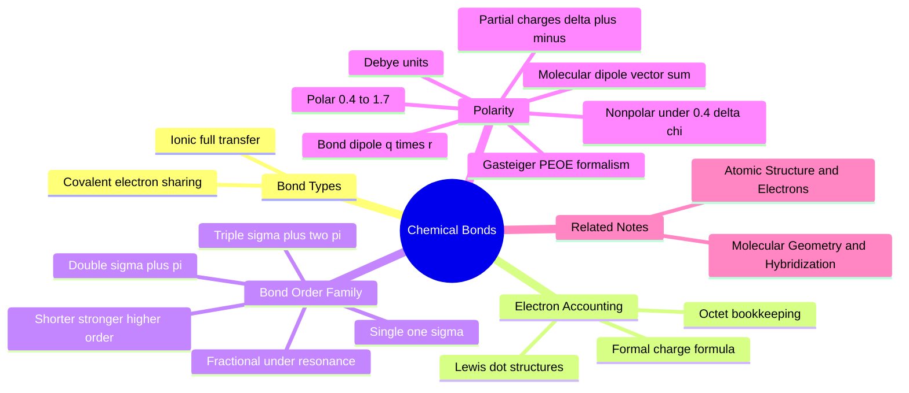

---
tags:
  - domain/chemistry
  - depth/essential
  - 3dsyntree
  - topic/bonding
  - topic/electronegativity
module: "01. Chemistry Foundations"
chapter: "Chapter 1. Atomic Structure and Chemical Bonding"
type: concept
---

# 2. Chemical Bonds and Electronegativity

> [!abstract] Core Idea
> Atoms glue together by electrical forces: covalent bonds share electron pairs between atoms, ionic bonds transfer electrons wholesale, and when the two partners pull on shared electrons with different strength (different electronegativity), the bond becomes polar — creating the partial charges that make drug molecules stick to proteins.

Navigation: [[0. Chemistry Foundations MOC]] · [[0. Master Vault Index]]

## 1. What It Is

A **chemical bond** is an electrical attraction that holds atoms together in a molecule. Two idealized extremes bracket reality:

- A **covalent bond** is a pair of electrons shared between two atoms, each atom contributing one electron. The shared negative cloud sits between the two positive nuclei and attracts both, gluing them together.
- An **ionic bond** forms when one atom completely transfers electrons to another, producing a **cation** (positive ion) and an **anion** (negative ion) that attract each other electrostatically — e.g. $\text{Na}^+$ and $\text{Cl}^-$ in table salt.

Real bonds sit on a continuum between these extremes. When the sharing is *unequal*, the bond is a **polar covalent bond**: the electron cloud drifts toward the greedier atom, producing a **partial negative charge** ($\delta^-$) on it and a **partial positive charge** ($\delta^+$) on the other. The atom's greediness is quantified by its **electronegativity** $\chi$.

## 2. Why It Exists

Nature runs downhill energetically. Isolated atoms with partially filled valence shells sit at higher energy than bonded atoms whose shells are filled (see [[1. Atomic Structure and Electrons]] for the octet rule). By sharing, transferring, or pooling electrons, atoms reach lower-energy, filled-shell arrangements and release energy. Every molecule that exists is a snapshot of this energy-lowering: a drug molecule is simply a specific arrangement of bonds, each one a local energy minimum. Understanding *where* electrons concentrate within those bonds is what lets you predict where a molecule is sticky, reactive, or chemically vulnerable.

## 3. How It Works

### 3.1 Lewis Dot Structures and Electron Accounting

A **Lewis structure** is the bookkeeping diagram for bonds: atoms are written with their symbols, valence electrons as dots, and shared pairs as lines (a line = one bond = one shared pair). The recipe:

1. Count total valence electrons (sum over atoms, add one per negative charge, subtract one per positive charge).
2. Connect atoms with single bonds (2 electrons each).
3. Distribute remaining electrons as lone pairs to satisfy every atom's octet (duet for H).
4. If an atom lacks an octet, convert lone pairs into double or triple bonds.

> [!example] Formaldehyde, $\text{CH}_2\text{O}$
> Valence count: C(4) + 2 × H(1) + O(6) = 12 electrons. Connect C to both H and to O (3 bonds, 6 electrons). The remaining 6 electrons go to oxygen as 3 lone pairs — but then carbon has only 6 electrons. Convert one O lone pair into a C=O double bond: now carbon has an octet (two C–H bonds + one C=O double bond = 4 shared pairs) and oxygen has an octet (double bond + 2 lone pairs). Formaldehyde has a C=O bond, not a C–O bond, precisely because of octet bookkeeping.

### 3.2 Formal Charge

**Formal charge** (FC) is the accounting charge an atom *carries on paper*, assuming perfectly equal sharing:

$$FC = V - N - \tfrac{1}{2}B$$

where $V$ = valence electrons of the free atom, $N$ = non-bonding (lone-pair) electrons on the bonded atom, $B$ = electrons in bonds it shares. The sum of all formal charges equals the molecule's net charge.

> [!example] Ammonium, $\text{NH}_4^+$
> Nitrogen: $V = 5$, $N = 0$, $B = 8$ (four bonds) → $FC = 5 - 0 - 4 = +1$. Each hydrogen: $1 - 0 - 1 = 0$. Net charge: $+1$. This is the charge state every aliphatic amine adopts at physiological pH — a direct bridge to [[3. Acids Bases and pH 7.4 Ionization]].

### 3.3 The Bond Taxonomy: Single, Double, Triple

Bonds come from orbital overlap in two flavors:

- **$\sigma$-bond (sigma)**: head-on overlap along the line joining the two nuclei. Every bond has exactly one $\sigma$-bond; it is the strong, rotation-permitting backbone of a molecule.
- **$\pi$-bond (pi)**: lateral (side-by-side) overlap of two parallel $p$ orbitals, above and below the bond axis. A $\pi$-bond is added *on top of* a $\sigma$-bond to make double and triple bonds, and it is rigid: rotating would break the overlap.

| Bond type | Composition | Bond order | Example | Typical C–C length |
| --- | --- | --- | --- | --- |
| Single | 1 $\sigma$ | 1 | ethane $\text{C}-\text{C}$ | 1.54 Å |
| Double | $\sigma + \pi$ | 2 | ethene $\text{C}=\text{C}$ | 1.34 Å |
| Triple | $\sigma + 2\pi$ | 3 | ethyne $\text{C}\equiv\text{C}$ | 1.20 Å |

**Bond order** is the number of shared electron pairs: higher order means shorter, stronger, stiffer bonds (**bond length** shrinks; **bond dissociation energy** rises). Fractional bond orders like 1.5 or 1.4 arise when electrons are *delocalized* over several atoms — the amide C–N bond's order of $\approx 1.4$ is the star of [[2. Resonance Conjugation and the Amide Planarity Lock]].

A **coordinate covalent (dative) bond** is the special case where one atom donates both electrons of the shared pair — common for metal complexes, less so in organic drugs.

### 3.4 Ionic Bonding

When $\Delta\chi$ is very large (e.g. Na 0.93 vs Cl 3.16), the "sharing" becomes a full transfer: sodium empties its valence shell to become $\text{Na}^+$, chlorine fills its octet to become $\text{Cl}^-$. The ions then stack into a lattice held by pure Coulombic attraction. In drug design, the *dissolved* version of this — a full $+1$ ligand group facing a full $-1$ protein group — is called a **salt bridge**, one of the strongest non-covalent interactions in a binding pocket. Metallic bonding (electron seas in metals) is out of scope.

### 3.5 Polarity: When Sharing Is Unequal

Electronegativity differences $\Delta\chi$ classify bonds:

| $\Delta\chi$ | Classification | Example |
| --- | --- | --- |
| $< 0.4$ | Non-polar covalent | C–H ($2.55 - 2.20 = 0.35$), C–C (0) |
| $0.4 \le \Delta\chi \le 1.7$ | Polar covalent | C–O (0.89), O–H (1.24), C–N (0.49) |
| $> 1.7$ | (Largely) ionic | Na–Cl (2.23) |

In a polar bond the electron cloud shifts toward the more electronegative atom, creating partial charges $\delta^+$ and $\delta^-$. The carbonyl group illustrates why this matters everywhere in med-chem: in $\text{C}{=}\text{O}$, oxygen (3.44) drags the $\pi$ cloud off carbon (2.55), so carbon becomes an electron-poor, attackable center while oxygen becomes an electron-rich hydrogen-bond acceptor.

### 3.6 Dipole Moments: The Vector Picture

A polar bond is a **bond dipole** — two equal and opposite partial charges $\pm q$ separated by distance $r$:

$$\vec{\mu} = q \cdot \vec{r}$$

measured in **Debye units** (D), where $1\text{ D} = 3.336 \times 10^{-30}$ C·m. A bond dipole is a vector pointing from $\delta^+$ toward $\delta^-$. The **molecular dipole** is the 3D vector sum of all bond dipoles — geometry decides whether they cancel or add:

> [!example] Cancellation vs addition
> Carbon dioxide, O=C=O, has two strong C–O bond dipoles, but the molecule is *linear*, so the two vectors point in opposite directions and cancel: net dipole 0 D — CO₂ is non-polar overall. Water, by contrast, is *bent* (see [[3. Molecular Geometry and Hybridization]]), so its two O–H dipoles cannot cancel: net dipole ≈ 1.85 D. Same ingredients, opposite outcome — shape controls polarity.

A **polarizability** note: large, soft electron clouds (S, I) develop *induced* dipoles on demand, which is why dispersion contacts grow with atom size.

### 3.7 Gasteiger Partial Charges

For software, "partial charge" must be a number on *every atom*. The **Gasteiger formalism** (PEOE — partial equalization of orbital electronegativity) iteratively pushes charge from less to more electronegative bonded atoms until convergence, assigning every atom a continuous charge in units of $e$ (e.g. O $\approx -0.38$, its C $\approx +0.3$ in a carbonyl). It is fast, deterministic, and requires no 3D structure — which is why it is the workhorse for featurizing hundreds of thousands of catalog molecules.

## 4. What It Consists Of

- **Covalent bond** — shared electron pair; the intra-molecular glue of organic molecules.
- **Ionic bond** — full electron transfer plus electrostatic attraction.
- **Polar covalent bond** — unequal sharing with partial charges $\delta^\pm$.
- **$\sigma$-bond** — head-on overlap; single-bond backbone; permits rotation.
- **$\pi$-bond** — lateral $p$-orbital overlap; stiffens and shortens bonds.
- **Bond order** — number of shared pairs; can be fractional under resonance.
- **Bond length / dissociation energy** — shorter and stronger as order rises.
- **Formal charge** — electron-bookkeeping charge per atom.
- **Electronegativity $\chi$** — pull on shared electrons (Pauling scale).
- **Bond and molecular dipole moments** — vector quantities in Debye units.
- **Gasteiger charges** — machine-computable per-atom partial charges.

## 5. What You Must Understand

> [!warning] Bonds are springs, not rods
> Every bond has a stiffness and a natural length: stretch it and it pulls back; bend it and it resists. This is the physical basis of the force fields behind conformer generation and clash penalties. Never imagine molecules as static stick figures — but also never imagine you can rotate *through* a $\pi$-bond; only the single $\sigma$-bond axis rotates freely.

> [!warning] Polar bonds are guided missiles
> A polar bond is a permanently installed electrostatic handle. When a ligand enters a pocket, its $\delta^-$ atoms seek the protein's $\delta^+$/positive sites and vice versa. If an AI designer ignores partial charges, it cannot explain why the ligand orients one way and not the other.

> [!tip] Quick electronegativity anchors
> F 3.98 · O 3.44 · N 3.04 · Cl 3.16 · C 2.55 · H 2.20. Any bond O–H, N–H, C=O, C–N, C–O in a drug is polar; C–H and C–C are not.

## 6. Prerequisites

- [[1. Atomic Structure and Electrons]] — bonds are valence electrons seeking octets; electronegativity is a periodic trend.

## 7. Project Connection

Partial charges are computed for every catalog synthon: `rdPartialCharges.ComputeGasteigerCharges` is called in `syntree/chemistry/synthon_encoder.py` when building descriptors, so each atom's $\delta$ value is part of what the retrieval and featurization pipeline sees. In the reward, `syntree/engine/rl.py` scores ligand–pocket electrostatic complementarity: its key-interaction term `S_key` (via `count_key_interactions()`) rewards hydrogen bonds (donor–acceptor pairs within $3.5\text{ Å}$) and salt bridges (full opposite charges within $4.0\text{ Å}$) — both concepts are applied polarity from this note. The $\sigma$-vs-$\pi$ distinction also decides which bonds the torsion engine may rotate: see [[3. Molecular Geometry and Hybridization]].

## 8. Required Depth

**Essential** — polarity, dipoles, and bond order underpin geometry, functional group reactivity, ionization, and every pocket-interaction reward term.

## 9. Further Dependencies

- [[3. Molecular Geometry and Hybridization]] — bond dipoles only become molecular dipoles after geometry is known.
- [[3. Acids Bases and pH 7.4 Ionization]] — partial charges pre-adapt atoms to carry formal charges when protonated or deprotonated.

## Concept Mind Map

## Cross-Domain Links

- [[AI/06. Equivariant Architectures: PaiNN and Bipartite Graphs/Chapter 2. Heterogeneous Molecular Modeling/3. Node-Type Feature Multiplexing and Edge Partitioning|2. Node-Type Feature Multiplexing and Edge Partitioning]] (AI vault) — Gasteiger partial charges and formal charges derived from electronegativity are projected through bias-free linear layers as continuous node features.
