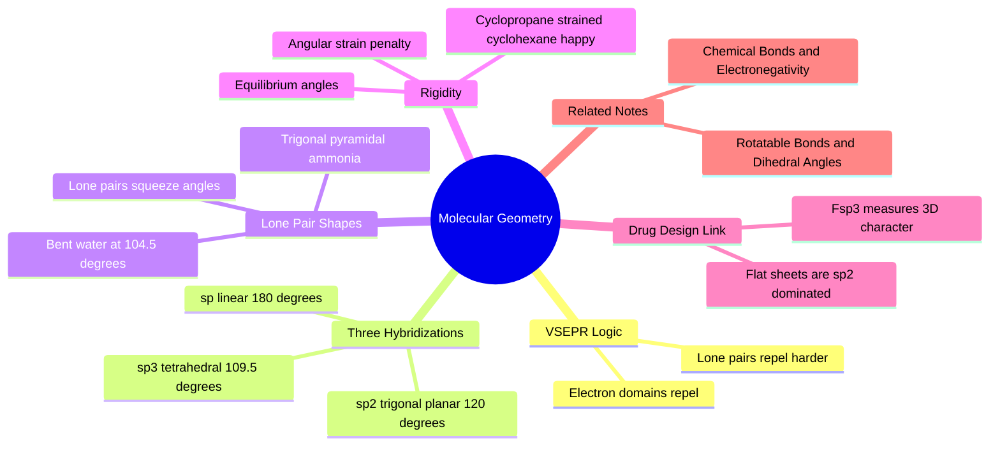

---
tags:
  - domain/chemistry
  - depth/essential
  - 3dsyntree
  - topic/hybridization
  - topic/molecular-geometry
module: "01. Chemistry Foundations"
chapter: "Chapter 1. Atomic Structure and Chemical Bonding"
type: concept
---

# 3. Molecular Geometry and Hybridization

> [!abstract] Core Idea
> When an atom forms bonds, its atomic orbitals blend together into hybrid orbitals that point in fixed directions in space — tetrahedral ($sp^3$, 109.5°), trigonal planar ($sp^2$, 120°), or linear ($sp$, 180°). This is why molecules have 3D shapes at all, why bond angles are nearly rigid, and why "flat" vs "3D" drug molecules are really just $sp^2$-count vs $sp^3$-count questions.

Navigation: [[0. Chemistry Foundations MOC]] · [[0. Master Vault Index]]

## 1. What It Is

**Hybridization** is the mathematical mixing of an atom's valence orbitals (one $s$ and some number of $p$ orbitals) into an equal number of identical **hybrid orbitals**, each pointing toward the corners of a specific geometric arrangement:

| Hybridization | Mixed from | Geometry | Angle between bonds | Carbon example |
| --- | --- | --- | --- | --- |
| $sp^3$ | 1 $s$ + 3 $p$ | **Tetrahedral** | $109.5^\circ$ | methane, $\text{CH}_4$ |
| $sp^2$ | 1 $s$ + 2 $p$ | **Trigonal planar** | $120^\circ$ | ethene, $\text{C}{=}\text{C}$ |
| $sp$ | 1 $s$ + 1 $p$ | **Linear** | $180^\circ$ | ethyne, $\text{C}\equiv\text{C}$ |

**Molecular geometry** is the resulting observed 3D arrangement of a molecule's atoms, predicted from electron-pair repulsion. The hybridization type of an atom is determined by what it is bonded to: carbon with four single bonds is $sp^3$; carbon in a double bond or aromatic ring is $sp^2$; carbon in a triple bond is $sp$.

## 2. Why It Exists

Electrons are negatively charged and repel each other — including the electron pairs *within* one atom's valence shell. **VSEPR theory** (Valence Shell Electron Pair Repulsion) states that all electron groups around an atom — bonding pairs and non-bonding **lone pairs** alike — arrange themselves to be as far apart in 3D as possible. Hybridization is the quantum-mechanical description of those far-apart arrangements: the tetrahedron is simply the best way to space four charge clouds around a center, the triangle for three, the line for two. Molecules adopt these shapes because any other arrangement leaves electron clouds closer together and the energy higher. There is no "choice" in the matter — geometry is set by electrostatics plus orbital mechanics.

## 3. How It Works

### 3.1 VSEPR: Counting Electron Domains

To predict shape: (1) count **electron domains** around the central atom — each bond (single, double, or triple counts once) and each lone pair is one domain; (2) arrange that many domains symmetrically in 3D; (3) note that a lone pair occupies more angular space than a bond, so it squeezes the remaining bond angles slightly smaller.

### 3.2 $sp^3$: The Tetrahedral Center

Mixing one $2s$ and three $2p$ orbitals gives four identical $sp^3$ hybrids aimed at the corners of a tetrahedron, $109.5^\circ$ apart.

> [!example] Methane and the 3D carbon
> Methane, $\text{CH}_4$: carbon contributes one electron to each of four $\sigma$-bonds. Four equivalent domains → perfect tetrahedron. Crucially, *any* carbon with four single bonds (alkanes, alcohols, amines' carbons) is such a center: its four substituents genuinely stick out in 3D, not flat on a page. A chain of $sp^3$ carbons is a flexible, three-dimensional object — exactly the machinery that makes saturated drug fragments fill pockets in 3D.

### 3.3 $sp^2$: The Flat Trigonal Center

Mixing one $s$ and two $p$ orbitals gives three $sp^2$ hybrids in a flat plane $120^\circ$ apart, leaving the third $p$ orbital perpendicular to the plane. Two adjacent $sp^2$ carbons each keep an unhybridized $p$; those overlap side-by-side to form the $\pi$-bond of the C=C double bond. Result: a double bond is *flat by construction* — all six atoms of ethene ($\text{C}_2\text{H}_4$) lie in one plane, and the $\pi$ cloud sits above and below it. Aromatic rings such as benzene are built entirely from $sp^2$ centers, which is why rings and flat $\pi$-systems form rigid, planar sheets. Partial double bonds lock neighbors into the same flatness — see [[2. Resonance Conjugation and the Amide Planarity Lock]].

### 3.4 $sp$: The Linear Center

Mixing one $s$ and one $p$ gives two $sp$ hybrids pointing opposite ways ($180^\circ$). The two leftover $p$ orbitals form the two $\pi$-bonds of the triple bond. Alkynes (e.g. acetylene, $\text{HC}\equiv\text{CH}$) are rigid rods: atoms on an $sp$ center are always colinear.

### 3.5 Lone Pairs: Bent and Trigonal Pyramidal Shapes

Heteroatoms bring lone pairs that count as domains but are *invisible* in the atom skeleton — so the observed shape of the atoms differs from the domain arrangement:

| Molecule | Central atom | Domains | Domain geometry | Observed shape | Angle |
| --- | --- | --- | --- | --- | --- |
| $\text{CH}_4$ | C | 4 bonds | tetrahedral | tetrahedral | $109.5^\circ$ |
| $\text{NH}_3$ | N | 3 bonds + 1 lone pair | tetrahedral | **trigonal pyramidal** | $107^\circ$ |
| $\text{H}_2\text{O}$ | O | 2 bonds + 2 lone pairs | tetrahedral | **bent** | $104.5^\circ$ |

The lone pairs press the bonds together ($107^\circ$, $104.5^\circ$ instead of $109.5^\circ$). These lone pairs are also the hydrogen-bond acceptors and nucleophiles of drug chemistry — geometry and reactivity come as a package (see [[1. Organic Functional Groups]]).

### 3.6 Valence Angles and Angular Strain

Each hybridization has an **equilibrium angle**. Bending a bond angle away from equilibrium costs energy — sharply. This **angular strain** is why:

- **Cyclopropane** (3-membered ring, forced angles $\approx 60^\circ$ vs the $109.5^\circ$ an $sp^3$ carbon wants) is strained and unusually reactive.
- **Cyclohexane** can adopt a chair conformation with near-perfect $109.5^\circ$ angles, making it essentially strain-free — the preferred saturated ring in drugs.
- A generative model that outputs molecules with, say, $90^\circ$ angles at an $sp^3$ carbon is describing a physically impossible object, not a real molecule.

> [!example] Angular strain arithmetic
> Force fields (see [[3. Molecular Mechanics and MMFF94 Restraints]]) typically charge a quadratic penalty like $E_\text{angle} = k_\theta (\theta - \theta_0)^2$ with large $k_\theta$. Bending an $sp^3$ angle by $15^\circ$ already costs multiple kcal/mol — far more than thermal noise ($kT \approx 0.6$ kcal/mol at room temperature). Equilibrium angles are effectively rigid constraints.

Hypervalent $dsp^3$/$d^2sp^3$ geometries (5- and 6-domain main-group centers like $\text{SF}_6$) are deliberately out of scope — drug-like organic chemistry rarely meets them.

### 3.7 Why This Splits Chemistry into Flat vs 3D

Since $sp^2$ centers are flat and conjugated, and $sp^3$ centers are 3D and rotatable, one number summarizes a molecule's shape character: **Fsp³** — the fraction of carbons that are $sp^3$-hybridized. Flat biaryl "grease" molecules are $sp^2$-dominated (low Fsp³); shape-diverse drugs are $sp^3$-rich. This single hybridization statistic became a medicinal-chemistry design criterion, developed in [[2. Fsp3 Saturation and the Flat Grease Trap]].

## 4. What It Consists Of

- **$sp^3$ hybridization** — 4 tetrahedral hybrids, $109.5^\circ$; single-bonded carbon; flexible 3D.
- **$sp^2$ hybridization** — 3 planar hybrids at $120^\circ$ + 1 perpendicular $p$; double bonds and aromatics; flat.
- **$sp$ hybridization** — 2 linear hybrids at $180^\circ$; triple bonds; rigid rods.
- **VSEPR theory** — electron domains repel; count domains to predict shape.
- **Lone pair** — a non-bonding domain that squeezes angles and creates bent/pyramidal shapes.
- **Equilibrium angle $\theta_0$** — the natural angle of a hybridization set.
- **Angular strain** — energy penalty for deviating from $\theta_0$.
- **$\sigma$-framework vs $\pi$-system** — the rotatable skeleton vs the flat, rotation-locked overlays.

## 5. What You Must Understand

> [!warning] You cannot negotiate with an equilibrium angle
> Bending bond angles away from their quantum-mechanical equilibrium triggers high energy penalties. A designed molecule with wrong angles is unphysical — it will fail physical-sanity checks and would explode (metaphorically) into a force field's strain energy.

> [!tip] One-glance hybridization diagnosis
> Four single bonds → $sp^3$. Anything involving a double bond or an aromatic ring → $sp^2$. A triple bond → $sp$. Oxygen in water or an alcohol → roughly $sp^3$ with two lone pairs; oxygen in a carbonyl → $sp^2$.

> [!note] Flat molecules are $sp^2$-dominated
> Because each $sp^2$ center is planar and conjugates with its neighbors, chains of them build flat sheets. 3D-shape-rich drug molecules require high $sp^3$ fractions — the direct motivation for Fsp³-based design rules.

## 6. Prerequisites

- [[2. Chemical Bonds and Electronegativity]] — you need $\sigma$/$\pi$ bond composition (which orbital overlaps form which bond) before hybridization makes sense.

## 7. Project Connection

The $sp^3$/$sp^2$ distinction is the thesis parameter of the whole project: the design constraint Fsp³ ≥ 0.40 is enforced as a catalog filter in `syntree/chemistry/catalog.py` (`min_fsp3 = 0.42`, applied via RDKit `FractionCSP3` filtering) — only sufficiently 3D synthons enter the 50,000-entry library, pushing generation away from flat "grease". The torsion machinery in `syntree/models/torsion_head.py` acts on rotatable single ($\sigma$) bonds, because $sp^2$ conjugated centers are locked flat; amide junctions get their planarity snapped by the conformer engine's `is_conjugated_junction()` logic in `syntree/chemistry/conformer.py`. Angular strain itself is scored by force fields when the conformer engine relaxes structures — the topic of [[3. Molecular Mechanics and MMFF94 Restraints]].

## 8. Required Depth

**Essential** — hybridization decides 3D shape, Fsp³ accounting, which bonds rotate, and what conformers are physically allowed; nothing downstream works without it.

## 9. Further Dependencies

- [[2. Fsp3 Saturation and the Flat Grease Trap]] — builds the Fsp³ metric directly on the $sp^3$/$sp^2$ counting introduced here.
- [[2. Rotatable Bonds and Dihedral Angles]] — defines which $\sigma$-bonds are rotatable and how their angles are parameterized.

## Concept Mind Map

## Cross-Domain Links

- [[AI/02. Representation Learning and Latent Metric Spaces/Chapter 1. Discrete Embedding Spaces/2. Categorical vs Continuous Latent Geometries|2. Categorical vs Continuous Latent Geometries]] (AI vault) — discrete hybridization states ($sp^3/sp^2/sp$) live in categorical latent spaces, while molecular shape lives in continuous 3D Euclidean space.
