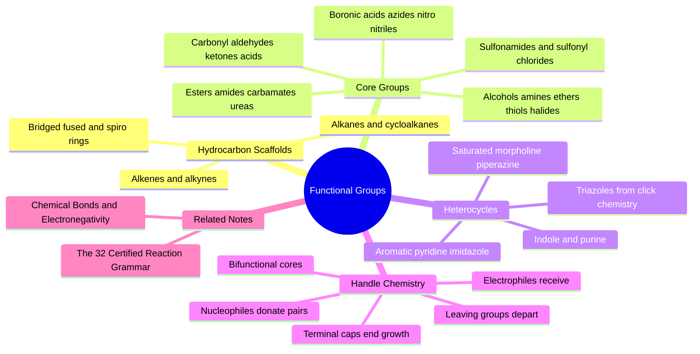

---
tags:
  - domain/chemistry
  - depth/essential
  - 3dsyntree
  - topic/functional-groups
  - topic/medicinal-chemistry
module: "01. Chemistry Foundations"
chapter: "Chapter 2. Functional Groups and Reactivity"
type: concept
---

# 1. Organic Functional Groups

> [!abstract] Core Idea
> A functional group is a small, recognizable cluster of atoms that behaves the same way chemically no matter what molecule it is attached to. Functional groups are the reusable "plug-and-play" units of drug design: they define what a molecule can react with in the lab and what it can interact with inside a protein pocket.

Navigation: [[0. Chemistry Foundations MOC]] · [[0. Master Vault Index]]

## 1. What It Is

Organic molecules are carbon skeletons (hydrocarbons) decorated with **heteroatoms** — atoms other than carbon and hydrogen, mainly O, N, S, P, and the halogens (F, Cl, Br, I). A **functional group** is a specific arrangement of heteroatoms (or a specific bond pattern like C=C) embedded in a carbon framework. The defining property is **consistent reactivity**: a carboxylic acid undergoes the same reactions whether it sits on benzene, on a cholesterol framework, or on a two-carbon chain.

Two complementary lenses on functional groups:

- **Reactivity lens**: heteroatoms, being more electronegative than carbon (see [[2. Chemical Bonds and Electronegativity]]), create electron-rich sites (**nucleophiles**, lone-pair donors, hydrogen-bond acceptors) and electron-poor sites (**electrophiles**, attack-prone carbons), plus **leaving groups** that can be displaced during reactions.
- **Interaction lens**: the same groups are the molecular recognition handles in biology — hydrogen-bond donors/acceptors, charged groups, hydrophobic patches.

## 2. Why It Exists

Carbon alone gives an extremely limited palette: chains and rings that burn. Heteroatoms break the symmetry of pure hydrocarbons, installing polarity, charge, lone pairs, and reactive "seams" at precise positions. This is what makes both **biology** (proteins recognize and bind specific group patterns) and **laboratory synthesis** (reactions join specific group pairs into stable junctions) possible. Without consistent functional-group reactivity, there would be no reactions to automate, no catalogs of building blocks to index, and no way to predict what a designed molecule would do — which is why functional groups are the atoms of 3D-SynTree's action space.

## 3. How It Works

### 3.1 Hydrocarbon Scaffolds: The Skeletons

| Scaffold | Formula / feature | Shape character | Example |
| --- | --- | --- | --- |
| **Alkanes** | $C_nH_{2n+2}$, all $sp^3$ | saturated, flexible chains | ethane, hexane |
| **Cycloalkanes** | closed rings | constrained, 3D | cyclopropane → cyclohexane |
| **Bridged / fused / spiro** | rings sharing ≥2 atoms, ≥1 atom, or exactly 1 atom | rigid, 3D, shape-diverse | norbornane, decalin, spiro[3.3]heptane |
| **Alkenes** | C=C double bond, $sp^2$ | flat, unsaturated | propene |
| **Alkynes** | C≡C triple bond, $sp$ | linear rod | propyne |

"Saturated" means only single bonds (maximum hydrogens; no $\pi$-bonds); "unsaturated" means double/triple bonds are present. Cyclopropane and cyclobutane carry angular strain (see [[3. Molecular Geometry and Hybridization]]), cyclopentane and cyclohexane are comfortable. **Spirocyclic** rings (two rings meeting at one shared atom) are prized as compact "exit-vector engines": a tiny atom count that projects substituents in rigid, exotic 3D directions — exactly the saturation-rich motifs that fight flatness.

### 3.2 The Core Functional Groups

The table below is the working vocabulary of medicinal chemistry. "Reactive site" and "role" columns connect to the reaction and interaction lenses.

| Group | Structure | Key properties and role |
| --- | --- | --- |
| Alkyl halides | R–F, R–Cl, R–Br, R–I | electrophilic carbon; C–Br and C–I are excellent reaction handles; C–F stabilizes metabolic hotspots |
| Alcohols | R–OH ($1^\circ$, $2^\circ$, $3^\circ$ by substitution count on C) | H-bond donor + acceptor; weak nucleophile; converts to esters, ethers |
| Phenols | Ar–OH (OH on aromatic ring) | H-bond donor; weakly acidic ($\text{p}K_a \approx 10$) |
| Ethers | R–O–R (acyclic or cyclic) | H-bond acceptor only; metabolically stable linker |
| Amines | $1^\circ$ R–NH₂, $2^\circ$ R–NHR, $3^\circ$ R–NR₂, $4^\circ$ R–NR₃⁺ | nucleophilic; basic (protonate to ammonium); key solubility and salt-bridge group |
| Aldehydes | R–CHO | very reactive carbonyl; H-bond acceptor |
| Ketones | R–CO–R | carbonyl acceptor; stable, common in drugs |
| Carboxylic acids | R–COOH | acidic ($\text{p}K_a \approx 4$); at pH 7.4 → carboxylate anion |
| Esters / acyl halides / anhydrides | R–CO–OR / R–CO–X / R–CO–O–CO–R | carboxylic-acid derivatives; esters are planar-ish and hydrolyzable; acyl halides and anhydrides are hyper-reactive acylating agents |
| Amides | R–CO–NHR (also $-\text{CONH}_2$, $-\text{CONR}_2$) | the most reliable junction in synthesis; planar, rotation-locked |
| Carbamates (urethanes) | R–O–CO–NH–R | ester + amide hybrid; common in drugs; participates in couplings |
| Ureas | R–NH–CO–NH–R | double amide; two H-bond donors; flat |
| Thiols, thioethers, disulfides | R–SH, R–S–R, R–S–S–R | sulfur analogs of alcohols/ethers; softer, more polarizable; disulfides bridge cysteines in proteins |
| Sulfonyl chlorides / sulfonamides | R–SO₂Cl / R–SO₂NHR | sulfonyl chlorides acylate amines; sulfonamides are a top-5 drug group (e.g. antibacterials) |
| Boronic acids / esters | R–B(OH)₂ / R–B(OR)₂ | the Suzuki-coupling handle; mild, stable, uniquely cross-couples onto aryl halides |
| Azides, nitro groups, nitriles | R–N₃, R–NO₂, R–C≡N | azide = click-chemistry handle; nitro = strong withdrawer; nitrile = small polar acceptor |

**Carbonyl mechanics** deserve one paragraph of their own, since half the table contains a C=O: the $\text{C}{=}\text{O}$ bond is strongly polarized ($\delta^+$ carbon, $\delta^-$ oxygen), making the carbonyl carbon an **electrophile** — attacked by amines (making amides), alcohols (making esters), or water (hydrolysis). Nucleophile attacks carbonyl carbon, oxygen takes the electrons, a tetrahedral intermediate forms, and a leaving group departs. That one sentence is the mechanism behind amide coupling, esterification, urea formation, and sulfonamide coupling — the dominant reaction families of the project.

### 3.3 Heterocycles: Rings with Heteroatoms Inside

**Heterocycles** are rings in which one or more ring atoms are heteroatoms. They dominate drug chemistry because they pack polarity, tune basicity/acidity, and control 3D shape into a single compact unit.

| Class | Members | Character |
| --- | --- | --- |
| Saturated | pyrrolidine, piperidine, morpholine, piperazine, tetrahydropyran | $sp^3$ rings; piperidine/morpholine/piperazine are the most common solubilizing, 3D fragments in drugs |
| Spirocyclic | spiro-piperidines, spiro-oxetanes, etc. | saturated, rigid 3D exit-vector engines |
| 5-membered aromatic | pyrrole, furan, thiophene, imidazole, oxazole, thiazole, pyrazole | flat $\pi$-systems; imidazole/pyrazole are both H-bond donors and acceptors |
| 6-membered aromatic | pyridine, pyrimidine, pyrazine, pyridazine | benzene with 1–2 N atoms; H-bond acceptors, less lipophilic than benzene |
| Bicyclic aromatic | indole, benzimidazole, quinoline, isoquinoline, purine | fused two-ring systems; indole is the tryptophan side-chain core, purine the adenine core |
| Triazoles | 1,2,3-triazole, 1,2,4-triazole | the signature product of click chemistry (azide + alkyne → triazole) |

Why heteroatoms change ring character: in pyridine, the ring nitrogen's lone pair sticks *out* of the ring (basic, good acceptor); in pyrrole, the lone pair is *inside* the aromatic sextet (non-basic, H-bond donor). Aromaticity rules are covered in [[2. Resonance Conjugation and the Amide Planarity Lock]].

### 3.4 Reactive Handles and Attachment Vectors

A **reactive handle** is a functional group intentionally left on a molecule so that a future reaction can attach there. This is the exact concept 3D-SynTree's action space is built on.

- **Nucleophiles** ("nucleus-loving", electron-pair donors): amines, alcohols, thiols — they attack electron-poor carbons. An amine handle accepts an acyl group to become an amide.
- **Electrophiles** ("electron-loving", electron-poor centers): acyl carbons (acid chlorides, activated acids), alkyl halides, sulfonyl chlorides — they *receive* the nucleophile's attack.
- **Leaving groups** (weak bases that depart with the bond's electrons): halides (Cl⁻, Br⁻), triflates, even water after activation. A good leaving group makes an electrophile *usable*.
- **Bifunctional / multifunctional cores**: building blocks carrying two or more *different* handles (e.g. an aryl bromide on one end and a carboxylic acid on the other), which can be elaborated in two independent directions — the growth points of molecular trees.
- **Monofunctional terminal caps**: single-handle reagents that add a final decoration and *terminate* growth (project rule: a terminal cap must clear a minimum molecular weight of 250, enforced by `MolecularAssemblyEnv`'s `terminal_cap_min_mw`).

> [!example] Reading a real building block
> **4-bromobenzoic acid**: a benzene ring carrying –COOH at position 1 and –Br at position 4. The carboxylic acid is a nucleophilic handle (after activation) that will couple with an amine to form an amide; the aryl bromide is an electrophilic handle for Suzuki coupling with a boronic acid. Two orthogonal handles on one small scaffold — a textbook bifunctional core that can sit at any internal node of a synthesis tree.

### 3.5 The Periodicity Behind Group Reactivity

Why can you predict group behavior from the periodic table? Because each group's chemistry is just its heteroatom's electronegativity, lone-pair count, and size playing out (see [[1. Atomic Structure and Electrons]]): oxygen's high electronegativity makes –OH a weak acid and a modest nucleophile; nitrogen's one-less proton makes amines both nucleophilic and basic; sulfur's larger, softer cloud makes thiols better nucleophiles than alcohols; boron's electron deficiency makes boronic acids the unique cross-coupling partner.

## 4. What It Consists Of

- **Hydrocarbon scaffolds** — alkanes, cycloalkanes, bridged/fused/spiro systems, alkenes, alkynes: the frames groups hang on.
- **Heteroatom groups** — alcohols, phenols, ethers, amines, thiols, thioethers, disulfides, halocarbons.
- **Carbonyl family** — aldehydes, ketones, carboxylic acids, esters, acyl halides, anhydrides, amides, carbamates, ureas.
- **Sulfonyl family** — sulfonyl chlorides, sulfonamides.
- **Organoboron** — boronic acids and esters.
- **Nitrogen accumulations** — azides, nitro groups, nitriles.
- **Heterocycles** — saturated, spirocyclic, 5- and 6-membered aromatic, bicyclic, triazoles.
- **Reactive-handle triad** — nucleophile, electrophile, leaving group.
- **Bifunctional cores and terminal caps** — growth nodes and terminating decorations of synthesis trees.

## 5. What You Must Understand

> [!warning] The group is the unit, not the molecule
> Never reason about "the whole molecule reacts". Reactions happen at specific groups with predictable mechanisms. A molecule with an amine *and* a boronic acid can react through either — which one fires depends on conditions and on reactivity tiers, the subject of [[1. Chemoselectivity and Reactivity Tiers]].

> [!tip] Learn the groups as pairs
> Every synthesis reaction in the vault is "nucleophilic handle + electrophilic handle → stable junction". Memorize the junction products: amine + activated acid → amide; amine + sulfonyl chloride → sulfonamide; boronic acid + aryl halide → biaryl; azide + alkyne → triazole.

> [!note] Handles are also interaction motifs
> The same amine that reacts in the flask becomes an ammonium salt bridge at pH 7.4 in the body; the same hydroxyl that forms an ester donates a hydrogen bond in the pocket. One group, two careers — design both careers simultaneously (see [[3. Acids Bases and pH 7.4 Ionization]]).

## 6. Prerequisites

- [[2. Chemical Bonds and Electronegativity]] — polarity and nucleophile/electrophile logic are applied bond dipoles.
- [[3. Molecular Geometry and Hybridization]] — group shape (flat amide vs tetrahedral amine) is applied hybridization.

## 7. Project Connection

This note *is* the project's grammar book. The 10 reactive handle classes recognized by the engine are defined by `HANDLE_SMARTS` in `syntree/chemistry/reactions.py` (SMARTS = a pattern-matching language for substructures, e.g. "find any primary amine"); `HANDLE_REACTIVITY_TIERS` and `rank_handles()` order competing handles so only one fires per step, and `apply_reaction()` then executes the junction. The 32 certified medicinal-chemistry reactions of the grammar (see [[2. The 32 Certified Reaction Grammar]]) are precisely pairings of the handles in Section 3.4 — amide coupling, sulfonamide coupling, reductive amination, Suzuki cross-coupling, urea formation, esterification, and click triazole formation among them. Downstream, `handle_features` in `syntree/data/featurizer.py` encodes each atom's functional-group class into the graph features the policy network sees, and the catalog of purchasable synthons is indexed by these very handle definitions (see [[1. Building Blocks and Synthons]]).

## 8. Required Depth

**Essential** — functional groups are the system's fundamental action units; without them neither the reaction grammar, nor the featurizer, nor the reward's interaction terms can be understood.

## 9. Further Dependencies

- [[2. The 32 Certified Reaction Grammar]] — each certified reaction is a specific handle-pair → junction rule from this note.
- [[1. Chemoselectivity and Reactivity Tiers]] — decides which handle wins when several are present.

## Concept Mind Map

