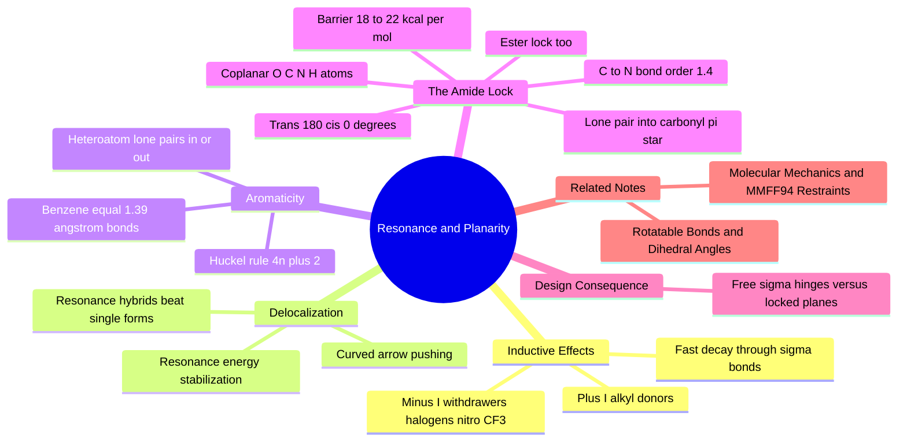

---
tags:
  - domain/chemistry
  - depth/essential
  - 3dsyntree
  - topic/resonance
  - topic/aromaticity
module: "01. Chemistry Foundations"
chapter: "Chapter 2. Functional Groups and Reactivity"
type: concept
---

# 2. Resonance Conjugation and the Amide Planarity Lock

> [!abstract] Core Idea
> When a chain of adjacent $p$ orbitals is available, $\pi$ electrons stop belonging to any one bond and spread out — delocalization — which lowers energy and partially doubles "single" bonds. In an amide, this delocalization locks the whole C–N unit flat with an 18–22 kcal/mol rotation barrier: the single most important rigidity constraint in drug molecules.

Navigation: [[0. Chemistry Foundations MOC]] · [[0. Master Vault Index]]

## 1. What It Is

**Resonance** (or **conjugation**) is the quantum-mechanical fact that when several atoms in a row each provide a $p$ orbital — a chain of alternating double and single bonds, or a lone pair next to a double bond — the $\pi$ electrons are not confined to one bond. They smear over the whole aligned system. The molecule is then best described as a **resonance hybrid**: a weighted average of several **Lewis structures** (the "resonance forms"), none of which is individually real. Two consequences matter enormously:

1. **Stabilization** — delocalized electrons are lower in energy (the **resonance energy** released).
2. **Partial double-bond character** — bonds in the middle of a conjugated path become shorter and stronger than normal single bonds, with **fractional bond orders** (e.g. benzene's C–C bonds are all order 1.5; the amide C–N bond is order $\approx 1.4$).

The headline application: in an **amide bond** $-\text{C}(=\text{O})-\text{N}-$, the nitrogen lone pair delocalizes into the carbonyl $\pi^*$ orbital, forcing the entire $\text{O}=\text{C}-\text{N}$ unit and its substituents to be **coplanar**, and imposing an $18\text{-}22\text{ kcal/mol}$ barrier to rotation about C–N. Amides (and their cousins, esters) are thereby **planarity-locked**.

## 2. Why It Exists

Electrons are waves. Waves confined to a small region (one bond) have higher kinetic energy than waves free to spread over a larger region (several bonds) — delocalization is nature's energy-lowering trick. The catch is geometric: $p$ orbitals only overlap when they are parallel, which forces every atom in the conjugated path to be $sp^2$-hybridized and **flat** (see [[3. Molecular Geometry and Hybridization]]). So molecules pay for resonance stability with rigidity. The amide takes this trade to the extreme: the nitrogen's lone pair would rather delocalize into the carbonyl than sit alone, and the price is that the amide becomes a rigid plane that cannot rotate. This lock is not a nuisance — it is structural engineering that proteins and drug designers both exploit.

## 3. How It Works

### 3.1 Inductive Effects: Polarity Transmitted Through $\sigma$-Bonds

Before resonance, the *local* electronic effect: **induction**. A polar bond tugs electron density through the chain of $\sigma$-bonds:

- **Electron-withdrawing groups ($-I$)**: halogens, $-\text{NO}_2$, $-\text{CF}_3$ — electronegative groups pull $\sigma$ density toward themselves, making nearby atoms electron-poorer (more acidic, more electrophilic).
- **Electron-donating groups ($+I$)**: alkyl substituents push slight extra density toward their neighbors.
- **Spatial decay**: induction is a through-bond tug, and it fades fast — noticeable one or two bonds away, nearly gone by three. It is a *local* effect, unlike resonance which can act across an entire conjugated path.

### 3.2 Resonance: The True Picture vs. the Bookkeeping

Lewis structures draw electrons pinned in place, so a conjugated molecule needs *several* of them. The real molecule is their hybrid — averaged bond orders, averaged charges. Take the carboxylate $\text{CH}_3\text{COO}^-$: two resonance forms put the negative charge on either oxygen. Reality: both C–O bonds are identical (order 1.5) and the charge sits half on each oxygen. The formalism of **curved-arrow electron pushing** (drawing how $\pi$ pairs shift between forms) is the bookkeeping tool chemists use to generate all valid forms.

Key rules for weighing resonance forms: (a) forms with full octets dominate; (b) charge separation costs energy; (c) negative charge prefers electronegative atoms. The **resonance energy** is the difference between the real molecule's energy and the best single Lewis structure — a direct measure of the stabilization. **Conjugated polyenes** (alternating single/double chains like 1,3-butadiene) show the same smoothing: partial double character in the "single" bond, locked planarity along the chain.

### 3.3 Aromaticity: Hückel's Rule

The strongest resonance stabilization of all closes the conjugated path into a ring. **Benzene** ($\text{C}_6\text{H}_6$): six $sp^2$ carbons, six $p$ orbitals in a flat ring, six $\pi$ electrons smeared uniformly — all six C–C bonds identical at 1.39 Å, between single (1.54 Å) and double (1.34 Å). This special stability is **aromaticity**, and **Hückel's rule** states it precisely:

> A flat, fully conjugated, cyclic system with $4n + 2$ $\pi$ electrons ($n = 0, 1, 2, \dots$: 2, 6, 10, 14) is **aromatic** — exceptionally stable. A cyclic conjugated system with $4n$ $\pi$ electrons (4, 8, 12) is **anti-aromatic** — destabilized; it typically escapes by twisting out of planarity, becoming merely non-aromatic.

Heteroatoms can join the sextet: in **pyrrole** the N lone pair is *inside* the ring's six $\pi$ electrons (so pyrrole is not basic — protonation would destroy aromaticity), while in **pyridine** the N lone pair sticks *outside* the sextet (so pyridine *is* basic). This lone-pair census explains the wildly different behavior of heterocycles introduced in [[1. Organic Functional Groups]].

### 3.4 The Amide Planarity Lock, Step by Step

Now the star mechanism. An amide $-\text{C}(=\text{O})-\text{N}<$ combines one carbonyl and one nitrogen lone pair — a conjugated system in miniature:

1. **Lone-pair donation**: the nitrogen's lone pair overlaps with the carbonyl carbon's $\pi^*$ orbital (the antibonding orbital of C=O). In resonance language, a second form appears: $-\text{C}(-\text{O}^-)=\text{N}^+-$, with an O⁻–C=N⁺ unit.
2. **Partial double bond**: the real C–N bond is the hybrid of "pure single" and "pure double" forms → **bond order $\approx 1.4$**, shortened from a normal 1.47 Å C–N single bond toward a 1.28 Å C=N.
3. **Coplanarity enforced**: for the overlap to exist, the N lone pair orbital must stay parallel to the carbonyl $\pi$ system. Every atom of the unit — O, C, N, H (or N-substituent) — lies in **one plane**: the $\text{O}=\text{C}-\text{N}-\text{H}$ atoms are coplanar, with the N substituent also trigonal-planar ($sp^2$ nitrogen).
4. **Rotation barrier**: twisting about C–N by 90° destroys the overlap and the partial double bond. Energy price: $18\text{-}22\text{ kcal/mol}$ at the transition state.

> [!example] How rigid is 18–22 kcal/mol really?
> At body temperature, thermal energy is $kT \approx 0.6\text{ kcal/mol}$. A barrier of $20\text{ kcal/mol}$ is over 30 $kT$: spontaneous 90° twisting is essentially impossible on any biological timescale (trans–cis interconversion of an amide happens roughly once per *minutes-to-hours* without catalysis). Compare a free C–C single bond, whose rotation barrier is $\approx 1\text{ kcal/mol}$ — it rotates freely millions of times per second. Amides are walls; single bonds are hinges.

5. **Trans vs cis**: the planar amide has two stable arrangements of its substituents: **trans** (O and the N-substituent on opposite sides, dihedral $180^\circ$) — the default, lower-energy form — and **cis** ($0^\circ$), slightly higher in energy and much rarer except inside constrained rings. Both are flat; what is forbidden is everything in between.

### 3.5 Esters Lock Too, and the Rotatable-Bond Contrast

**Esters** ($-\text{CO-O-R}$) run the same play: the alkoxy oxygen's lone pair delocalizes into the carbonyl, giving the C–O bond partial double character and planarizing the $\text{O}=\text{C}-\text{O}$ unit (barrier lower than an amide's, but still locking). By contrast, an **unconjugated single bond** — a plain C–C or C–C(alkyl) bond with no adjacent $\pi$ system, like the bond in ethane or between two non-conjugated atoms — is a pure $\sigma$-bond and rotates freely. The engineering summary:

| Junction type | Example | Rotation | Torsional treatment |
| --- | --- | --- | --- |
| Free single $\sigma$-bond | C–C in an alkyl chain | free ($\approx 1\text{ kcal/mol}$) | a genuine design variable |
| Resonance-locked amide | peptide bond | blocked ($18\text{-}22\text{ kcal/mol}$) | snapped flat to $0^\circ$ or $180^\circ$ |
| Resonance-locked ester | –CO–O– | strongly hindered | snapped flat |

### 3.6 Why the Lock Matters Everywhere

Proteins are built from amide bonds (the peptide backbone — see [[1. Amino Acids and Peptide Backbones]]), so their backbones are strings of flat, trans amide planes separated by rotatable single bonds. Any drug-like molecule with amides, esters, ureas, or carbamates inherits the same mixture of rigid planes and flexible hinges — its conformational freedom is *defined* by which bonds resonance has locked.

## 4. What It Consists Of

- **Inductive effect ($\pm I$)** — $\sigma$-bond polarization by electronegativity; short-ranged.
- **Resonance / conjugation** — $\pi$ delocalization over aligned $p$ orbitals; planarity-demanding.
- **Resonance hybrid and resonance forms** — the true averaged structure vs. its Lewis bookkeeping.
- **Curved-arrow pushing** — notation for generating resonance forms.
- **Resonance energy** — stabilization from delocalization.
- **Aromaticity and Hückel's rule** — $(4n+2)$ $\pi$ electrons in a flat ring; benzene's equal 1.39 Å bonds.
- **Amide lock components** — lone-pair donation into $\pi^*$, bond order $\approx 1.4$, coplanar $\text{O}=\text{C}-\text{N}-\text{H}$, $18\text{-}22\text{ kcal/mol}$ barrier, trans ($180^\circ$) vs cis ($0^\circ$).
- **Ester planarity** — weaker but real version of the same lock.

## 5. What You Must Understand

> [!warning] You cannot freely rotate an amide or ester
> A generative model that treats an amide C–N like a rotatable hinge produces an unphysical, high-energy molecule that would distort any real binding pocket. Rotating through the lock costs $18\text{-}22\text{ kcal/mol}$ — the molecule simply will not do it. Amide junctions must be generated planar, full stop.

> [!tip] Spot the lock instantly
> Any atom sequence C(=O)–N or C(=O)–O means "flat junction, no torsion freedom". Anything else that is a plain single bond between two $sp^3$ atoms is a free hinge the designer can use.

> [!note] Resonance is why aniline is barely basic
> The same lone-pair-into-$\pi$ donation that locks amides is what ties up aniline's nitrogen lone pair in the benzene ring — dropping its basicity from $\text{p}K_a \approx 10.5$ (aliphatic amines) to $\approx 4.5$. Electronic effects, acidity, and geometry are one subject, not three (see [[3. Acids Bases and pH 7.4 Ionization]]).

## 6. Prerequisites

- [[3. Molecular Geometry and Hybridization]] — conjugation requires $sp^2$ centers and parallel $p$ orbitals; hybridization supplies that vocabulary.
- [[1. Organic Functional Groups]] — you need amides, esters, and aromatic rings as concrete objects before their electronic behavior makes sense.

## 7. Project Connection

The conformer engine in `syntree/chemistry/conformer.py` implements this note directly: `is_conjugated_junction()` tests each newly formed bond for amide/ester conjugation, and when it finds one, `apply_junction_torsion()` *overrides* the neural torsion prediction, snapping the junction to $0^\circ$ or $180^\circ$ and instead rotating an adjacent ordinary single bond. In other words, the $18\text{-}22\text{ kcal/mol}$ barrier is encoded as a hard prior in the physics pipeline, while the remaining free single bonds are left to the torsion policy — the division of labor detailed in [[2. Rotatable Bonds and Dihedral Angles]]. The same planarity informs distance-geometry embedding (the topic of [[2. Distance Geometry and ETKDG]]) and the force-field restraints that keep angles and planes at equilibrium during relaxation, covered in [[3. Molecular Mechanics and MMFF94 Restraints]].

## 8. Required Depth

**Essential** — the amide/ester lock is a hard geometric constraint wired into the conformer engine; misunderstanding it breaks every downstream concept in torsion design.

## 9. Further Dependencies

- [[2. Rotatable Bonds and Dihedral Angles]] — defines the torsion angles over the *non-locked* bonds that the policy actually controls.
- [[3. Molecular Mechanics and MMFF94 Restraints]] — the force-field terms that enforce planarity and angular equilibrium during relaxation.

## Concept Mind Map

