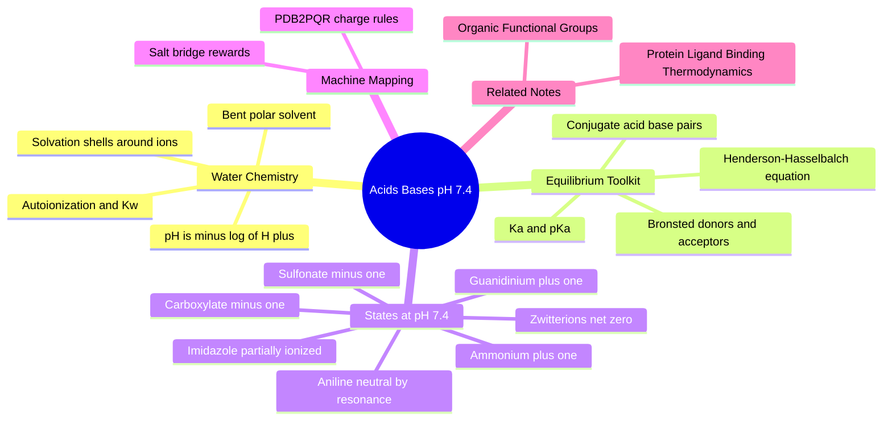

---
tags:
  - domain/chemistry
  - depth/essential
  - 3dsyntree
  - topic/acid-base
  - topic/ionization
module: "01. Chemistry Foundations"
chapter: "Chapter 2. Functional Groups and Reactivity"
type: concept
---

# 3. Acids Bases and pH 7.4 Ionization

> [!abstract] Core Idea
> In water, chemical groups grab or release protons depending on their acidity (pKa) and the surrounding pH. Because blood and cells hold pH near 7.4, every drug and every protein side chain carries a *predictable* charge at that exact pH — computable with one equation, Henderson–Hasselbalch — and those charges decide solubility, binding, and salt bridges.

Navigation: [[0. Chemistry Foundations MOC]] · [[0. Master Vault Index]]

## 1. What It Is

An **acid** is a proton ($\text{H}^+$) donor; a **base** is a proton acceptor (the **Brønsted–Lowry definition**; the broader Lewis definition — electron-pair acceptor/donor — is mostly a change of vocabulary here). **Ionization** is the process of a neutral molecule gaining or losing a proton to become a charged **ion**. Two numbers control everything:

- **pH** = $-\log_{10}[\text{H}^+]$, the concentration of free protons in the solution (low pH = acidic = proton-rich).
- **pKa** = $-\log_{10} K_a$, where $K_a$ is the **acid dissociation constant** of a specific group: how willingly it gives up a proton. Low pKa = strong acid (gives up H⁺ easily); high pKa = weak acid.

When an acid HA loses $\text{H}^+$ it becomes its **conjugate base** $\text{A}^-$; when a base B gains $\text{H}^+$ it becomes its **conjugate acid** $\text{BH}^+$. The physical reference point for all biology: **physiological pH is $7.40 \pm 0.05$**.

## 2. Why It Exists

Biology runs in water held tightly near pH 7.4 by buffers. A molecule's charge state at that pH is not a detail — it is destiny: an ionized group is water-loving (soluble) and can form **salt bridges** with oppositely charged partners, while a neutral group can cross cell membranes. Crystallographic and simulation tools that ignore this create a chemically wrong picture of the binding pocket. If an AI model is fed neutral atoms where nature has ions, it cannot even represent the strongest interactions a drug makes. This note supplies the machinery to compute the true state of every group from first principles.

## 3. How It Works

### 3.1 Water: The Stage

Water is a bent, strongly polar molecule (see [[3. Molecular Geometry and Hybridization]]) with a permanent dipole of ≈ 1.85 D. In any drop of water a few molecules rip protons off each other (**autoionization**): $\text{H}_2\text{O} \rightleftharpoons \text{H}^+ + \text{OH}^-$. The **ion product of water** constrains the two concentrations:

$$K_w = [\text{H}^+][\text{OH}^-] = 1.0 \times 10^{-14}$$

so at neutrality $[\text{H}^+] = [\text{OH}^-] = 10^{-7}$ M → pH 7. The pH scale runs from about 0 (1 M acid) to 14 (1 M base), each unit meaning a factor of 10 in proton concentration. Water's polarity also builds **solvation shells**: each dissolved ion is wrapped in a cage of oriented water dipoles, which is why ions dissolve at all — and why stripping that cage costs energy when an ion binds a hydrophobic pocket.

### 3.2 From Ka to pKa to Conjugate Pairs

For an acid HA in water:

$$K_a = \frac{[\text{H}^+][\text{A}^-]}{[\text{HA}]} \qquad \text{p}K_a = -\log_{10} K_a$$

The $K_a$ expression is an equilibrium: both forms coexist, and their ratio is set by how far pH sits from pKa. Strong acids (pKa < 0) are essentially fully deprotonated in water; ordinary organic acids have pKa values spread from ~3 to ~15, making the ratio a tunable dial.

### 3.3 The Henderson–Hasselbalch Equation

Taking $-\log_{10}$ of the $K_a$ expression and rearranging gives the master equation of this note:

$$\text{pH} = \text{p}K_a + \log_{10}\frac{[\text{A}^-]}{[\text{HA}]} \qquad \text{or for bases} \qquad \text{pH} = \text{p}K_a + \log_{10}\frac{[\text{B}]}{[\text{BH}^+]}$$

Read it as a two-way street:

- $\text{pH} = \text{p}K_a$ → the group is exactly 50% ionized / 50% neutral.
- Each pH unit above pKa → 10× more deprotonated (acids) or 10× more neutral (bases).
- Each pH unit below pKa → 10× more protonated.

> [!example] Worked example, a carboxylic acid
> Acetic acid has pKa 4.76. At physiological pH 7.4:
> $\frac{[\text{A}^-]}{[\text{HA}]} = 10^{7.4 - 4.76} = 10^{2.64} \approx 440$. Ionized fraction $= \frac{440}{441} \approx 99.8\%$. Acetic acid at pH 7.4 is, for all practical purposes, **fully converted to the acetate anion** (charge −1).

> [!example] Worked example, an aliphatic amine
> A typical alkylamine conjugate acid has pKa 10.5. At pH 7.4:
> $\frac{[\text{B}]}{[\text{BH}^+]} = 10^{7.4 - 10.5} = 10^{-3.1} \approx 1/1260$. Protonated fraction $= \frac{1260}{1261} \approx 99.9\%$. The amine is essentially **fully converted to the ammonium cation** (charge +1).

### 3.4 Ionization Fractions as a General Formula

The fraction deprotonated (acid case) at any pH is:

$$f_{\text{A}^-} = \frac{1}{1 + 10^{\text{p}K_a - \text{pH}}}$$

This sigmoid curve is what "ionization fraction" means: compute the exponent, evaluate, done. Groups with pKa more than ~2 units below 7.4 are fully anionic; groups with pKa more than ~2 units above 7.4 are fully cationic (as conjugate acids); groups within ~1.5 units of 7.4 are *mixtures* — partially ionized and sensitive to local pH shifts.

### 3.5 The Physiological Charge Table at pH 7.4

| Group (see [[1. Organic Functional Groups]]) | Typical pKa | State at pH 7.4 | Charge |
| --- | --- | --- | --- |
| Carboxylic acid –COOH | 3.5–4.5 | carboxylate –COO⁻ | $-1$ |
| Aliphatic amine –NHR | 9.5–10.5 | ammonium –NH₂R⁺ / –NHR₂⁺ | $+1$ |
| Aniline (aromatic amine) Ar–NH₂ | 4.0–4.5 | neutral amine | $0$ |
| Phenol Ar–OH | ~10.0 | neutral hydroxyl | $0$ |
| Sulfonic acid –SO₃H | < 1 | sulfonate –SO₃⁻ | $-1$ |
| Guanidine C(=NH)NH₂ | ~12.5 | guanidinium cation | $+1$ |
| Imidazole (histidine's group) | 6.0–6.5 | mostly neutral, minority protonated | $0$ to $+0.1$ |

Three of these rows need explanation:

- **Aniline** stays neutral because its lone pair is delocalized into the benzene ring (resonance — see [[2. Resonance Conjugation and the Amide Planarity Lock]]), so it is a much weaker base than an aliphatic amine: pKa ~4.5 is *below* 7.4, so at physiological pH the balance sits on the neutral side.
- **Guanidinium** stays protonated because the +1 charge is spread over three nitrogens (a delocalized, resonance-stabilized cation), making it an extremely weak acid — it holds its proton even at pH 7.4. Arginine side chains exploit this to be permanent "+" anchors.
- **Imidazole** has pKa near neutrality, so its Henderson–Hasselbalch ratio at 7.4 is only $10^{6.0-7.4} \approx 0.04$ to $10^{6.5-7.4} \approx 0.13$ protonated — roughly 4–13% cation, the rest neutral. It also **tautomerizes** (the proton can sit on either of its two nitrogons), so both nitrogens interchange roles as donor and acceptor. This near-neutral pKa is why histidine is the workhorse of enzyme active sites.

### 3.6 Zwitterions

A molecule carrying both a acidic and a basic group can be *simultaneously* minus-one and plus-one: a **zwitterion** with net charge zero but two localized charges. The classic example: amino acids at pH 7.4 exist as ${}^+\text{H}_3\text{N}-\text{CH(R)}-\text{COO}^-$ — internally salt-bridged, highly polar, still net-zero. Net zero does *not* mean "no electrostatics": both charges still attract partners individually (full detail in [[1. Amino Acids and Peptide Backbones]]).

### 3.7 PDB2PQR and Why Crystals Lie by Omission

Protein structures solved by X-ray crystallography usually **omit hydrogen atoms** (they are too small to scatter X-rays detectably) and often deposit all atoms as neutral. But at pH 7.4, Asp and Glu side chains are carboxylates ($-1$) and Arg and Lys side chains are guanidinium/ammonium ($+1$). Feeding neutral atoms to a model erases every salt bridge — the strongest, longest-range interaction between a charged ligand and a charged residue. The community-standard fix is **PDB2PQR**: a tool (name = PDB to PQR, where PQR adds per-atom charge Q and radius R fields) that adds hydrogens and assigns physiological pH charges by rule. The rules applied to the pocket are exactly the table above: Asp/Glu → $-1$, Arg/Lys → $+1$, His judged by its local environment.

## 4. What It Consists Of

- **pH** — $-\log_{10}[\text{H}^+]$; the acidity of the medium.
- **Ka / pKa** — a group's intrinsic proton-release strength.
- **Conjugate acid–base pair** — HA/A⁻ or BH⁺/B, two forms differing by one proton.
- **Henderson–Hasselbalch equation** — the ratio calculator linking pH, pKa, and ionization.
- **Ionization fraction** — the quantitative deprotonated/protonated percentage.
- **Physiological pH 7.4** — the standard biological reference.
- **Zwitterion** — net-zero molecule with separated + and − charges.
- **PDB2PQR** — rule-based physiological charge assignment for protein structures.

## 5. What You Must Understand

> [!warning] The crystallography trap
> PDB files usually lack hydrogens and assign neutral charges to all atoms. If an AI model trains on neutral atoms, it cannot learn salt bridges — ionic bonds between full $+$ and $-$ charges that drive drug affinity. Always ask: what did the data *assume* about pH 7.4?

> [!tip] The 2-unit rule of thumb
> pKa more than ~2 units below 7.4 → fully deprotonated (anion). More than ~2 above → fully protonated (cation, for bases). Within ~1.5 units → partial ionization; compute the fraction with Henderson–Hasselbalch rather than guessing.

> [!note] Charge is a function of environment
> The same molecule can be neutral in the stomach (pH ~2), anionic in blood (7.4), and neutral again inside a hydrophobic pocket if the local environment shifts a group's effective pKa. Ionization is a dial, not a stamp.

## 6. Prerequisites

- [[2. Chemical Bonds and Electronegativity]] — electronegativity differences make O–H and N–H bonds polar enough to release protons.
- [[1. Organic Functional Groups]] — you must recognize carboxylic acids, amines, phenols, sulfonamides, and heterocycles before you can assign their ionization states.

## 7. Project Connection

The pocket featurizer in `syntree/data/featurizer.py` implements PDB2PQR-style physiological rules through `assign_pocket_formal_charges()`, which sets Asp/Glu side chains to $-1$ and Arg/Lys to $+1$ before the graph is built — ensuring the neural model sees pocket chemistry the way it exists at pH 7.4. The resulting per-atom charges are pooled into the `pocket_charge` and `ligand_charge` inputs and injected into the `BipartitePaiNN` encoder through `self.charge_proj(charge)`, so charge state is a first-class feature of the joint protein–ligand representation. Downstream, the reward's key-interaction term in `syntree/engine/rl.py` (`count_key_interactions()` within `S_key`) explicitly counts salt bridges — opposite formal charges within $4.0\text{ Å}$ — a rewardable event that only exists because ionization was computed rather than assumed. The binding-energetics payoff of these charges is developed in [[1. Protein Ligand Binding Thermodynamics]].

## 8. Required Depth

**Essential** — charge state at pH 7.4 feeds the featurizer, the reward's salt-bridge term, and every binding-energetics argument downstream.

## 9. Further Dependencies

- [[1. Amino Acids and Peptide Backbones]] — amino acid zwitterions and side-chain pKa values build directly on this note.
- [[1. Protein Ligand Binding Thermodynamics]] — salt bridges and charge complementarity are quantified as binding free energy.

## Concept Mind Map

## Cross-Domain Links

- [[AI/06. Equivariant Architectures: PaiNN and Bipartite Graphs/Chapter 2. Heterogeneous Molecular Modeling/3. Node-Type Feature Multiplexing and Edge Partitioning|2. Node-Type Feature Multiplexing and Edge Partitioning]] (AI vault) — protonation states at pH 7.4 are encoded as categorical node features multiplexed by atom type.
