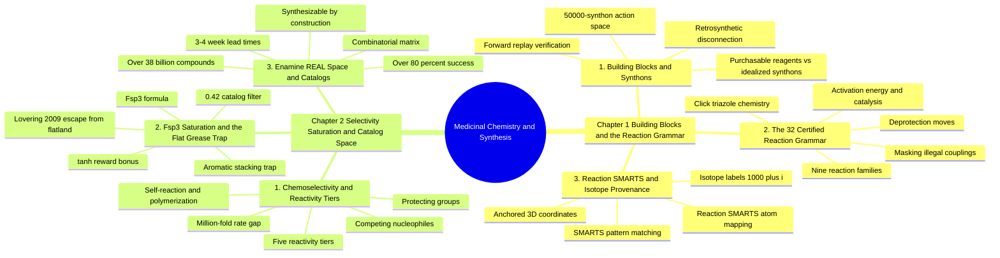

---
tags:
  - moc
  - domain/medicinal-chemistry
  - 3dsyntree
module: "02. Medicinal Chemistry and Synthesis"
type: moc
---

# 0. Medicinal Chemistry and Synthesis MOC

> [!abstract] Module Mission
> This module builds the chemical half of 3D-SynTree: what synthons and purchasable building blocks are, which 32 certified reactions may join them, how those reactions are encoded and atom-tracked in software, and how selectivity tiers, the $Fsp^3$ saturation constraint, and the Enamine REAL catalog bound the design space so that every generated molecule is actually synthesizable.

Navigation: [[0. Master Vault Index]] · [[2. Prerequisite Knowledge Graph]] · [[3. Study Tracks and Curriculum]]

## Module Mind Map

## Chapter 1. Building Blocks and the Reaction Grammar

| Note | Focus | Required Depth | Key Prerequisites |
| --- | --- | --- | --- |
| [[1. Building Blocks and Synthons]] | Purchasable building blocks vs idealized synthons; retrosynthetic disconnection and forward replay verification | Essential | [[1. Organic Functional Groups]] |
| [[2. The 32 Certified Reaction Grammar]] | The nine certified reaction families, why they are certified, and how the engine enforces them | Essential | [[1. Organic Functional Groups]] · [[1. Building Blocks and Synthons]] |
| [[3. Reaction SMARTS and Isotope Provenance]] | Encoding transformations as pattern-matching strings; tracking atoms across reactions with isotope labels | Essential | [[1. Atomic Structure and Electrons]] · [[2. The 32 Certified Reaction Grammar]] |

## Chapter 2. Selectivity Saturation and Catalog Space

| Note | Focus | Required Depth | Key Prerequisites |
| --- | --- | --- | --- |
| [[1. Chemoselectivity and Reactivity Tiers]] | Why some handles react first: the five-tier reactivity hierarchy and selectivity conflicts | Supporting | [[1. Organic Functional Groups]] · [[3. Acids Bases and pH 7.4 Ionization]] |
| [[2. Fsp3 Saturation and the Flat Grease Trap]] | The $Fsp^3$ metric, the flat-aromatic failure mode, and its two-layer enforcement | Essential | [[3. Molecular Geometry and Hybridization]] |
| [[3. Enamine REAL Space and Catalogs]] | Make-on-demand combinatorial libraries and the curated 50,000-synthon action space | Essential | [[1. Building Blocks and Synthons]] · [[2. The 32 Certified Reaction Grammar]] |

## Learning Path Through This Module

1. [[1. Building Blocks and Synthons]] — the vocabulary of handles, synthons, disconnections, and verification; everything else in the module builds on it.
2. [[2. The 32 Certified Reaction Grammar]] — the legal moves of the assembly game, from amide coupling to click triazole.
3. [[3. Reaction SMARTS and Isotope Provenance]] — how those moves are written as code and how atom identity survives each reaction.
4. [[1. Chemoselectivity and Reactivity Tiers]] — when a molecule offers several reactive sites, which one wins and why.
5. [[2. Fsp3 Saturation and the Flat Grease Trap]] — why the system refuses to design flat molecules, whatever the docking score says.
6. [[3. Enamine REAL Space and Catalogs]] — where the synthons physically come from, and why every design is orderable.

## Why This Module Matters for 3D-SynTree

3D-SynTree's defining promise is that every molecule it designs is synthesizable and purchasable, and this module is where that promise is engineered. The certified reaction grammar turns molecular design into composition over a finite move set, so the GFlowNet policy (see [[1. 3D-SynTree System Overview]]) can never propose chemistry that no laboratory can run. Reaction SMARTS and isotope provenance are what keep the 3D pocket coordinates attached to the right atoms as each move executes — the bridge from 2D chemical logic to the 3D structural world of [[0. Spatial Chemistry and Force Fields MOC]]. Chemoselectivity tiers make the discrete action space chemically honest, the $Fsp^3$ constraint blocks the flat-grease reward-hacking mode that plagues unconstrained generators, and the Enamine REAL catalog grounds the whole system in a vendor-fulfillable universe of $>38$ billion compounds, curated down to a 50,000-synthon action space. Together with the chemistry foundations of [[0. Chemistry Foundations MOC]], these six notes supply the "synthesis-constrained" half of structure-based, synthesis-constrained molecular design; the spatial and learning-theory modules supply the rest.

## Gate Check

> [!question] Before moving on, can you...
> - Distinguish a building block, a synthon, and a synthetic equivalent — and explain forward replay verification in one sentence?
> - Name the nine certified reaction families and the bond or ring each one forms?
> - Explain why RDKit's reaction engine severs 3D coordinate continuity, and how the isotope labels $1000+i$ and $2000+j$ repair it?
> - Rank an aliphatic amine, an aniline, a carboxylic acid, an alcohol, and an aryl halide by reactivity tier, and justify the $\approx 10^6$ rate gap between the first two?
> - Define $Fsp^3$, describe the flat grease trap, and state both saturation thresholds (0.40 design floor, 0.42 catalog filter and reward hinge)?
> - Explain what a make-on-demand library is, why 38 billion compounds cost nothing to store, and what the fulfillment statistics are?

## Primary Reading

Hartenfeller, M., et al. (2011). *A Collection of Robust Organic Synthesis Reactions for In Silico Molecule Design*. **Journal of Chemical Information and Modeling**, 51(12), 3093–3098.
