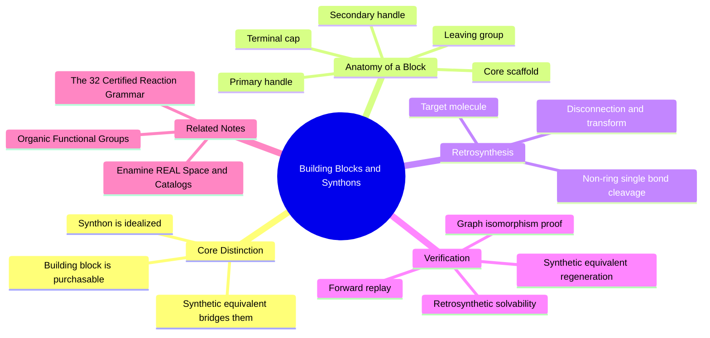

---
tags:
  - domain/medicinal-chemistry
  - depth/essential
  - 3dsyntree
  - topic/retrosynthesis
module: "02. Medicinal Chemistry and Synthesis"
chapter: "Chapter 1. Building Blocks and the Reaction Grammar"
type: concept
---

# 1. Building Blocks and Synthons

> [!abstract] Core Idea
> A **building block** is a real chemical you can order from a supplier, carrying one or more reactive handles — molecular "sockets" it can use to bond to partners. A **synthon** is the idealized fragment that a building block contributes to a growing molecule during one synthesis step. Designing drugs from catalogued building blocks, rather than atom by atom, is what makes automated, AI-driven synthesis planning possible.

Navigation: [[0. Medicinal Chemistry and Synthesis MOC]] · [[0. Master Vault Index]]

## 1. What It Is

A molecule is a graph of atoms joined by covalent bonds (shared electron pairs). Medicinal chemists almost never build molecules one atom at a time; they snap together larger, pre-manufactured pieces. Two words describe those pieces from two different points of view:

- A **building block** is an actual, purchasable chemical reagent — something that exists in a bottle in a warehouse — that carries one or more **reactive handles**: functional groups (characteristic clusters of atoms with predictable chemistry, see [[1. Organic Functional Groups]]) that can form a new covalent bond to a partner molecule. Example: *4-bromobenzoic acid*, a benzene ring bearing a carboxylic acid group ($-\text{COOH}$) on one side and a bromine atom on the other. It carries two handles: the acid (for amide or ester formation) and the aryl bromide (for palladium cross-couplings).
- A **synthon** is a *theoretical, idealized structural fragment* that gets attached to the growing molecule (the **core**) during one synthesis step. The synthon is what the designer thinks with; the building block is what the laboratory buys. When 4-bromobenzoic acid couples through its acid group, the synthon it delivers is "a 4-bromophenyl ring carrying a carbonyl carbon"; the acid's $-\text{OH}$ and the partner's $-\text{H}$ leave as water.

The distinction is like the difference between a word in the dictionary and the concept you want to express: synthons live in design space, building blocks live in inventory space.

## 2. Why It Exists

High-throughput drug discovery needs thousands of new molecules per week, each in milligram amounts and high purity. Building molecules atom by atom cannot deliver this: every single atom addition would require its own reaction, its own purification, and would suffer its own yield loss (multiply ten 80% steps and you keep barely 11% of what you started with). Instead, the industry assembles **pre-manufactured fragments**: each synthesis step is one robust, bond-forming reaction between two purchasable pieces, and the whole route is only a few steps long.

For an AI system, this fragment-based view is even more powerful. Selecting an entire pre-formed synthon from a finite library is a **discrete action** — exactly like choosing a token from a vocabulary in a language model. The action space is finite, enumerable, and every legal action produces a chemically valid molecule, so the model cannot invent nonsense chemistry.

## 3. How It Works

### 3.1 One Step, One Fragment

A bifunctional (two-handle) or monofunctional (one-handle) building block enters a reaction, **loses its leaving group** — the atom or small group expelled with the bonding electrons (the acid's $-\text{OH}$ once the acid is activated, the amine's $-\text{H}$) — and attaches to the growing ligand through a newly formed covalent bond. Example amide coupling:

$$\text{4-bromobenzoic acid} + \text{benzylamine} \to \text{4-bromo-}N\text{-benzylbenzamide} + \text{H}_2\text{O}$$

Note what survives: the aryl bromide did not participate. It remains as a **latent handle** for a *later* step (say, a Suzuki coupling). A synthesis route is therefore a sequence of handle choices: use handle 1 now, keep handle 2 for later, and finally cap any leftover handle with an unreactive terminal piece.

### 3.2 Anatomy of a Building Block

| Component | Meaning |
| --- | --- |
| Primary handle | The functional group used to attach this block in the current step. |
| Secondary handle | A latent group (e.g., an aryl bromide) deliberately kept for a later step. |
| Leaving group | The atom or group expelled when the handle reacts (the acid's $-\text{OH}$, the amine's $-\text{H}$, an alkyl halide's halide). |
| Core scaffold | The central, growing structure to which each new synthon is attached. |
| Terminal cap | A monofunctional fragment that ends the chain — it consumes the last handle so the molecule can no longer grow. |

### 3.3 Thinking Backward: Retrosynthetic Analysis

**Retrosynthetic analysis** (formalized by E. J. Corey) is the inverse of synthesis planning: starting from the **target molecule** you want, you mentally un-make it. Its vocabulary:

- **Target molecule**: the structure you want to obtain.
- **Disconnection**: an imaginary cut through one bond of the target, chosen so that the cut reverses a known *forward* reaction.
- **Transform**: the general reaction being run in reverse (e.g., "undo an amide coupling").
- **Synthon**: the idealized fragment revealed by the cut, often drawn with a formal charge where the bond used to be.

This is exactly a backward pass / dynamic-programming decomposition: break the target into pieces that are all purchasable building blocks, then replay the cuts forward as real reactions.

### 3.4 Where to Cut: Strategic Non-Ring Single-Bond Cleavage

Good disconnections follow rules that keep the forward chemistry easy:

1. **Cut single bonds only** — reversing a double or triple bond requires difficult, low-yield chemistry.
2. **Never cut inside a ring** — ring-forming reactions are among the hardest in organic chemistry; instead, buy rings pre-built inside building blocks.
3. **Prefer bonds that a certified reaction forms** — amide $\text{C}-\text{N}$, sulfonamide $\text{S}-\text{N}$, aryl–amine, biaryl $\text{C}-\text{C}$, alkyl $\text{C}-\text{N}$, ester $\text{C}-\text{O}$, triazole rings — so the forward replay is guaranteed to be a robust, high-yield step.

### 3.5 Synthetic Equivalents: Turning Synthons Back Into Bottles

Synthons are idealizations; some are not real molecules at all (the "acyl cation" synthon $\text{R}-\text{C}\equiv\text{O}^+$ cannot be bottled). A **synthetic equivalent** is the real reagent that delivers the same synthon: the acyl synthon's synthetic equivalent is a carboxylic acid activated by a coupling reagent. **Synthetic equivalent regeneration** is the step of reconstructing the actual precursor functional groups from each disconnection: cutting an amide bond regenerates a carboxylic acid on one side and an amine on the other — both of which you can buy.

### 3.6 Forward Replay Verification

A proposed decomposition is only legitimate if, when you *replay* it forward — apply the real reaction to the real building blocks — the product graph is **identical** to the target. Identity is checked by **graph isomorphism** (an exact atom-by-atom match, in practice via canonical SMILES comparison in [[1. SMILES and Canonical Molecular Graphs]]), *not* by fuzzy similarity. Think of it as the unit test of retrosynthesis: the backward plan must reconstruct the target exactly. Independent planners can also verify solvability from scratch — the job of tools covered in [[2. AiZynthFinder Retrosynthetic Solvability]].

### 3.7 Retrosynthetic Solvability

**Retrosynthetic solvability** asks whether *some* planner, using only purchasable stock and known reactions, can find a route to the molecule. It is the benchmark metric for the Synthesizability Wall: unconstrained 3D generators produce molecules that are mostly *unsolvable* this way, while molecules assembled from catalogued synthons via certified reactions are solvable **by construction**.

> [!example] Complete Worked Example
> **Target**: 4-bromo-$N$-benzylbenzamide.
> **Disconnection**: cut the amide $\text{C}-\text{N}$ bond (a non-ring single bond that a certified reaction forms).
> **Synthons**: a 4-bromobenzoyl fragment and a benzylamine fragment.
> **Synthetic equivalents**: 4-bromobenzoic acid and benzylamine — both purchasable.
> **Forward replay**: amide coupling of the two building blocks gives a product whose canonical structure is atom-by-atom identical to the target. Test passed; the route is legitimate.

## 4. What It Consists Of

- **Primary handle** — the group used for attachment in the current step.
- **Secondary handle** — a latent group reserved for a later step.
- **Leaving group** — the expelled atom or group that takes the bonding electrons.
- **Core scaffold** — the growing central structure.
- **Terminal cap** — a monofunctional chain-ending fragment.
- **Target molecule** — the structure being synthesized (or designed).
- **Transform** — a reaction run in reverse during planning.
- **Disconnection** — an imaginary bond cut mirroring a known forward reaction.
- **Synthon** — the idealized fragment delivered by a building block.
- **Synthetic equivalent** — the real reagent realizing a synthon.
- **Forward replay verification** — graph-isomorphism proof that a decomposition rebuilds the target.
- **Retrosynthetic solvability** — whether an independent planner can find a route at all.

## 5. What You Must Understand

> [!warning] Synthon is not building block
> A synthon is an *idealized fragment* (sometimes a charged abstraction); a building block is a *purchasable molecule*. Confusing the two leads to routes that look fine on paper but cannot be ordered from any supplier.

> [!warning] Propose backward, prove forward
> Any retrosynthetic plan is a hypothesis until forward replay verification passes an exact graph-isomorphism check. Similarity is not identity — a 99% match is a failed synthesis.

> [!tip] Cut where the grammar welds
> Only cut non-ring single bonds, and prefer bonds your certified reaction set can re-form. If a disconnection cannot be reversed by a robust reaction, it is a fantasy cut.

> [!note] Whole-synthon actions make illegal chemistry impossible
> 3D-SynTree's discrete action space selects entire pre-formed synthons from a 50,000-entry library. Because every action is "attach a complete, validated molecule via a certified reaction," the product is guaranteed legal: no pentavalent carbons, no impossible valences, no fabricated ring strain — failures that plague atom-by-atom generators (see [[1. 3D-SynTree System Overview]]).

## 6. Prerequisites

- [[1. Organic Functional Groups]] — you must recognize carboxylic acids, amines, halides, and their characteristic reactions before handles or leaving groups make sense.

The note is otherwise self-contained; the closest companion reading is [[1. SMILES and Canonical Molecular Graphs]] for the graph representation used in verification.

## 7. Project Connection

The `SynthonCatalog` class in `syntree/chemistry/catalog.py` manages the curated 50,000-entry synthon library that constitutes the purchasable universe. The generative policy never places single atoms: after choosing an exposed reactive handle and a reaction family, the building-block component of the action selects a synthon index $B_t \in \{0, 1, \ldots, K-1\}$ (with $K = 50{,}000$) from this catalog, conditioned on the pocket context and the current molecule state. Because each candidate $B_t$ is a whole, pre-validated building block, every reachable product is a chemically legal structure by construction — the valence and ring-strain sanity that other systems must check *after* generation is here guaranteed *before* it.

## 8. Required Depth

**Essential** — this note supplies the vocabulary (handle, synthon, disconnection, synthetic equivalent) on which the entire reaction grammar and the assembly action space are built.

## 9. Further Dependencies

- [[2. The 32 Certified Reaction Grammar]] — defines exactly which reactions may join two synthons.
- [[3. Hashed Inverted Indices for Synthon Retrieval]] — how the engine retrieves usable candidates from the 50,000-entry library in milliseconds.

## Concept Mind Map

## Cross-Domain Links

- [[AI/08. Generative Modeling, MDPs, and GFlowNets/Chapter 1. Discrete Markov Decision Processes/1. Autoregressive Molecule Assembly Formulations|1. Autoregressive Molecule Assembly Formulations]] (AI vault) — each purchasable synthon becomes a discrete action token in the autoregressive assembly sequence.
