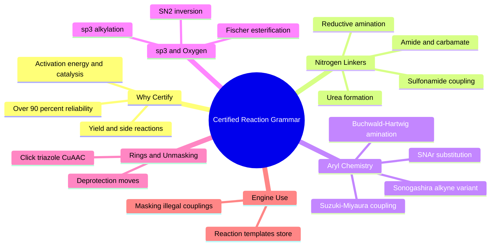

---
tags:
  - domain/medicinal-chemistry
  - depth/essential
  - 3dsyntree
  - topic/reaction-grammar
  - topic/organic-synthesis
module: "02. Medicinal Chemistry and Synthesis"
chapter: "Chapter 1. Building Blocks and the Reaction Grammar"
type: concept
---

# 2. The 32 Certified Reaction Grammar

> [!abstract] Core Idea
> A certified reaction grammar is a closed set of 32 laboratory-verified, high-yield reactions — grouped into roughly nine families — that a generative model is allowed to compose. Restricting the model to moves that medicinal chemists have already proven to work with $>90\%$ reliability is what turns "interesting molecule" into "synthesizable molecule."

Navigation: [[0. Medicinal Chemistry and Synthesis MOC]] · [[0. Master Vault Index]]

## 1. What It Is

A **chemical reaction** transforms one set of molecules (reactants) into another (products) by breaking and forming covalent bonds. Organic chemistry textbooks catalog thousands of such transformations — but only a small minority are *reliable*: high-yielding, forgiving of substrate variation, and workable under mild, parallel-friendly conditions. A **certified reaction grammar** is a curated subset of these robust reactions, validated by medicinal chemists (the collection published by Hartenfeller and co-workers in 2011 is the reference example), formalized as machine-readable rules. 3D-SynTree uses **32 certified reactions** organized into about **nine families**. The word *grammar* is deliberate: like the production rules of a programming language, these reactions are the only legal ways two molecular fragments may be joined, so any structure built from them is grammatical — and synthesizable — by construction.

## 2. Why It Exists

Most theoretically possible organic reactions fail in practice: low yield (most material ends up as by-product), narrow substrate scope (works only for a few molecules), harsh conditions (high heat, water-free handling), or slow rates. A generative model free to propose *any* bond would routinely emit molecules with no realistic laboratory route. The certified set inverts the problem: the model may only use reactions **known to work with $>90\%$ reliability** across diverse fragments. Synthesis difficulty is then not something to check after design — it is baked into the design space itself. This is the chemical half of 3D-SynTree's answer to the Synthesizability Wall described in [[1. 3D-SynTree System Overview]].

## 3. How It Works

### 3.1 What Makes a Reaction Reliable: Energy, Rates, and Yield

Every transformation has an energy hill between start and finish. Plot energy against reaction progress (the **reaction coordinate**) and the maximum is the **transition state** — the highest-energy arrangement of bonds half-broken and half-formed. Its height above the reactants is the **activation energy** $E_a$, which controls speed exponentially through the Arrhenius relation $k = A e^{-E_a/RT}$: small barrier changes, huge rate changes. Three practical numbers grade a reaction: **conversion** (fraction of starting material consumed), **yield** (fraction converted into the *desired* product), and **side reactions** (competing pathways that eat material). A brief note on control regime: **kinetic control** means the product distribution is decided by which pathway is fastest, while **thermodynamic control** means it is decided by which product is most stable at equilibrium; the certified reactions are fast, irreversible, high-driving-force processes — effectively run under kinetic control with a strong thermodynamic push, which is why they are dependable.

### 3.2 Catalysis and the Palladium Cycle

A **catalyst** accelerates a reaction by providing a lower-barrier alternative pathway, without being consumed. The certified grammar leans on **transition-metal catalysis** — palladium and copper especially — for its aryl chemistry. The palladium cycle has three acts: **oxidative addition** (a Pd(0) atom inserts into the aryl–halogen bond, becoming Pd(II) carrying the aryl group and the halide), **transmetalation** (the partner fragment, e.g., an aryl group delivered from a boronic acid, is handed over to Pd), and **reductive elimination** (the two fragments couple as a new covalent bond forms and Pd(0) is regenerated). Understanding this one cycle explains Suzuki, Buchwald-Hartwig, and Sonogashira at once.

### 3.3 The Nine Families at a Glance

| Family | Reactant A | Reactant B | Bond or ring formed | Typical by-product |
| --- | --- | --- | --- | --- |
| Amide coupling | Carboxylic acid | Amine | Amide $\text{C}(=\text{O})-\text{N}$ | Water (captured by coupling reagent) |
| Carbamate formation | Chloroformate or carbonate | Amine or alcohol | Carbamate $\text{C}(=\text{O})-\text{O}$ or $\text{C}(=\text{O})-\text{N}$ | Chloride salt |
| Sulfonamide coupling | Sulfonyl chloride | Amine | Sulfonamide $\text{S}(=\text{O})_2-\text{N}$ | $\text{HCl}$ (neutralized by base) |
| Reductive amination | Aldehyde or ketone | Amine | Alkyl $\text{C}-\text{N}$ | Water, then reduction |
| Aryl amination (Buchwald-Hartwig or SNAr) | Aryl halide | Amine | Aryl amine $\text{Ar}-\text{N}$ | Halide salt |
| Suzuki-Miyaura (and Sonogashira) coupling | Aryl halide | Boronic acid or terminal alkyne | Biaryl $\text{C}-\text{C}$ (or $\text{Ar}-\text{C}\equiv\text{C}$) | Boron waste or halide salt |
| $sp^3$ alkylation | Alkyl halide | Amine, alcohol, or phenol | Alkyl $\text{C}-\text{N}$ or $\text{C}-\text{O}$ | Halide salt |
| Urea formation | Amine | Amine plus carbonyl source | Urea $\text{N}-\text{C}(=\text{O})-\text{N}$ | Imidazole or salt |
| Esterification (and ether synthesis) | Carboxylic acid or alkyl halide | Alcohol | Ester $\text{C}(=\text{O})-\text{O}$ or ether $\text{C}-\text{O}$ | Water or halide salt |
| Click triazole (CuAAC) | Terminal alkyne | Azide | 1,2,3-triazole ring | None |
| Deprotections (auxiliary moves) | Masked group | Cleavage reagent | Restored $\text{N}-\text{H}$ or $\text{COOH}$ | Mask fragments |

### 3.4 Amide and Carbamate Formation

The **amide bond** $\text{R}-\text{C}(=\text{O})-\text{N}$ is the single most popular linkage in drugs. Directly mixing an acid and an amine gives an unreactive salt, so laboratory practice uses **coupling reagents** (HATU, EDC, HOBt) that first convert the acid's $-\text{OH}$ into an excellent leaving group — *activating* the acid and slashing the barrier. The amine then attacks the activated carbonyl and the amide forms, releasing water captured by the reagent. **Carbamates** ($\text{R}-\text{O}-\text{C}(=\text{O})-\text{N}$) are the sibling linkage: an amine or alcohol attacks a chloroformate or similar carbonyl equivalent. Amides and their planarity — central to 3D-SynTree's torsion locking — are treated in [[2. Resonance Conjugation and the Amide Planarity Lock]].

### 3.5 Sulfonyl Couplings

A **sulfonyl chloride** $\text{R}-\text{SO}_2\text{Cl}$ carries a sulfur already at its highest common oxidation state; the sulfur is a strong electrophile (electron-seeking center). An amine attacks the sulfur and chloride leaves — nucleophilic substitution at sulfur — giving a **sulfonamide** $\text{R}-\text{SO}_2-\text{N}$ plus $\text{HCl}$, mopped up by a base. Sulfonamides are flat, strongly hydrogen-bonding motifs beloved in medicinal chemistry (think of the sulfa drugs).

### 3.6 Reductive Amination

A carbonyl compound (an **aldehyde** $\text{R}-\text{CHO}$ or **ketone** $\text{R}_2\text{C}=\text{O}$) condenses reversibly with an amine, releasing water and forming an **imine** (or its protonated form, the **iminium ion**) — a $\text{C}=\text{N}$ double bond. A mild hydride source such as $\text{NaBH(OAc)}_3$ or $\text{NaCNBH}_3$ then reduces that $\text{C}=\text{N}$ to a single bond, delivering a new alkylated amine $\text{R}-\text{CH}_2-\text{N}$. The reagent is chosen to be gentle: it reduces the iminium far faster than the starting aldehyde, so the reaction is self-selecting (a theme explored in [[1. Chemoselectivity and Reactivity Tiers]]).

### 3.7 Aryl Amination: Buchwald-Hartwig and SNAr

To attach a nitrogen to an aromatic ring (forming an **aryl amine**), two robust routes exist. **Buchwald-Hartwig amination** is palladium-catalyzed: oxidative addition of the aryl halide to Pd(0), then ligation of the amine, then reductive elimination forges the $\text{Ar}-\text{N}$ bond. **Nucleophilic aromatic substitution (SNAr)** needs no metal: on an electron-poor arene (a ring bearing electron-withdrawing groups), an amine can attack the ring carbon holding the halide, forming a transient anionic (Meisenheimer) intermediate that expels the halide. The engine's key insight is **unified aryl amination**: whichever route a chemist would choose, the *product connectivity* is identical — aryl carbon bonded to amine nitrogen — so both are folded into one reaction family for design purposes.

### 3.8 Carbon-Carbon Couplings: Suzuki-Miyaura and Sonogashira

**Suzuki-Miyaura coupling** joins an aryl halide with a **boronic acid** or boronate ester through the full palladium cycle (Section 3.2), producing a **biaryl** $\text{Ar}-\text{Ar}$. It is the most trusted $\text{C}-\text{C}$ bond formation in the industry: boronic acids are stable, bench-friendly solids and conditions are mild. **Sonogashira coupling** uses the same oxidative-addition logic but the partner is a terminal alkyne, giving an aryl alkyne $\text{Ar}-\text{C}\equiv\text{C}-\text{R}$. (The Heck and Stille couplings, relatives of these, are deliberately out of scope of the certified set — narrower scope and toxic organotin reagents keep them out of robust medicinal-chemistry practice.)

### 3.9 Aliphatic Substitution: SN2, SN1, and $sp^3$ Alkylation

For bonds to non-aromatic ($sp^3$) carbons the workhorse is **nucleophilic substitution**. In the **SN2 mechanism** the nucleophile attacks the electrophilic carbon from the side opposite the leaving group, simultaneously expelling it — one concerted step that *inverts* the carbon's 3D arrangement like an umbrella turning inside out. In the **SN1 mechanism** the leaving group departs first, forming a flat **carbocation** that the nucleophile can attack from either face, *racemizing* (blurring) any stereochemistry — one reason the certified set prefers SN2-type alkylations. **$sp^3$ alkylation** is the family application: an alkyl halide reacts with an amine, alcohol, or phenol to give a substituted alkyl amine or ether.

### 3.10 Urea Formation

A **urea** links two nitrogens through one carbonyl: $\text{N}-\text{C}(=\text{O})-\text{N}$. In practice one amine is first converted into a reactive **isocyanate** ($\text{R}-\text{N}=\text{C}=\text{O}$) or activated by **carbonyldiimidazole (CDI)**; the second amine then attacks, giving symmetrical or unsymmetrical ureas in a multi-component coupling. Ureas are excellent peptide-bond mimics and hydrogen-bond donors.

### 3.11 Ester and Ether Syntheses

**Fischer esterification** condenses a carboxylic acid with an alcohol under acid catalysis, releasing water and giving an ester $\text{R}-\text{C}(=\text{O})-\text{O}-\text{R}'$. The **Williamson ether synthesis** instead alkylates an alcohol or phenol (as its deprotonated alkoxide) with an alkyl halide, giving an ether $\text{R}-\text{O}-\text{R}'$.

### 3.12 Click Chemistry and the Triazole

**Click chemistry** is a design philosophy: pick reactions with a high thermodynamic driving force, essentially no by-products, and tolerance of almost any functional group. The flagship is the **Huisgen 1,3-dipolar cycloaddition**: an azide ($\text{N}_3$) and a terminal alkyne ($\text{C}\equiv\text{CH}$) zip together into a five-membered **1,2,3-triazole ring**. Copper(I) catalysis (the **CuAAC** variant) makes it fast and regioselective at room temperature. The triazole is a sturdy, polar, hydrogen-bond-accepting linker — a favorite mild-conditions "molecular buckle."

### 3.13 Deprotection Moves

Rounding out the grammar are **deprotections** — reactions that *unmask* a temporarily protected group (see [[1. Chemoselectivity and Reactivity Tiers]]): **Boc** (tert-butoxycarbonyl, a masked amine) is cleaved under acid; **Fmoc** is cleaved under mild base; and **esters hydrolyze back to carboxylic acids**. In a multi-step assembly these moves re-expose a handle so the next certified reaction can use it.

> [!example] A Two-Step Route in the Grammar
> Start from 4-bromobenzoic acid. Step 1, amide coupling with benzylamine through the acid handle gives 4-bromo-$N$-benzylbenzamide (the aryl bromide survives as a secondary handle). Step 2, Suzuki coupling of that bromide with phenylboronic acid gives $N$-benzyl-[1,1'-biphenyl]-4-carboxamide. Every step used a certified family; the whole route is one sentence of chemistry.

### 3.14 Grammar Enforcement: Masking Impossible Moves

Certification only helps if the model cannot stray. The engine stores every legal transformation and, before each action, computes which (handle, reaction, synthon) combinations are chemically valid; invalid combinations are **masked out** of the action space, exactly like illegal-move masking in game-playing reinforcement learning. If two fragments cannot be coupled by any template, the policy simply never sees that option.

## 4. What It Consists Of

- **Reaction templates** — machine-readable rules, one per certified reaction (32 in total).
- **Reactants** — the two input fragments each template requires (core side and synthon side).
- **Leaving groups** — the expelled atoms defining what must already sit on each handle.
- **Catalysts** — palladium or copper systems enabling the aryl and alkyne families.
- **Coupling conditions** — reagents, bases, solvents, and tolerances that make each family robust.

## 5. What You Must Understand

> [!warning] Legal on paper is not certified
> Thousands of reactions exist in textbooks; only high-reliability, broad-scope, mild-condition transformations earn a place in the grammar. Even famous reactions (Heck, Stille) can be excluded when they fail the robustness bar.

> [!warning] Stereochemistry rides on the mechanism
> SN2 inverts configuration at the reacting carbon; SN1 racemizes it. When the engine also selects chiral parity for a new synthon, the mechanism behind the template determines whether that parity is actually deliverable.

> [!tip] One cycle explains three families
> Oxidative addition, transmetalation (or amine ligation), reductive elimination — learn the palladium cycle once and Suzuki, Buchwald-Hartwig, and Sonogashira become variations on a theme.

> [!note] Families, not reactions, drive the policy
> The model first chooses a *reaction family*, then a synthon. The family abstraction keeps the action space small while the 32 member templates preserve chemical specificity.

## 6. Prerequisites

- [[1. Organic Functional Groups]] — you need to recognize acids, amines, halides, carbonyls, and aromatics to read any reaction rule.
- [[1. Building Blocks and Synthons]] — defines handles, leaving groups, and the fragment-based assembly view this grammar operates on.

## 7. Project Connection

The certified set lives in `syntree/chemistry/reactions.py`: `REACTION_TEMPLATES` stores the machine-readable reaction rules and `REACTION_FAMILY_MEMBERS` maps each family to its member templates, while `HANDLE_SMARTS` defines the 10 handle classes that reactants must present. The reaction-family head in `syntree/models/reaction_head.py` predicts which family to apply *before* any synthon is selected, and the environment masks (handle, family) combinations that no template can legally join. This note is the chemical foundation of the hierarchical action described in [[1. The Assembly MDP Formulation]].

## 8. Required Depth

**Essential** — the reaction families are the generative model's move set; without them neither the action space nor the synthesizability guarantee is comprehensible.

## 9. Further Dependencies

- [[3. Reaction SMARTS and Isotope Provenance]] — how these templates are written as pattern-matching strings and how atoms are tracked through them.
- [[1. The Assembly MDP Formulation]] — how reaction choice becomes an action in the assembly MDP.

## Concept Mind Map

## Cross-Domain Links

- [[AI/08. Generative Modeling, MDPs, and GFlowNets/Chapter 1. Discrete Markov Decision Processes/3. Action Space Factorization and Masking Operators|3. Action Space Factorization and Masking Operators]] (AI vault) — the certified reaction families define the factorized action space; dynamic grammar masks forbid uncertified chemistry.
