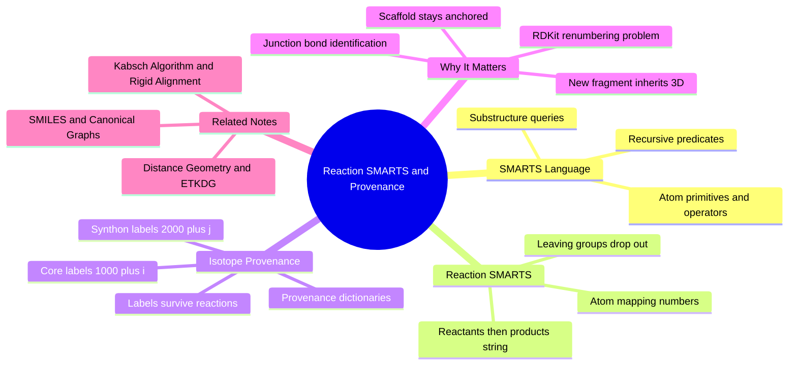

---
tags:
  - domain/medicinal-chemistry
  - depth/essential
  - 3dsyntree
  - topic/smarts
  - topic/atom-tracking
module: "02. Medicinal Chemistry and Synthesis"
chapter: "Chapter 1. Building Blocks and the Reaction Grammar"
type: concept
---

# 3. Reaction SMARTS and Isotope Provenance

> [!abstract] Core Idea
> **Reaction SMARTS** is a small string language for expressing chemical transformations as substructure pattern-matching rules — think regular expressions for molecular graphs, plus find-and-replace. **Isotope provenance** is a bookkeeping trick that tags every atom with a fake isotope mass label (core atoms $1000+i$, synthon atoms $2000+j$) so that each atom's identity — and its 3D coordinates — survive the reaction engine.

Navigation: [[0. Medicinal Chemistry and Synthesis MOC]] · [[0. Master Vault Index]]

## 1. What It Is

**SMARTS** (SMILES Arbitrary Target Specification) is a query language over molecular graphs. Where a SMILES string describes one specific molecule (see [[1. SMILES and Canonical Molecular Graphs]]), a SMARTS string describes a *class* of substructures: "any trivalent nitrogen bearing two hydrogens," "any benzene ring," "any carbonyl carbon." **Reaction SMARTS** extends this to transformations with the syntax `[Reactant 1].[Reactant 2]>>[Product]` — a find-and-replace rule over graphs. **Isotope provenance** is the practice of writing a number into each atom's *isotope field* (the same field that distinguishes carbon-12 from carbon-13; isotopes are atoms of the same element with different neutron counts, as covered in [[1. Atomic Structure and Electrons]]) before a reaction, so that after the reaction each surviving atom can still be traced back to its origin.

## 2. Why It Exists

3D-SynTree assembles molecules step by step *inside a protein pocket*, and after every step the growing scaffold must keep its hard-won 3D position. The problem: when the cheminformatics toolkit **RDKit** (the open-source cheminformatics library the engine is built on) executes a reaction, it (1) deletes the leaving groups, (2) builds a *brand-new product molecule*, and (3) renumbers all atoms from zero in its own arbitrary order. The link between "atom number 5 in the product" and "atom number 5 that had these 3D coordinates in the pocket" is severed. Isotope provenance repairs the severed link: the isotope field is an atom property that RDKit faithfully copies from reactant atoms to product atoms, and because a fake heavy isotope does not change reaction behavior, the labels ride through every transformation untouched.

## 3. How It Works

### 3.1 SMARTS: Regex for Molecules

In SMILES, `[N]` or `N` means "a nitrogen, specifically this one." In SMARTS, brackets describe *conditions* an atom must satisfy, combined with logical operators:

- Atom primitives: `[C]` aliphatic carbon, `[c]` aromatic carbon, `[#6]` any atom with atomic number 6, `[N,O]` nitrogen or oxygen.
- Property queries: `[NX3]` a nitrogen with three connections, `[N;H2]` a nitrogen with exactly two attached hydrogens — a **primary amine nitrogen**.
- Negation: `!H0` means "not zero hydrogens," i.e., at least one attached H.
- **Recursive SMARTS** `$()`: a query embedded inside another query. The predicate `!$(NC=O)` reads "this atom must *not* be part of an N-C=O pattern" — it excludes amide nitrogens so an already-formed amide cannot be mistaken for a free amine handle.
- Bond symbols `-`, `=`, `#`, `~` (any) restrict how matched atoms must be connected; by default SMARTS bonds match single or aromatic connections.

**Pattern matching** is then substructure search: given a query and a target molecule, the matcher returns every set of target atoms (and bonds) satisfying the query — exactly like a regex engine returning match positions in a string.

### 3.2 Reaction SMARTS: Find-and-Replace with Atom Maps

A reaction rule is written as

```
[Reactant 1].[Reactant 2]>>[Product]
```

The dot separates reactants; `>>` separates reactants from products (a fuller form `reactants>agents>products` allows solvent-like agents in the middle). Each atom may carry a **mapping number** written after a colon, e.g. `[C:1]`:

```
[C:1](=[O:2])-[O;H1].[N;H2;!$(N-C=O):3]>>[C:1](=[O:2])-[N;H1:3]
```

Read it as: *find* a carbonyl carbon with a hydroxyl (a carboxylic acid) and a non-amide primary amine; *replace* with those same mapped atoms now joined by a $\text{C}-\text{N}$ bond. The mapping numbers are the capture groups of the analogy: atoms `:1`, `:2`, `:3` are tracked from reactants to product. Any reactant atom that is mapped but never appears in the product — here the acid's $-\text{OH}$ oxygen and one amine hydrogen — is understood to be the **leaving group** and is discarded. The 32 templates of [[2. The 32 Certified Reaction Grammar]] are exactly such strings, one per certified reaction, stored in `REACTION_TEMPLATES`.

### 3.3 Handle Detection by Pattern Matching

Before any reaction can fire, the engine must know *where* the current molecule can be grabbed. `HANDLE_SMARTS` in `syntree/chemistry/reactions.py` defines the **10 handle classes** — amine, acid, aldehyde, aryl halide, alkyne, azide, and so on — each as a SMARTS pattern matched against the growing structure. A match exposes that atom as a legal attachment point, with its reactivity tier recorded in the tier tables described in [[1. Chemoselectivity and Reactivity Tiers]].

### 3.4 The Isotope-Tagging Trick

The core maneuver, executed by `_tag_atoms()` before `apply_reaction()` runs a template:

1. **Core labeling.** Every atom of the anchored core (the growing scaffold already positioned in the pocket), whatever its internal index $i$, receives isotope label $1000 + i$ — the offset `_CORE_MAP_OFFSET = 1000`.
2. **Synthon labeling.** Every atom of the incoming synthon receives $2000 + j$ — offset `_SYNTHON_MAP_OFFSET = 2000`.

Why this is safe and collision-free: genuine isotope mass numbers are small (hydrogen's are 1–3, carbon's around 12–13, bromine's 79–81), so labels in the 1000s never coincide with a real nuclide; drug-like molecules have tens of atoms, far fewer than 1000, so the core namespace ($1000$–$1999$) and the synthon namespace ($2000$–$2999$) never overlap. And because isotope mass barely affects chemical reactivity, the reaction proceeds exactly as it would without labels.

### 3.5 Worked Example: One Amide Coupling, Tracked Atom by Atom

> [!example] Isotope Provenance Through an Amide Coupling
> **Setup.** The anchored core is a benzylamine (8 atoms, internal indices 0–7) already docked in the pocket; its nitrogen happens to be index 7. `_tag_atoms()` labels the core atoms 1000 through 1007, so the nitrogen carries isotope 1007. The selected synthon is 4-bromobenzoic acid (10 atoms, indices 0–9); its carboxyl carbon, say index 6, now carries isotope 2006.
> **Reaction.** The amide-coupling template fires in `apply_reaction()`. Chemically, the acid's hydroxyl oxygen (label 2008) and one amine hydrogen depart as water, and a new bond forms between the carbonyl carbon and the nitrogen.
> **Aftermath.** RDKit hands back a fresh product molecule with completely renumbered atoms. But the surviving atoms kept their isotope fields: somewhere in the product there is a carbon reading 2006 and a nitrogen reading 1007, now bonded to each other.
> **Reconstruction.** `_build_result()` walks the product atoms. Isotope 1007 lies in the core range: $1007 - 1000 = 7$, the original core nitrogen — its 3D coordinate is known and anchored. Isotope 2006 lies in the synthon range: $2006 - 2000 = 6$, the synthon's carboxyl carbon — no coordinates yet; it must be embedded. The function returns two dictionaries, `core_atom_map` and `synthon_atom_map`, each mapping product atom index to original molecule atom index.
> **Handoff.** `ConformerEngine.embed_product()` in `syntree/chemistry/conformer.py` consumes the maps: core atoms are pinned to their pocket coordinates via `coordMap`-constrained ETKDG embedding (see [[2. Distance Geometry and ETKDG]]), the new synthon fragment is embedded with its internal geometry locked, realigned onto the anchor by the Kabsch algorithm ([[4. The Kabsch Algorithm and Rigid Alignment]]), and the dihedral of the new junction bond is selected. That junction is trivially identifiable: it is the one bond whose two atoms live in different label namespaces (one 1000-series atom, one 2000-series atom).

### 3.6 Why Two Numbering Systems?

The engine juggles two similar-looking schemes, and confusing them is the classic beginner error: **atom mapping numbers** (`:1`, `:2`, `:3`) live *inside the reaction template string* and say which template roles correspond across reactants and product; **isotope labels** (1000-series, 2000-series) live *on actual molecule instances* and say which physical atom is which across a specific reaction event. Mapping numbers are generic; isotope labels are instance-specific provenance — the difference between a regex capture group and a row's primary key surviving a database join.

## 4. What It Consists Of

- **SMARTS patterns** — substructure queries over atoms, bonds, and neighborhoods.
- **Recursive predicates** — embedded queries like `!$(NC=O)` used to exclude unreactive or already-committed atoms.
- **Reaction SMARTS strings** — the `reactants >> product` transformation rules with embedded atom maps.
- **Atom mappings** — `:n` labels pairing template roles across the `>>` arrow.
- **Isotope tags** — the $1000+i$ (core) and $2000+j$ (synthon) mass labels written before each reaction.
- **Atom-mapping dictionaries** — `core_atom_map` and `synthon_atom_map`, the provenance tables returned after each reaction.
- **Handle classes** — the 10 SMARTS-defined reactive site categories detected on every molecule.

## 5. What You Must Understand

> [!warning] Atom maps are not isotope labels
> Mapping numbers belong to the template and are reused in every reaction of that kind; isotope labels belong to one molecule instance in one step. Mixing the two makes provenance debugging hopeless.

> [!warning] Unmapped reactant atoms vanish
> In reaction SMARTS, a reactant atom absent from the product side is discarded as a leaving group. Forget to map an atom you meant to keep, and the product silently loses it.

> [!tip] Regex analogy
> SMARTS is to molecular graphs what regular expressions are to text: atom classes are character classes, recursive SMARTS are lookahead/lookbehind, atom maps are capture groups, and reaction SMARTS is find-and-replace.

> [!note] Labels are bookkeeping, not physics
> A carbon of mass 1001 does not exist in nature. The isotope field is simply an integer slot RDKit preserves through reactions; the engine uses it as a namespace-separated ID scheme and never pretends the molecule really contains such an atom.

## 6. Prerequisites

- [[1. Atomic Structure and Electrons]] — isotopes are defined there; the provenance trick borrows the isotope field.
- [[2. The 32 Certified Reaction Grammar]] — reaction SMARTS strings encode exactly these certified transformations.

## 7. Project Connection

In `syntree/chemistry/reactions.py`, `_tag_atoms()` writes the labels (offsets `_CORE_MAP_OFFSET = 1000` and `_SYNTHON_MAP_OFFSET = 2000`), `apply_reaction()` executes a certified template on the labeled pair, and `_build_result()` reconstructs the provenance dictionaries `core_atom_map` and `synthon_atom_map`, which are handed to `ConformerEngine.embed_product()` in `syntree/chemistry/conformer.py`. This chain is what allows the original scaffold to stay anchored in the protein pocket while each newly attached fragment inherits geometrically consistent 3D coordinates — the enabling mechanism for all downstream torsion decisions.

## 8. Required Depth

**Essential** — without isotope provenance, the link between 2D reaction events and the 3D pocket would break at every assembly step; this mechanism underlies the entire 3D-aware pipeline.

## 9. Further Dependencies

- [[4. The Kabsch Algorithm and Rigid Alignment]] — how the newly embedded synthon fragment is rigidly realigned onto the anchored scaffold once provenance is known.

## Concept Mind Map



## Cross-Domain Links

- [[AI/01. Advanced Tensor Algebra and Computational Graphs/Chapter 1. Tensor Geometries and Strides/3. Advanced Tensor Slicing and Scatter-Gather Operations|3. Advanced Tensor Slicing and Scatter-Gather Operations]] (AI vault) — the isotope offsets $1000+i$ and $2000+j$ that track atom provenance across buffers are implemented with tensor slicing and scatter-gather.
