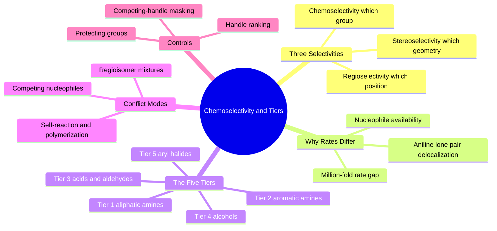

---
tags:
  - domain/medicinal-chemistry
  - depth/supporting
  - 3dsyntree
  - topic/chemoselectivity
module: "02. Medicinal Chemistry and Synthesis"
chapter: "Chapter 2. Selectivity Saturation and Catalog Space"
type: concept
---

# 1. Chemoselectivity and Reactivity Tiers

> [!abstract] Core Idea
> Real molecules carry several reactive groups, and reagents prefer some over others by enormous margins — a primary aliphatic amine reacts about $10^6$ times faster than an aromatic amine in the same coupling. 3D-SynTree encodes these preferences as a five-tier reactivity hierarchy so that every assembly step happens at the chemically favored site, not a random one.

Navigation: [[0. Medicinal Chemistry and Synthesis MOC]] · [[0. Master Vault Index]]

## 1. What It Is

**Chemoselectivity** is the preference of a reagent to react at one specific *type* of functional group when several competing groups are present on the same molecule. It is one of three selectivities chemists distinguish: **chemoselectivity** (which functional group reacts), **regioselectivity** (which *position* on a group or ring reacts when several are possible), and stereoselectivity (which 3D arrangement is formed — covered later in [[1. Stereochemistry Chirality and CIP Rules]]). A **reactivity tier** is a ranked class of handles that react at broadly similar speeds, with the top tier (aliphatic amines) outpacing the bottom tier (aryl halides) by factors of millions in bond-forming competitions.

## 2. Why It Exists

Drug-like molecules are decorated with amines, alcohols, acids, halides, and more — often several on the same scaffold. A reagent dropped onto such a molecule does not read the chemist's mind: it reacts wherever the energy barrier is lowest. Without selectivity control, a single "reaction" yields a cocktail of products — wrong regioisomers, doubly-acylated species, oligomers — that is useless to a program that needs one pure compound per designed structure. Understanding the hierarchy lets both human chemists and the engine predict, and then enforce, *where* chemistry will happen.

## 3. How It Works

### 3.1 Why Some Groups React Faster: Nucleophilicity

A **nucleophile** ("nucleus-lover") is an electron-rich atom that attacks electron-poor centers; an **electrophile** is the electron-poor partner. Reaction speed in coupling chemistry is largely governed by how available the nucleophile's lone pair of electrons is. Compare two nitrogens:

- An **aliphatic amine** (e.g., $\text{CH}_3\text{CH}_2\text{NH}_2$) holds its lone pair tightly on nitrogen; its conjugate acid has $\text{p}K_a \approx 10.5$.
- An **aniline** (aromatic amine, $\text{PhNH}_2$) pushes its lone pair into the benzene ring by resonance (see [[2. Resonance Conjugation and the Amide Planarity Lock]] for the same delocalization logic); its conjugate acid has $\text{p}K_a \approx 4.5$ — about a million times weaker base, and in amide couplings it reacts roughly $10^6$ times more slowly.

That six-orders-of-magnitude gap is the empirical backbone of the tier system: if a molecule contains both an aliphatic amine and an aniline, essentially all coupling happens at the aliphatic amine. Acid-base reasoning behind these p$K_a$ values is developed in [[3. Acids Bases and pH 7.4 Ionization]].

### 3.2 The Five-Tier Hierarchy

| Tier | Handle class | Typical role in the grammar |
| --- | --- | --- |
| 1 | Aliphatic amines (primary, secondary) | Fastest nucleophiles; preferred partners for amide, sulfonamide, urea, reductive amination, arylation |
| 2 | Aromatic amines (anilines) | Slower nucleophiles; usable but never competitive with Tier 1 |
| 3 | Carboxylic acids, aldehydes | Electrophilic handles; acids for amides or esters, aldehydes for reductive amination |
| 4 | Alcohols (and phenols) | Weak nucleophiles; esterification and ether formation only |
| 5 | Aryl halides | Nearly inert to direct substitution; require palladium catalysis (Suzuki, Buchwald-Hartwig) or activated SNAr rings |

The ranking is a *priority queue over attachment sites*: when several handles are exposed, the incoming synthon is directed to the top-ranked chemically compatible handle.

### 3.3 Conflict Mode 1: Competing Nucleophiles on One Reactant

A scaffold bearing, say, both an amine and a phenol offers two nucleophiles to an activated acid. The amine (Tier 1) wins overwhelmingly; the phenol (Tier 4) is essentially untouched. The engine encodes this by matching handle classes and suppressing couplings at low-tier sites when a higher-tier site of compatible class is available. But when *two handles of the same tier* compete — two primary amines on one molecule — a plain reagent would give a 50-50 regioisomer mixture; such ambiguous cases are filtered rather than gambled on.

### 3.4 Conflict Mode 2: Self-Reaction and Polymerization

A bifunctional building block (say, a diamine) can react with *itself*: one molecule's amine attacks another's activated partner, chaining into oligomers and polymers — exactly how nylon (diamine plus diacid) and polyurethanes are made industrially. In a design engine this is catastrophic: the intended product is one defined molecule, not a distribution of chain lengths. 3D-SynTree grows structures one handle at a time from a single anchored core, and uncontrolled chain extension is prevented by masking cross-reactive handle combinations and by terminating growth with monofunctional **terminal caps** — no free second handle, no chain.

### 3.5 Conflict Mode 3: Regioselectivity

Even with the functional group fixed, position can be ambiguous: a substituted ring may offer two electronically similar carbons for SNAr, or an unsymmetrical ketone two flanking alkylations. Mixed regioisomer outcomes are as useless as mixed chemoselectivity outcomes; the certified templates are written so that the reacting position is uniquely determined by the matched pattern, and molecules whose handle matches are non-unique are not offered as attachment sites.

### 3.6 Protecting Groups: Temporary Blinding

The classical laboratory solution to selectivity conflicts is a **protecting group**: a temporary modification that masks a reactive site while other chemistry proceeds. Amines are protected as Boc or Fmoc derivatives; carboxylic acids are protected as esters. The certified grammar includes the matching **deprotections** (acidic Boc cleavage, basic Fmoc cleavage, ester hydrolysis) among its 32 moves — see [[2. The 32 Certified Reaction Grammar]]. In 3D-SynTree's forward-only assembly, protection is mostly avoided by construction (handles are exposed one at a time), but the concept explains why catalog synthons sometimes arrive masked, and why deprotection moves exist in the template set.

### 3.7 How the Engine Uses Tiers

At every assembly step the exposed handles are collected, classified, and **ranked by reactivity tier**; the policy's handle head then proposes among *chemically favored* sites, and combinations that would trigger competing-handle or cross-reactivity problems are masked out of the action space before the policy ever sees them — a design formalized in the MDP of [[1. The Assembly MDP Formulation]].

> [!example] Selective Coupling in Practice
> 4-(aminomethyl)aniline carries an aliphatic $\text{CH}_2\text{NH}_2$ (Tier 1) and an aromatic $\text{NH}_2$ (Tier 2). Add an activated carboxylic acid and the aliphatic amine wins the race by about $10^6$ to 1: the product is the side-chain amide, with the aniline nitrogen left free for a later, deliberately chosen arylation. One reaction, one structure, no purification lottery.

## 4. What It Consists Of

- **Reactivity hierarchies** — the ranked ordering of handle classes by coupling speed.
- **Competing nucleophiles** — same-molecule races between different functional groups.
- **Regioselectivity conflicts** — same-group, different-position ambiguities.
- **Self-reaction and polymerization** — bifunctional substrates chaining with themselves.
- **Protecting groups** — Boc, Fmoc, and ester masks, plus their certified deprotections.
- **Tier ranking** — the five-tier table the engine uses to sort exposed handles.

## 5. What You Must Understand

> [!warning] Nucleophilicity is not basicity
> The two correlate (hence p$K_a$ arguments work) but are distinct: nucleophilicity is about *rate of attack* in a solvent, basicity about proton affinity at equilibrium. Sterically buried but strongly basic amines can be slow nucleophiles.

> [!warning] Tiers predict, they do not legislate
> The hierarchy is an empirical tendency. The engine still masks ambiguous same-tier competitions because a 90-to-10 selectivity still produces a 10% impurity — unacceptable when purity defines the product.

> [!tip] The nitrogen ladder
> Aliphatic amine beats aniline, aniline beats alcohol, and aryl halides need a metal catalyst to react at all. Memorize this one ladder and most medicinal-chemistry selectivity puzzles collapse.

> [!note] Why rank handles at all
> Sorting exposed handles by tier is what makes the discrete action space chemically honest: the policy is steered toward reactions that will actually succeed in the flask, not sites that merely look reactive on paper.

## 6. Prerequisites

- [[1. Organic Functional Groups]] — you must recognize the competing groups before you can rank them.
- [[3. Acids Bases and pH 7.4 Ionization]] — p$K_a$ and conjugate-pair reasoning explains the $10^6$ rate gap.

## 7. Project Connection

`HANDLE_REACTIVITY_TIERS` and `rank_handles()` in `syntree/chemistry/reactions.py` implement the tier table and the sorting of exposed handles; filters for competing handles and cross-reactivity are handled under Issue #40 [CHEM-06]. At every step, this machinery determines which attachment sites the policy is allowed to propose, making chemoselectivity a property enforced *inside* the action space rather than a filter applied to finished molecules.

## 8. Required Depth

**Supporting** — the tier mechanics operate under the hood of every reaction choice; you need the conceptual hierarchy, not implementation-level mastery, to follow the system.

## 9. Further Dependencies

- [[1. The Assembly MDP Formulation]] — the tier-ranked, filtered handle list becomes the first factor of the hierarchical action.

## Concept Mind Map

