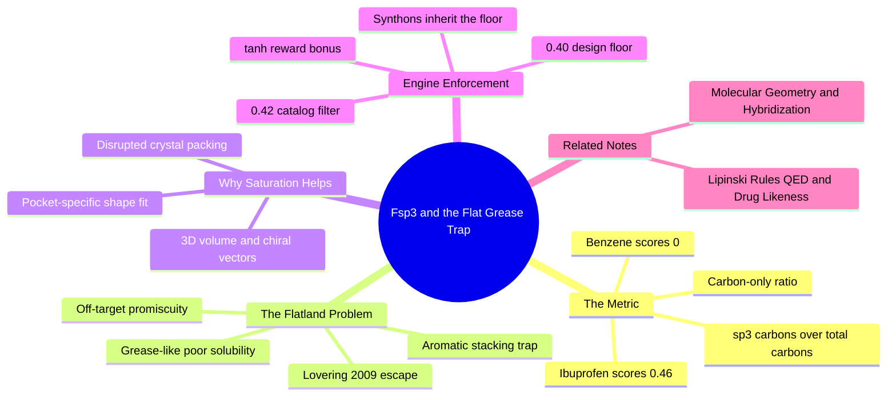

---
tags:
  - domain/medicinal-chemistry
  - depth/essential
  - 3dsyntree
  - topic/drug-likeness
module: "02. Medicinal Chemistry and Synthesis"
chapter: "Chapter 2. Selectivity Saturation and Catalog Space"
type: concept
---

# 2. Fsp3 Saturation and the Flat Grease Trap

> [!abstract] Core Idea
> $Fsp^3$ is the fraction of a molecule's carbon atoms that are tetrahedral ($sp^3$-hybridized) rather than flat ($sp^2$). Flat, all-aromatic molecules score beautifully in docking simulations but dissolve badly and bind promiscuously — the "flat grease" trap. 3D-SynTree therefore enforces saturation twice: a hard catalog filter at $Fsp^3 \ge 0.42$ and a soft, saturating reward bonus above the same threshold.

Navigation: [[0. Medicinal Chemistry and Synthesis MOC]] · [[0. Master Vault Index]]

## 1. What It Is

Carbon atoms adopt two main shapes. In **$sp^2$ hybridization** the atom is trigonal planar — three bonds in one flat plane, the geometry of every aromatic ring; in **$sp^3$ hybridization** the atom is tetrahedral — four bonds pointing to the corners of a pyramid, the geometry of saturated chains and rings (both are defined in [[3. Molecular Geometry and Hybridization]]). The **fraction $sp^3$** metric counts carbons of each kind:

$$Fsp^3 = \frac{\text{Number of } sp^3 \text{ carbons}}{\text{Total number of carbons}}$$

It ranges from 0 (every carbon flat, e.g., benzene, biphenyl) to 1 (every carbon tetrahedral, e.g., cyclohexane). Heteroatoms (N, O, S) are simply ignored by the ratio. The **flat grease trap** is the empirically observed failure mode in which unconstrained molecular generators — human or artificial — drift toward low-$Fsp^3$, all-aromatic "grease": flat hydrophobic plates that look excellent to scoring functions but behave terribly as drugs.

## 2. Why It Exists

The metric was introduced by Lovering and co-workers (2009) to quantify the escape from "**flatland**." Their analysis of medicinal-chemistry collections showed a systematic pattern: compound sets skew flat and aromatic early in discovery, while the survivors — clinical candidates and approved drugs — are measurably more saturated. Saturation turned out to correlate with the things that make a molecule survive development: aqueous solubility, cleaner selectivity profiles, and better odds of success. For a generative AI system the problem is sharper: docking scorers reward surface contact and stacking interactions, and nothing in the objective itself penalizes flatness — so an unconstrained optimizer will happily farm the score with flat grease. $Fsp^3$ supplies the missing regularization target.

## 3. How It Works

### 3.1 Counting Saturation: Worked Examples

> [!example] Computing $Fsp^3$
> **Benzene** ($\text{C}_6\text{H}_6$): six aromatic carbons, zero $sp^3$ carbons — $Fsp^3 = 0/6 = 0.00$. The flatland limit.
> **Biphenyl** (two joined benzene rings, 12 carbons): still $0.00$. A perfect "flat biaryl grease" prototype.
> **Aspirin** (9 carbons: a benzene ring, a carboxylic acid carbon, an ester carbon — all $sp^2$ — and one methyl carbon, $sp^3$): $Fsp^3 = 1/9 \approx 0.11$. Below the catalog filter.
> **Ibuprofen** (13 carbons, of which 6 are $sp^3$: a methine, a methyl, and the four isobutyl carbons): $Fsp^3 = 6/13 \approx 0.46$. Passes the 0.42 filter.

### 3.2 Why Saturation Helps: Solubility and Selectivity

Saturated $sp^3$ carbons improve molecules through three linked mechanisms:

1. **3D volume and vectors.** A tetrahedral carbon projects its substituents out of the plane, giving the molecule genuine three-dimensional shape and (when the carbon carries four different groups) chiral centers — stereochemical "handles" for distinguishing one protein pocket from another.
2. **Disrupted crystal packing.** Flat aromatic molecules stack like playing cards into crystals; that lattice energy must be overcome for the molecule to dissolve. Bulgy $sp^3$ geometry disrupts the packing, lowering lattice energy and raising aqueous solubility.
3. **Reduced promiscuity.** Flat aromatic plates stack — via hydrophobic and $\pi$-stacking interactions — against the flat aromatic residues (phenylalanine, tyrosine, tryptophan) found in nearly every protein pocket. A flat molecule can therefore score well almost anywhere, which means poor target selectivity; a shape-rich saturated molecule fits only pockets complementary to its particular 3D form.

### 3.3 The Trap Itself: High Docking Scores, Dead Molecules

Aromatic rings slide into flat hydrophobic sub-pockets and make maximal van der Waals contact, so docking scores climb ever higher as the generator bolts on ring after ring. The resulting molecules are lipophilic grease: poorly soluble, rapidly cleared by the liver, metabolically fragile, and promiscuous across many targets. They excel in silico and fail in animal models — precisely the dissociation that motivated 3D-SynTree's design (see [[1. 3D-SynTree System Overview]]), and a known pathology of unconstrained generative baselines discussed in [[3. Baseline Comparisons TargetDiff SyntheMol]].

### 3.4 Enforcement Layer 1: The Hard Catalog Filter

3D-SynTree's scientific design rule is $Fsp^3 \ge 0.40$; the implementation is deliberately a notch stricter. At catalog build time, `min_fsp3 = 0.42` — using RDKit's `FractionCSP3` descriptor — screens every candidate synthon in `syntree/chemistry/catalog.py`, so **only synthons with $Fsp^3 \ge 0.42$ enter the 50,000-entry action space**. Because every generated molecule is assembled exclusively from admitted synthons, the saturation floor is inherited by construction: the policy cannot even propose flat grease. The gap between 0.40 (design intent) and 0.42 (filter setting) provides margin so assembled products stay on the right side of the line.

### 3.5 Enforcement Layer 2: The Soft Reward Shaping

The terminal reward's drug-likeness term $S_{\text{props}}$ combines the QED score (covered in [[1. Lipinski Rules QED and Drug Likeness]]) with a saturation bonus of the form

$$S_{\text{Fsp3}} = w_{\text{fsp3}} \cdot \tanh\!\left(\max\left(0,\; Fsp^3 - 0.42\right)\right)$$

in `syntree/engine/rl.py`. Reading it like an ML practitioner: the $\max(0, \cdot)$ makes the term exactly zero at or below 0.42 (no penalty — the hard filter already guarantees the floor), while the $\tanh$ saturation caps the bonus at $w_{\text{fsp3}}$ so the policy cannot farm the reward by maximizing $Fsp^3$ to 1.0 at the expense of affinity and specificity. It is a shaped, diminishing-returns incentive — regularization, not a new objective.

### 3.6 Necessary but Not Sufficient

$Fsp^3$ is a one-dimensional descriptor: it ignores heteroatoms and knows nothing about shape details. A molecule can be fully saturated and still be useless grease (a long alkyl chain has $Fsp^3 = 1.0$ and terrible drug properties). That is why saturation is enforced alongside QED, steric clash terms, and interaction bonuses rather than alone, and why the catalog curation described in [[3. Enamine REAL Space and Catalogs]] balances several filters at once.

## 4. What It Consists Of

- **$sp^3$ carbon count** — tetrahedral carbons, the numerator.
- **Total carbon count** — the denominator; heteroatoms excluded.
- **Aromatic carbon counts** — the flat $sp^2$ population the metric penalizes.
- **Solubility correlation** — saturated molecules pack into crystals poorly and dissolve better.
- **Target selectivity correlation** — 3D shape and chirality enable pocket-specific binding.

## 5. What You Must Understand

> [!warning] The metric is carbon-only
> $Fsp^3$ ignores nitrogens, oxygens, and halogens completely. Two molecules can share an identical $Fsp^3$ and differ wildly in polarity, size, and behavior.

> [!warning] High $Fsp^3$ is not automatically good
> Pure alkane chains are maximally saturated and maximally undruggable. The filter is a floor against flatland, not a certificate of quality.

> [!tip] Two thresholds, one idea
> Remember the pair: **0.40** is the scientific design constraint; **0.42** is the implemented catalog filter and reward hinge. Same principle, one safety margin apart.

> [!note] Flat scores die in the animal
> The flat grease trap is the canonical reward-hacking story of structure-based design: the scorer loves stacked aromatics; solubility, clearance, and selectivity do not. Docking rewards must be paired with saturation and drug-likeness terms.

## 6. Prerequisites

- [[3. Molecular Geometry and Hybridization]] — you cannot count $sp^3$ carbons without knowing what hybridization means geometrically.

The note is otherwise self-contained; ADMET consequences of poor solubility are expanded in [[2. ADMET Pharmacokinetics and Metabolic Stability]].

## 7. Project Connection

Two code sites enforce saturation. First, `min_fsp3 = 0.42` with `FractionCSP3` filtering in `syntree/chemistry/catalog.py` admits only sufficiently saturated synthons into the 50,000-entry catalog — the hard constraint. Second, the reward component `fsp3_weight` times `tanh(max(0, fsp3 − 0.42))` inside $S_{\text{props}}$ of the terminal reward in `syntree/engine/rl.py` adds the soft, saturating bonus alongside the QED term. Together they make the Flat Grease Trap structurally unreachable rather than merely discouraged.

## 8. Required Depth

**Essential** — the $Fsp^3$ constraint is one of the three founding motivations of 3D-SynTree; understanding why flatness is punished is essential to reading the reward function at all.

## 9. Further Dependencies

- [[2. ADMET Pharmacokinetics and Metabolic Stability]] — solubility, clearance, and metabolic stability are the downstream pharmacokinetic properties the saturation constraint protects.

## Concept Mind Map

## Cross-Domain Links

- [[AI/08. Generative Modeling, MDPs, and GFlowNets/Chapter 2. Generative Flow Networks/4. Stationary Terminal Rewards vs Batch-Relative Drift|4. Stationary Terminal Rewards vs Batch-Relative Drift]] (AI vault) — the $Fsp^3 \ge 0.42$ saturation target enters the reward as a shaped $\tanh$ term that does not drift with the batch.
