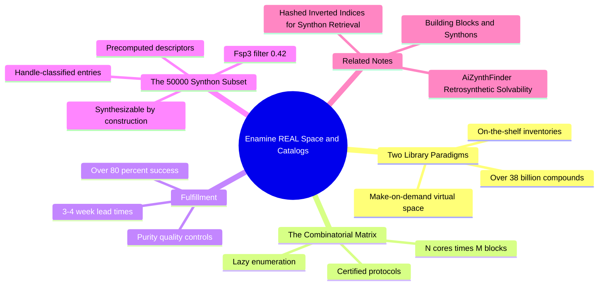

---
tags:
  - domain/medicinal-chemistry
  - depth/essential
  - 3dsyntree
  - topic/chemical-catalogs
module: "02. Medicinal Chemistry and Synthesis"
chapter: "Chapter 2. Selectivity Saturation and Catalog Space"
type: concept
---

# 3. Enamine REAL Space and Catalogs

> [!abstract] Core Idea
> Enamine REAL is a **make-on-demand** chemical space of more than 38 billion compounds — not stored anywhere, but *enumerable* as every certified reaction applied to every in-stock building block. Order any one of them and Enamine synthesizes it with $>80\%$ success in 3–4 weeks. 3D-SynTree's 50,000-synthon action space is a curated slice of this space, which is what makes every designed molecule buyable by construction.

Navigation: [[0. Medicinal Chemistry and Synthesis MOC]] · [[0. Master Vault Index]]

## 1. What It Is

A **chemical library** is a collection of compounds a researcher can obtain. Two paradigms exist:

- **On-the-shelf commercial inventories** — physical stock you can order today: the catalogues of suppliers like Sigma-Aldrich, or Enamine's own building-block warehouse. Whatever exists in a bottle somewhere can ship immediately, but humanity has only ever purified on the order of a few hundred million distinct compounds in total — a tiny corner of possible chemistry.
- **Virtual make-on-demand combinatorial libraries** — compounds that do *not* exist yet but are guaranteed synthesizable, because each is one or two certified reactions away from building blocks that *are* on the shelf. Enamine **REAL** (the world's largest, at $>38$ billion compounds) and WuXi Galaxi are the flagship examples. Nothing is stored: the library is a generative function, lazily evaluated only when a customer orders.

A **synthon catalog** in the 3D-SynTree sense is a curated, finite subset of such a space — the 50,000 purchasable building blocks that constitute the system's action space.

## 2. Why It Exists

Generative design is worthless if the designs cannot be made. Historically, computational chemists produced ideas faster than labs could reject them, and the bottleneck was the gap between "molecule on screen" and "molecule in a vial." Make-on-demand libraries close that gap *by construction*: because every virtual member is defined as a certified protocol applied to in-stock starting materials, **any compound constructed within this grammar can be synthesized with $>80\%$ success in 3–4 weeks**. The library is, in effect, a purchasability proof baked into the search space itself — the direct answer to the Synthesizability Wall described in [[1. 3D-SynTree System Overview]].

## 3. How It Works

### 3.1 The Combinatorial Matrix: N Cores Times M Building Blocks

The engine of virtual-library growth is the **combinatorial synthesis matrix**: for each reaction family, one axis holds the $N$ eligible core scaffolds and the other the $M$ eligible building blocks, and every cell of the $N \times M$ matrix is a valid, orderable product. Combinatorics does the rest:

> [!example] Lazy Enumeration
> A toy library with $N = 1{,}000$ cores and $M = 1{,}000$ first-position building blocks contains $10^6$ single-step products. Let each product keep a second handle and offer another $1{,}000$ second-position blocks: $10^9$ two-step compounds — from about 3,000 purchasable starting materials and two certified protocols. Enamine's matrix, run over their full building-block inventory and validated protocol set for up to a few steps, expands past $38$ billion members. Nobody ever writes those structures to disk; like the digits of $\pi$, they are computed only when requested.

This is why "38 billion" costs nothing to maintain: the library is the *closure* of (in-stock building blocks) $\times$ (certified reactions), not a warehouse.

### 3.2 Pre-Curation: Handles and Protocols

Enamine's curation team pre-classifies every stocked building block by its **reactive handle** (the same handle concept introduced in this chapter's first note) and validates each **synthesis protocol** — the exact reaction conditions under which a family reliably converts its inputs to product. Only high-yielding, broad-scope protocols (in the spirit of the certified grammar of [[2. The 32 Certified Reaction Grammar]]) enter the enumeration, so the $>80\%$ fulfillment statistic is an empirical property of the whole pipeline, not a promise about any single molecule.

### 3.3 Fulfillment: From Click to Compound

When you order a make-on-demand compound, the vendor executes the stored route in its synthesis lab: **3–4 weeks** typical lead time, with **$>80\%$ success** across the catalog, and the delivered sample passes quality control — identity and purity verified by standard analytical chemistry. The failures are informative, not random: they concentrate in the rare substrates where a generally robust protocol happens to misbehave, which is exactly the residual risk the $>80\%$ figure prices in.

### 3.4 From 38 Billion to 50,000: Curating the Action Space

A reinforcement-learning policy cannot point at 38 billion candidates per step — the action head must be finite and embeddable. 3D-SynTree therefore curates a 50,000-synthon subset, balancing:

- **Handle coverage** — every certified reaction family must find compatible partners (each synthon enters with classified handles).
- **Saturation** — the $Fsp^3 \ge 0.42$ filter of [[2. Fsp3 Saturation and the Flat Grease Trap]] is applied at admission.
- **Diversity and size** — enough chemical variety to decorate any pocket, small enough for the policy to search.
- **Precomputed embeddings** — each entry carries precalculated descriptors: the 2138-dimensional pharm3D descriptor projected down to a 256-dimensional embedding, plus 2D Morgan fingerprints, computed by the encoders in `syntree/chemistry/synthon_encoder.py`.

The build pipeline `scripts/build_synthon_catalog.py` performs this curation and writes the result to the file `enamine_real_50k_pharm3d_d256.h5` — a precompiled database of synthons and their embeddings that `SynthonCatalog` in `syntree/chemistry/catalog.py` loads to serve as the action space. Fast candidate retrieval from this 50,000-entry store is its own engineering problem, solved by the structures described in [[3. Hashed Inverted Indices for Synthon Retrieval]].

### 3.5 Synthesizable by Construction — and Independently Verifiable

Because the policy can only combine catalog synthons through certified reaction templates, every generated molecule comes with an explicit, executable route: order these bottles, run these protocols. Independent verification is still performed — retrosynthesis planners that never saw the generation process re-derive routes, as covered in [[2. AiZynthFinder Retrosynthetic Solvability]] — and this is one of the benchmark axes separating 3D-SynTree from unconstrained generators whose outputs mostly have no route at all.

### 3.6 From Catalog to Wet Lab

The catalog is the first link of the translational chain: designed molecules are ordered from the make-on-demand vendor, arrive weeks later as real samples, and enter the assay cascade — the experimental pipeline described in [[1. Assay Cascade Strategy and nanoDSF]]. The 3–4 week clock and the $>80\%$ success rate are therefore planning parameters for the whole drug-discovery program, not vendor trivia.

## 4. What It Consists Of

- **Building-block inventories** — the on-the-shelf stock (Enamine's own, plus suppliers like Sigma) that anchors the space.
- **Validated synthesis protocols** — certified, high-yield reaction conditions per family.
- **The combinatorial matrix** — the $N \times M$ enumeration rule generating virtual products.
- **Lead times** — 3–4 weeks from order to compound.
- **Success-rate and quality controls** — $>80\%$ fulfillment, identity and purity checks on delivery.
- **The curated 50,000-synthon catalog** — 3D-SynTree's finite, filtered, pre-embedded action space.

## 5. What You Must Understand

> [!warning] Virtual does not mean stored
> No database holds 38 billion structures. The space is a generative rule — building blocks times certified reactions — evaluated only where an order (or a design step) touches it.

> [!warning] Make-on-demand is not same-day
> Unlike catalog stock, a REAL compound does not exist until someone orders it; budget the 3–4 weeks and the $\sim$20% failure probability into any experimental plan.

> [!tip] The catalog is the action space
> A single mental image organizes this module: the 50,000-synthon catalog is literally the menu the policy chooses from at every assembly step. Purchasability is not a post-hoc check — it is what the actions are.

> [!note] Why a subset at all
> 50,000 is chosen for searchability (finite, embeddable, retrievable) and quality (Fsp3-filtered, handle-classified), not because the rest of REAL space is unusable — it remains a future expansion dial.

## 6. Prerequisites

- [[1. Building Blocks and Synthons]] — the catalog entries are building blocks with handles; that vocabulary is assumed here.
- [[2. The 32 Certified Reaction Grammar]] — the certified reaction families are what the combinatorial matrix enumerates over.

## 7. Project Connection

`scripts/build_synthon_catalog.py` curates the make-on-demand space into the file `enamine_real_50k_pharm3d_d256.h5`, and `SynthonCatalog` in `syntree/chemistry/catalog.py` serves it as the policy's action space (including the `min_fsp3 = 0.42` admission filter). Precomputed synthon representations come from `encode_catalog_pharm3d()`, `encode_catalog_morgan2d()`, and `build_projection()` (2138 to 256 dimensions) in `syntree/chemistry/synthon_encoder.py`, so that every candidate a reaction head proposes is scored against the pocket instantly. The reward-side story of why this space is bounded at all continues in [[2. Fsp3 Saturation and the Flat Grease Trap]].

## 8. Required Depth

**Essential** — the catalog defines what the generative model can say; without it, neither the action space nor the synthesizability guarantee of the whole system makes sense.

## 9. Further Dependencies

- [[3. Hashed Inverted Indices for Synthon Retrieval]] — the data structure that makes candidate lookup over the 50,000-entry action space fast enough for training.

## Concept Mind Map

